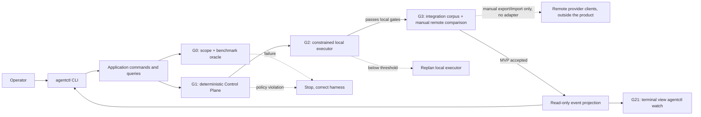
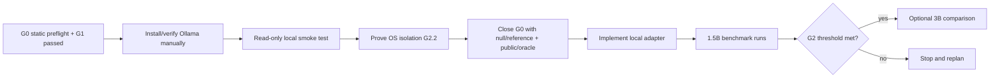
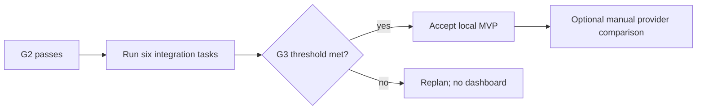
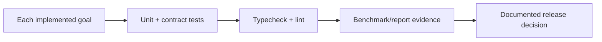

# Agent Control Plane — Executable Build Plan

## Architecture contract

This is a **greenfield, Windows-local, single-user** system. Its purpose is to prove whether a constrained local coding executor can complete small, deterministic software tasks safely enough to reduce human work. It is not a way to make Codex or Claude free, to control personal subscription credits, or to run an autonomous fleet of agents.

### Decisions carried into this plan

- The approved implementation stack is **Node.js LTS + TypeScript**, confirmed in archived GOALS 0 and recorded in `docs/decisions/ADR-001-mvp-scope.md`. The same typed contracts will serve the controller, benchmark runner, event stream, and the later browser UI.
- Runtime is Windows on the current PC: Ryzen 5 3600 observed; 24 GB RAM is owner-reported and unverified; GTX 1650 Super with 4 GB VRAM measured. Local execution is sequential (`concurrency = 1`).
- **Local MVP accepted (2026-11-13, `docs/decisions/ADR-005-qwen35-9b-passes-g3.md`):** `qwen3.5:9b` under protocol v4 passes G3.2 (mean 2.0 of 6) and G2.7 (8 of 10). The interim G2-scope decision (`ADR-004`) is superseded.
- The monetary constraint is **no new recurring charge**. Electricity, engineering time, and already-owned provider allowances are tracked as limitations, not claimed as zero cost.
- The MVP accepts only operator-confirmed disposable repositories selected explicitly for capture. Filename/path filters for `.env*`, credentials, and private keys are best-effort, not complete secret scanning; NTFS alternate data streams are not enumerated by Node, and snapshot v1 copies only unnamed/default streams. Content-addressed snapshots, workspaces, and tool allowlists are integrity/workflow controls, not an OS sandbox.
- The Control Plane owns state transitions, policy, audit, workspaces, and verification. Model adapters never self-approve or directly mutate the audit log.
- The provisional `agentctl` CLI is the mandatory operator interface for GOALS 0–3 and remains the canonical mutation surface after GOALS 4. It may call application commands/query services only; it must never access JSONL storage, policy internals, adapters, or workspaces directly.
- The baseline is local-only. Codex and Claude are optional, manual comparison tracks after the local MVP passes; no API key, account automation, credit scraping, or forced remote delegation is part of the MVP.
- The terminal observability view (GOALS 21, `agentctl watch`) is the **last** goal. It replaced the cancelled 2D isometric dashboard (GOALS 4) on 2026-11-13. It cannot start from mocked data or block validation of the Control Plane.

### Non-goals for the first release

- Cloud deployment, multi-user auth, payments, custom model training (lifted for the G20.6 pilot only, owner authorization 2026-11-10), adaptive routing, parallel local agents, general shell access, network tools, Docker/WSL as a requirement, MCP, and a game engine.
- Treating hidden tests stored under the same Windows user as protection against hostile code. An OS isolation boundary must pass the G2.2 gate before model-generated code is tested; snapshots alone do not provide isolation.

### Target dependency flow

## GOALS 2 — Constrained local executor and evidence-based utility test

Suggested: gpt-5.6-sol · high — it spans local inference, tightly constrained tools, benchmark instrumentation, and a real go/no-go decision.

- [x] **G2.1 [MANUAL] Install and verify the local inference runtime.** The owner manually installs Ollama for Windows and pulls `qwen2.5-coder:1.5b`; the CLI never installs a runtime or downloads a model. After that manual setup, `agentctl runtime diagnose` and one bounded, read-only `agentctl runtime smoke --model qwen2.5-coder:1.5b` may use only fixed loopback `127.0.0.1:11434`, with no tools, workspace/task-code execution, evaluator, task tests, or oracle. Record the runtime version and model digest; do not assume GPU fit, throughput, or 7B feasibility. G2.1 is the only local-inference exception before G2.4; G2.4 remains the full agent adapter and all candidate-code execution remains blocked by G2.2. **Done when:** the manually installed model returns schema-validated structured smoke output, the exact tag/digest and runtime version are recorded, and no write/process tool is enabled.
> **Execution evidence (2026-10-27; local Windows host):** `npm run agentctl -- runtime diagnose --json` returned `ready` for Ollama `0.40.12` and `qwen2.5-coder:1.5b`, digest `d7372fd828518a4d38b1eb196c673c31a85f2ed302b3d1e406c4c2d1b64a0668`. The bounded `npm run agentctl -- runtime smoke --model qwen2.5-coder:1.5b --json` returned `passed` with validated output `{"schemaVersion":1,"ready":true,"summary":"local-smoke-ok"}`. Smoke used the fixed loopback runtime; no tools, task code, evaluator, task tests, or oracle were invoked.

- [x] **G2.2 [MANUAL GATE] Prove OS isolation before any patch execution.** Before any agent-authored reference/null patch or `source=model` patch is applied, or any public/hidden task test runs against patched code, integrate a production AppContainer + Job Object launcher into the evaluator path. The Job Object must enforce a 1 GiB job-wide committed virtual-memory ceiling on both production and diagnostic workers; this does not cap total resident physical RAM. Apply it alongside the existing process-tree and timeout controls. The host parses bounded declarative JSON case graphs with a fixed schema and materializes only allowlisted fixtures; case files are never imported or executed on the host. The host sends bounded, schema-validated JSON requests to an isolated worker that executes candidate code only; public assertions, oracle expectations, and comparisons remain host-side. The worker must not import or execute host-side tests, oracles, expected values, or evaluator logic; no candidate code may be imported or run through the normal host spawn path. Use the same launcher and JSON protocol for the trusted host harness in `run_declared_test`, benchmark public tests, hidden oracles, probes, and production evaluation, with disposable canaries only. The evaluator closure is private to the CLI's approved `runG0` path, and the review index must match the current generated bytes exactly before and after evaluation. The current host-spawned benchmark test scripts and direct oracle imports are not acceptable evidence and must be converted to host-side JSON requests before this gate can pass. Explicitly allow only the staged Node runtime, required immutable Windows resources, and the disposable workspace. Separately record whether per-run AppContainer TEMP/profile storage is required; if so, scope it to that run, prove it contains no owner data, and prove it is cleaned after the run. Prove denial of owner-profile data, repository contents and secrets, oracle inputs and expected values, network, and all undeclared paths, plus workspace access as required and timeout termination of the full process tree. Record the mechanism, setup, host baseline, allowed paths, reproducible probe results, cleanup evidence, and limitations in a host/runner-bound attestation. If AppContainer + Job Object cannot meet the declared boundary or any check fails, stop before G2.3 and require a revised owner-approved plan; do not fall back to a VM automatically or substitute worktrees, allowlists, or same-user evaluator code for isolation.
  - proof: attestation runtime/diagnostics/g2-isolation-evidence.json written by npm run isolation:attest for report 0a1dc747a282f57f21584b5af1bc878fb999b8ed519c1b392a3638d1a12eabbc (attestation SHA-256 526ceaa900926ad7da7f8ec0c26126d9becb920e42d3040e2686bb7f6ba3cbc2) and accepted by readG2IsolationAttestation in the worktree. Verified: probe checks (filesystem, network, process tree, oracle, profile, cleanup), the evaluator path in bench/evaluator/index.mjs reads the attestation and uses the isolated runner, host-harness and case-data suites pass. Not independently verified: that the evaluator closure is private to runG0 and that the review index matches generated bytes; G2.3 re-checks the review-set hash with the owner. The attestation is bound to the exact file bytes of the checkout where the probe ran (the worktree, LF line endings); the main checkout has CRLF files and needs its own probe run and attestation before it can run the benchmark, 2026-11-09, Sonnet 5.5

> **Owner decision (2026-10-29):** G2.2 requires the staged Node runtime, fixed worker modules, and disposable workspace under a per-run nonce subtree of the newly created profile's `AC\Temp`. Verify that `Temp` is an ordinary empty directory before staging, keep repository/oracle/owner-profile canaries outside it, and verify removal of the nonce subtree before deleting the profile. This resolves the storage choice; it does not pass G2.2 or authorize a probe run.

- [x] **G2.3 [POST-G2.2 GATE] Close the behavioral G0 benchmark.** Require a passing G2.2 host/runner attestation and the owner's approval of the current full review-set hash, which binds task manifests/prompts, snapshots, public tests, hidden oracles, null/reference patches, evaluator, and protocol. Run only the 20 null controls and 20 owner-reviewed references through the fixed evaluator; do not run `source=model`. A null control is expected to fail the public tests; a reference passes only when both its public tests and hidden oracle pass. Record public/oracle statuses separately, verify protected hashes before and after, and generate `bench/results/g0-report.json`. **Done when:** 20/20 null controls fail as expected, 20/20 references pass both public tests and hidden oracles, `source=model` and protected-path changes are refused, and the complete report binds the attestation and review-set hash. Any failure is `NO_GO` and stops before G2.4.
  - proof: `node bench/evaluator/index.mjs --run --approve-review-set-sha256 83ec8b569f788ef18fe7a873e899821cbbde1f05c1f84eb27cd1e305a6905936` printed `G0 PASS` and exited 0 on 2026-11-10; report `bench/results/g0-report.json` (SHA-256 `c3df1817d348128b43c3531ac245de239d343bfe597b32eac17a7aa0b126d9c5`) has `decision` PASS, `execution_status` `post_g2.2_behavioral`, `execution_scope` `null_and_reference_only`, `model_source_executed` false, every `validations` entry true, 20 of 20 references PASS on public tests and hidden oracle, 20 of 20 null controls failed their public tests (19 `FAIL`, I05 `CRASH`, accepted by the owner), the review-set SHA-256 `83ec8b56…5936` and attestation SHA-256 `9519b6d4…2772` bound in the report; no leftover AppContainer profile or evaluator temp directory. Not re-verified in this run: the refusal of `source=model` and of protected-path changes, which rely on existing tests, 2026-11-10, Opus 5.5

  > Execution evidence (2026-11-09, owner approved review-set `2256a7d07a6734531e2d4c75e1a849bc39a5d5159c70358aeb674a9ca5842455`): `node bench/evaluator/index.mjs --run` ended `NO_GO` with `model_source_executed=false`. 39 of 40 evaluations returned `RUNNER_FAILURE`; the I05 null control returned `CRASH`, which is an expected failure. The patches were not at fault: the production launcher `bench/isolation/run-worker.ps1` ran the worker (token and Job membership verified, Job drained) and then failed cleanup (`profile_cleanup_verified=false`, `staging_cleanup_verified=false`, `failure_code=cleanup_unverified`). Root cause, from the swallowed PowerShell errors: `Set-Acl` at line 134 (`Set-WorkerAcl`) and line 180 (`Restore-WorkspaceAclTree`) throws `PrivilegeNotHeldException` for `SeSecurityPrivilege`. In Windows PowerShell 5.1, `Get-Acl` and `Set-Acl` read and write the SACL as well; the probe in `run-probes.ps1` avoids this with `GetAccessControl` and `SetAccessControl` on the access section only. The first evaluation also left an unverified AppContainer profile, so later launches failed with `launcher_failed`. Five evaluator runs left 532 leftover profiles; 531 were removed with `AppContainerLauncher.DeleteProfile` and 7 older ones from 2026-10-28 and 2026-11-02 remain. The previous placeholder `bench/results/g0-report.json` (2026-10-24) was renamed to `g0-report.pre-g2.2-2026-10-24.json`. G2.3 stays open and G2.4 stays blocked. Any fix changes `run-worker.ps1`, which is part of the runner fingerprint, so it needs a new probe run, a new attestation, a new review index, and a new owner approval of the review-set hash.

  > Execution evidence (2026-11-10, one invocation of `npm run isolation:launch:smoke` after the ACL fix of GOALS 18): the production launcher completed one B01 launch and printed `{"ok":true,"evidence":{"jobDrained":true,"workerTokenVerified":true,"jobMembershipVerified":true}}` with exit 0. Cleanup was verified: the count of `agentcp*` profile directories stayed at 7 (the older leftovers) and no `agent-control-smoke-*` temp directory remained. G2.3 stays open until the review-set approval and the full run.

  > Execution evidence (2026-11-10, after the ACL fix of GOALS 18): one probe run printed `AppContainer probes: PASS`, exit 0, 22 of 22 checks PASS, `failure` null, report SHA-256 `50f2207051984165a1789e8304878d4ec3c5b13cbd2ded2cbf9ab1457dbe3a97`, runner fingerprint `a147d7183d5ba70cd238c8fe66845c42f26ababde6c58ad4afc930b61faf8919`. The agent wrote a new attestation at the owner instruction to run everything it could (`npm run isolation:attest -- --approve-report-sha256 50f2207051984165a1789e8304878d4ec3c5b13cbd2ded2cbf9ab1457dbe3a97`, attestation SHA-256 `0018548c970eb4fb698b985bca49e7ef7e2da002294e34bd0b2fcac23f36ec81`); the previous attestation was moved to the backup folder because its runner fingerprint no longer matched. `npm run benchmark:g0:prepare` produced the new review-set SHA-256 `df71ee570e4696cdfedee074d2c525700875a527f1dce205a6559e8ae338e997`. All 20 task rows of the review index (task manifest, snapshot, oracle, public test, reference and null patch hashes) are identical to the previously approved index; only the evaluator fingerprint changed. The owner must approve the new hash before the full run.

  > Execution evidence (2026-11-10, owner approved review-set `df71ee570e4696cdfedee074d2c525700875a527f1dce205a6559e8ae338e997`): `node bench/evaluator/index.mjs --run` ended `NO_GO`, `model_source_executed=false`. Cleanup now works: no leftover profile or temp directory. All 20 null controls failed as expected (19 `FAIL`, I05 `CRASH`). 18 of 20 reference patches passed their public tests and hidden oracle. The I01 and I04 references returned `RUNNER_FAILURE` because `applyUnifiedPatch` raised `PatchFormatError: Unified diff context does not match the restored file`: both patches have a hunk header one line too high (I01 `-4,5 +4,5` should be `-3,5 +3,5`; I04 `-11,6 +11,6` should be `-10,6 +10,6`). The agent confirmed with the evaluator own patch applier that both patches apply to their base with the corrected header and fail as written. The agent changed only those two header lines in `bench/tasks/I01/reference.patch` and `bench/tasks/I04/reference.patch`; the only changed index columns are the I01 and I04 `reference_patch_sha256`; the runner fingerprint and the attestation are unchanged. The new review-set SHA-256 is `257c0cc921cf9888e76899f9c45471a9396741117d33443df7bac7c1d04b4b74`. The owner must review these two header changes and approve the new hash before G2.3 runs again.

  > Execution evidence (2026-11-10, owner approved review-set `257c0cc921cf9888e76899f9c45471a9396741117d33443df7bac7c1d04b4b74`): `node bench/evaluator/index.mjs --run` ended `NO_GO`, `model_source_executed=false`, no leftover profile or temp directory. All 20 reference patches passed both their public tests and the hidden oracle (`reference_patches_expected_to_pass=true`). All 20 null controls failed their public tests: 19 returned `FAIL` and the I05 null control returned `CRASH` (public and oracle), which is the intended behavior because the I05 bug is a startup import cycle that throws during module initialization. The decision is `NO_GO` only because `bench/evaluator/index.mjs` line 572 sets `null_controls_expected_to_fail` with `result.null_status === 'FAIL'`, which rejects `CRASH`. The plan says a null control is expected to fail the public tests. Owner decision needed: accept `CRASH` as an expected null-control failure (changes the evaluator, so it needs a new probe run, attestation, review index and approval) or stop.

  > Owner decision and follow-up (2026-11-10): the owner accepted `CRASH` as an expected null-control failure. `bench/evaluator/index.mjs` now uses the exported helper `isExpectedNullControlFailure`, which accepts only `FAIL` or `CRASH` for null controls; references still require `PASS`, and `RUNNER_FAILURE`, `TIMEOUT`, `POLICY_VIOLATION`, and passes are still rejected. `evaluator-static.test.mjs` covers the helper (7 of 7), and `npm run verify` exits 0. Because the evaluator changed, the agent ran one probe (`AppContainer probes: PASS`, 22 of 22, report SHA-256 `9537b1a6acefb661d968a52803d1185437be1214de11dc59ce191a58ca80aba2`, runner fingerprint `c7931930851247fc622983e7ad00751fb793928c28ae2499243a7fe6ffeabba7`), wrote the new attestation (SHA-256 `aca8e161014deff8ff24e721e98bae0f2eb52d8f4e68d495f073e0a0bf3627ff`, old one moved to the backup folder), and regenerated the review index. All 20 index task rows are identical to the previous index; only the evaluator fingerprint changed. The new review-set SHA-256 is `3862078cb603cd2b3a038d02adfd0639d6273a49473325cdc0dad7b8d37d8d02`. G2.3 runs again after the owner approves that hash.

  > Execution evidence (2026-11-10, owner approved review-set `3862078cb603cd2b3a038d02adfd0639d6273a49473325cdc0dad7b8d37d8d02`): `node bench/evaluator/index.mjs --run` still ended `NO_GO` although every entry in `validations` was true: 20 of 20 references passed public tests and oracle, 20 of 20 null controls failed (19 `FAIL`, I05 `CRASH`), no leftover profile or temp directory, `model_source_executed=false`. Cause: the agent's previous change fixed only the `validations` flag in `index.mjs`; the function `g0Decision` in `bench/evaluator/g0-report.mjs` has its own `FAIL`-only rule (`null_status` and `null_evaluation.public_status`) and decides `PASS` or `NO_GO`. The agent moved `isExpectedNullControlFailure` into `g0-report.mjs`, used it in `g0Decision` for both fields, re-exported it from `index.mjs`, and added five `g0Decision` cases to `g0-report.test.mjs` (CRASH accepted only for null controls; `RUNNER_FAILURE`, `TIMEOUT`, a null that passes, and a failing reference are rejected). Tests: `test:g0-report` 8 of 8, `test:evaluator:static` 7 of 7, `npm run verify` exit 0. The evaluator fingerprint changed again, so the agent reran one probe (`AppContainer probes: PASS`, 22 of 22, report SHA-256 `ff8ea5d167f451276361e14a38faec7a8a92fb11db14330cd4ab9d9985ce6f80`), wrote the new attestation (SHA-256 `9519b6d4f874a97a89eb6764656edf79ca484a5dbad57fc4e5905b5899262772`, old one moved to the backup folder), and regenerated the review index; all 20 task rows are identical to the previous index. The new review-set SHA-256 is `83ec8b569f788ef18fe7a873e899821cbbde1f05c1f84eb27cd1e305a6905936`. G2.3 runs again after the owner approves that hash.

- [x] **G2.4 Implement the Ollama adapter behind the existing contract.** Implement `src/adapters/ollama.ts` with localhost-only configuration, bounded context, one active run, per-task timeout, bounded tool-call count, model/version recording, and fail-closed JSON parsing. The adapter receives only task-approved context references. **Done when:** adapter contract tests cover malformed tool calls, unavailable runtime, timeout, context overflow, and accidental concurrent-run rejection.
  - proof: `src/adapters/ollama.ts` (`OllamaAgentAdapter implements AgentInvocationPort`) and `src/adapters/ollama.test.ts` (19 tests) added; npm run typecheck exit 0, `biome lint` clean on both files, npm test 196 of 196 pass. Fixed loopback URL only, no `tools` field, redirects refused, bounded bodies, context built only from the envelope, one active run (`agent_busy`), per-invocation timeout (`timeout`), at most 8 tool requests (`tool_call_limit_exceeded`), proposals validated by `parseAgentProposal`, refusals `context_overflow` and `invalid_structured_output`, model tag, digest and runtime version reported through `onInvocation`. Independent review found three defects (awaited stream cancels could outlive the timeout, the token estimate was called conservative, size caps untested); all three were fixed, including a post-response `prompt_eval_count` guard. Not done on purpose: the adapter is not wired into any CLI or composition; the tests never contacted a real Ollama; the new hung-cancel tests were not run against the pre-fix code. Optional review note left open: `tool-gateway.ts` pulls in a module that imports `node:fs`, so the adapter loads file-system-capable code it never calls, 2026-11-10, Opus 5.5

- [x] **G2.5 Add resource and result instrumentation.** Implement `src/infra/metrics.ts` and benchmark result writers that capture wall time, time to first output if available, CPU/RAM/VRAM samples, tool calls, changed files, patch lines, model tag, seed capability, evaluator outcome, and policy denials. Treat unavailable GPU metrics as unavailable, never zero. **Done when:** every local run writes a schema-valid result and metrics collection cannot change a task outcome.
  - proof: added `src/infra/metrics.ts` (run metrics collector: wall time, first output or null, CPU, RAM, GPU through a fixed `nvidia-smi` call that is only injected in tests, tool-call counts, truncation, every failure swallowed) with 16 tests, and `src/infra/benchmark-result.ts` (strict `LocalRunResultV1` validator, `deriveLocalRunOutcome`, exclusive atomic writer using a hard-link publish, typed `BenchmarkResultError`) with 13 tests; npm run typecheck exit 0, `biome lint` clean on the four files, npm test 225 of 225 pass. Unavailable CPU, RAM and GPU metrics are written as `status: unavailable` with a reason, never as zero; a result with contradictory outcome fields or extra keys is refused before any file is written. Not done on purpose: nothing is wired into `agentctl` (that is G2.6), no real `nvidia-smi` was run, and no independent review was requested for this item, 2026-11-10, Opus 5.5

- [x] **G2.6 Run the 1.5B local benchmark under the defined protocol.** Proceed only after G2.3 passes. Use the bounded `agentctl benchmark` commands for `P01–P04` and `B01–B06`, run three repetitions per task when possible, restore a fresh workspace from the validated `base_snapshot_sha256` per attempt, and retain patches/log hashes. The CLI may trigger only already-approved application operations; it may not construct a shell command. **Done when:** results distinguish `resolved_hidden`, `public_pass`, `policy_clean`, `timeout`, and runner failures; no task is hand-corrected inside the measured run.
  - proof: owner authorized the model runs in chat on 2026-11-10 with review-set `c9a82e5e503da49f4189cfe70ae8d6debfa93edb735c43f47952b9acdb3bce65`. `npm run agentctl -- benchmark run --suite g2-local-pure-localized --repetitions 3 --approve-review-set-sha256 <hash>` ran run `e54ff1dd-9239-492b-973b-0f68c5e8db14` with `qwen2.5-coder:1.5b` (digest `d7372fd8…0668`, Ollama 0.40.16): 30 attempts, 12 `resolved_hidden`, 12 `public_pass`, 30 `policy_clean`, 0 `timeout`, 0 runner failures, no leftover profile or temp directory; result files in `bench/results/local/e54ff1dd-9239-492b-973b-0f68c5e8db14/` validate. Per task (3 repetitions each, temperature 0): B01, B03, B06, P01 resolved 3 of 3; B04 and B05 `public_fail` 3 of 3 (wrong fix); B02, P02, P03, P04 `no_change_proposed` 3 of 3 (the model returned the file unchanged). Median wall time of solved attempts 11.2 s. No task was hand-corrected inside the measured run. Two short trial runs (B01, one repetition each) came before it: the first showed that the adapter refused model output without a final newline (`unsupported_text_format`), so CRLF to LF and a final LF are now normalized for every run (30 adapter tests); the trial results are not part of the measured run, 2026-11-10, Opus 5.5

  > Evidence chain after GOALS 19 code changes (2026-11-10): one probe run printed `AppContainer probes: PASS`, exit 0, 22 of 22 checks PASS, `failure` null, report SHA-256 `90a9e78628fbdc81e56bc410127368d880c752d533faa8a39e79caabe87ee5e9`, runner fingerprint `b36913f612bb2113aa6676a7be6c7a0474b4971621b85e58e8d2eb182e3efdca`; `agentcp*` profile directories stayed at 7. The agent wrote the new attestation (`npm run isolation:attest -- --approve-report-sha256 90a9e78628fbdc81e56bc410127368d880c752d533faa8a39e79caabe87ee5e9`, attestation SHA-256 `7bdfb19697c67c6fca3c44e54c6fd21efd2dbdc87eb14338a5a8a58be99cbcea`; the old one moved to the backup folder), and `npm run benchmark:g0:prepare` produced the new review-set SHA-256 `c9a82e5e503da49f4189cfe70ae8d6debfa93edb735c43f47952b9acdb3bce65`. All 20 task rows of the review index are identical to the previous index; only the evaluator fingerprint changed. The owner must approve that hash before the G0 regression run (G19.18).

- [x] **G2.7 Apply the local utility gate.** Accept progression only if the three-run mean is at least 5/10 for pure/localized tasks, `policy_clean` is at least 90%, and median time for solved tasks is at most 10 minutes. **Done when:** `bench/results/g2-report.json` calculates the thresholds; a mean below 3/10 or any policy violation creates a `NO_GO` decision and blocks GOALS 3/4 implementation until a revised plan is approved.
  - proof: second measured run `1f9a1d2e-c2bc-4f2a-be1e-1da898afadb7` (2026-11-10, same suite, same review-set hash, 3 repetitions) after a prompt change (system prompt states the content must differ from the original, plus one bounded retry when the first answer is unchanged, identical for every task; 31 adapter tests). 30 attempts, 15 resolved_hidden, 30 policy_clean, 0 timeout, 0 runner failure. `node dev/scripts/g2-report.mjs 1f9a1d2e-c2bc-4f2a-be1e-1da898afadb7`: mean solved 5.0 of 10 (gate needs at least 5), policy_clean 100 percent, median solved time 11.4 s: decision `PASS`, exactly at the threshold. B02 moved from 0 to 3 of 3; B04, B05, P02, P03, P04 still fail. First run `e54ff1dd-…` (4.0 of 10, `NOT_ACCEPTED`) is kept as the earlier protocol version; the protocol was changed after seeing its result, so treat the pass as a marginal one.

- [x] **G2.8 Compare a 3B model only after G2 passes.** Repeat the same protocol with a 3B configuration only if baseline hardware evidence shows enough disk/RAM/VRAM and the 1.5B result passes. The 3B run remains sequential and short-context; 7B is excluded as a presumed GPU-resident default. **Done when:** the comparison records equal task/snapshot/oracle versions and concludes which configuration is preferred on measured quality, policy compliance, and elapsed time—not an assumed cost.
  - proof: 3B `qwen2.5-coder:3b` (digest `f72c60ca…`, pulled with owner approval 2026-11-10; 1.9 GB, fits the 4 GB GTX 1650 SUPER, run sequential) ran run `6059a15a-222e-4d65-9e65-835b2a6662d1` with the same suite, snapshots, oracle-v1, review-set hash, protocol and adapter prompt as 1.5B run `1f9a1d2e-…` (new `--model` option on `benchmark run`, default unchanged). 3B: 30 attempts, 21 `resolved_hidden`, 24 `public_pass`, 30 `policy_clean`, 0 timeout, 0 runner failure, mean solved 7.0 of 10, median solved time 12.1 s, gate decision `PASS`. 1.5B: 15 resolved, mean 5.0 of 10, median 11.4 s, `PASS` at the threshold. 3B also solved B05 and P04; both models fail B04, P02, P03; P02 passed the public tests 3 of 3 but failed the hidden oracle. Preferred configuration on measured quality: 3B (+2 of 10 tasks, no policy violation, similar time); 1.5B stays the fallback. Single hardware, 3 repetitions at temperature 0, so the difference is evidence, not a general claim, 2026-11-10, Sonnet 5.5

  > Owner approval and regression (2026-11-10): the owner approved review-set `c9a82e5e503da49f4189cfe70ae8d6debfa93edb735c43f47952b9acdb3bce65`. `node bench/evaluator/index.mjs --run` printed `G0 PASS` (exit 0; report SHA-256 `f83eddb1891214f0649289b4c04267df37cacee7f3889a4e5da8a91078a9d2fa`): 20 of 20 references PASS on public tests and oracle, 20 of 20 null controls failed (19 `FAIL`, I05 `CRASH`), `model_source_executed` false, no leftover profile or temp directory. `npm run test:evaluator:post-g2.2` passed 5 of 5, including the two isolated model-workspace tests (B01 reference patch: public PASS and oracle PASS; unmodified base: public FAIL). `node src/composition/benchmark-smoke.ts --approve-review-set-sha256 c9a82e5e503da49f4189cfe70ae8d6debfa93edb735c43f47952b9acdb3bce65 --task-id B01` ran the real pipeline with a scripted agent: attempt 1 `resolved_hidden`, attempt 2 `not_resolved`, exit 0, no leftover profile or temp directory. Both result files under `bench/results/local/` validate with `validateLocalRunResult`, hold no patch text or paths, and the GPU metric was `available` (the real `nvidia-smi` ran). No model ran.

## GOALS 3 — Small integrations and optional manual provider comparison

Suggested: gpt-5.6-sol · high — this stage compares cross-file behavior and enforces a hard separation between manual provider use and automated orchestration.

- [x] **G3.1 Validate the six small-integration fixtures.** Run `I01–I06` with the accepted local configuration, preserving the same tool policy, evaluator, hashes, and repetition protocol as GOALS 2. **Done when:** each result includes the external evaluator outcome and G2 policy guarantees remain intact.
  - proof: new suite `g3-local-small-integrations` (I01-I06) in the catalog; `agentctl benchmark run --suite g3-local-small-integrations --repetitions 3 --model qwen2.5-coder:3b` ran `ecc847b1-c72f-4979-868e-2cbce8e6393e` with the same tool policy, evaluator, review-set hash and protocol as G2: 18 attempts, 3 `resolved_hidden` (I04 3 of 3), the other 15 attempts were 9 `FAIL` and 6 `CRASH`, 18 `policy_clean`, 0 timeout, 0 runner failure; every result file carries the evaluator outcome, 2026-11-10, Sonnet 5.5

- [x] **G3.2 Apply the integration gate and accept or reject the local MVP.** Continue only when the average is at least 2/6 integrations without falling below G2 quality/policy thresholds. **Done when:** `bench/results/g3-report.json` records the calculation and an ADR states either `LOCAL_MVP_ACCEPTED` or the specific reason to stop/replan.
  - proof: `node dev/scripts/g3-report.mjs ecc847b1-c72f-4979-868e-2cbce8e6393e` wrote `bench/results/g3-report.json`: mean 1.0 of 6 (needs 2), policy 100 percent, median 13.8 s, decision `NOT_ACCEPTED`. `docs/decisions/ADR-002-g3-integration-gate.md` records that `LOCAL_MVP_ACCEPTED` is not granted and the plan must be revised before GOALS 4 (no dashboard), 2026-11-10, Sonnet 5.5
  - rerun (2026-11-13, model search after G20; `docs/decisions/ADR-005-qwen35-9b-passes-g3.md`): `qwen3.5:9b` (protocol v4, `think:false`, same review-set hash) `node dev/scripts/g3-report.mjs 1b7e96d0-863c-49ad-907a-61761a4eb20d` over three repetitions: mean 2.0 of 6, policy 100 percent, median 39.4 s, decision `PASS` (I03 and I04 solved; I02 ended in `RUNNER_FAILURE` at the 120 s limit in all repetitions). Single-repetition run `a99e24c3-399c-49ae-a8d7-b95a7e43db06` agrees; G2.7 for the same model `0ab9194e-f5ff-4eb5-86bc-b5de7e3b52b7` is 8 of 10. `LOCAL_MVP_ACCEPTED` is granted; GOALS 4 is unblocked.
  - 30-task rerun (2026-11-13, corpus I01-I30, hash `7783afce…`): `node dev/scripts/g3-report.mjs b98b34d7-979b-4488-b461-091f4953e869` `qwen3.5:9b`: 12 of 30 solved, policy 100 percent, median 50.8 s, 1 runner failure (I02), decision `PASS`.

- [x] **G3.3 Define the remote comparison package without a provider adapter.** Implement `agentctl comparison export` and `agentctl comparison import` over application services for an immutable, provider-neutral task package: prompt, `base_snapshot_sha256`, permitted paths, timeout, external test command identifier, and expected patch submission format. Import only patch/log/result artifacts supplied by an engineer who used an official client manually. **Done when:** CLI export/import tests reject secrets, modified base snapshot IDs, missing logs, and patches outside the allowlist.
  - proof: `src/application/comparison-services.ts` (package export, import with hash record, `unobservable_by_control_plane` label) wired through `agentctl comparison export|import` (repository-relative, never-overwrite file port; the catalog task now carries `timeout_ms` and the public test id). `src/application/comparison-services.test.ts` (9 tests) and 2 CLI tests reject secrets, a base snapshot id that changed (in the package or in the catalog), a missing or empty log, a missing patch, and patches outside the allowlist, deletions, creations and traversal. Real export of I04 wrote `bench/results/comparison/pkg-i04.json` (gitignored) and a second export refused to overwrite it, 2026-11-10, Sonnet 5.5

- [ ] **G3.4 [MANUAL, OPTIONAL] Run a remote-existing-allowance comparison.** Only after local MVP acceptance and per-run human authorization, run one task at a time in the official Codex or Claude client. Disable/avoid API keys, automated login, browser/UI scraping, proxy/gateway, background repetition, paid credit/auto-reload ambiguity, and any new charge. The engineer imports the resulting patch for the same evaluator. **Done when:** the comparison record contains task/provider approval, pre/post manual allowance attestation, patch/log hashes, and evaluator result; it explicitly labels provider cost as `unobservable_by_control_plane`.
  - progress: the owner's bounded session authorization of 2026-11-20 (item 4 of 4) allowed only the local export. `npm run agentctl -- comparison export --task-id i04 --output bench/results/comparison/pkg-i04.json` exited 0 and wrote a 663-byte package (package SHA-256 `226c16ab…e889`, allowed paths `src/**/*.mjs`, timeout 600000 ms), ignored by Git. Nothing was sent to any provider. This item stays open: the manual run in the official client, the allowance attestations and the import are the owner's, per ADR-003. The task id must be lowercase (`i04`); `I04` is refused as `invalid_command`.

- [x] **G3.5 Keep remote integrations out of product control.** Do not create a Codex SDK, Claude Agent SDK, App Server, MCP, or remote-account adapter during this goal. Create an ADR documenting why: the current product cannot programmatically impose personal allowance ceilings or force internal provider delegation. **Done when:** the architecture diagram and tests have no remote credential/configuration path and the ADR records conditions required for a future separately-approved adapter spike.
  - proof: `docs/decisions/ADR-003-no-remote-integrations.md` records why and the conditions for a future adapter spike; `src/architecture-no-remote.test.ts` (2 tests) fails on a remote SDK import, provider host, credential variable or non-loopback URL in production sources; the architecture diagram gained the manual-only remote node, 2026-11-10, Sonnet 5.5

## GOALS 23 — One LoRA training round of qwen3.5:9b on Kaggle, judged by local replay (Gerente de empresa IA feature)

Format: executor-v1

This plan trains one LoRA adapter for `qwen3.5:9b` on Kaggle GPUs with synthetic protocol v5 data, exports it to GGUF, runs it in Ollama on Kaggle, and replays the answers through the local isolated evaluator. It ends with one GO or NO_GO decision against fixed thresholds; any second round needs a new plan. Git HEAD when written: `7a030de` on branch `claude/kaggle-colab-training-integration-66b6a3` (same tree as `origin/main` merge `48adee7`).

### Decisions

- One round only. No hyperparameter search. A NO_GO ends the training track until a new plan exists.
- Base weights: Hugging Face `Qwen/Qwen3.5-9B`. It is ungated, Apache-2.0, architecture `Qwen3_5ForConditionalGeneration`, four safetensors shards, and ships `chat_template.jinja` (Hugging Face API, checked 2026-11-22). The vision tower stays frozen.
- Training mode A (first choice): 16-bit LoRA in fp16 across both Kaggle T4 GPUs with `device_map="auto"`, Hugging Face `transformers` 5.x, `peft`, `trl`, `accelerate`. No Unsloth.
- Why mode A: Unsloth states that QLoRA (4-bit) training "is not recommended" for Qwen3.5 and that bf16 LoRA for 9B uses 22GB, more than one T4; T4 has no bf16; Qwen3.5 needs transformers v5 (https://unsloth.ai/docs/models/qwen3.5/fine-tune, accessed 2026-11-22).
- Training mode B (fallback, only after mode A fails the spike): QLoRA nf4 4-bit on one T4 with `bitsandbytes`. ADR-008 records the fallback as a deviation.
- Training mode C (owner choice of 2026-11-23, after spike 2 gave NaN in fp16 and spike 3 ran out of memory in mode B): bf16 weights across both T4 with `device_map="auto"` and `bf16=True`. A T4 has no native bf16, so it is emulated and slower. One 20-step spike decides: finite loss, a time estimate under 8 hours, and a memory peak that fits.
- LoRA settings: `r=16`, `lora_alpha=16`, `lora_dropout=0`, `bias="none"`, target modules `q_proj`, `k_proj`, `v_proj`, `o_proj`, `gate_proj`, `up_proj`, `down_proj`, restricted to modules whose name contains `language_model` (Unsloth text recipe, same source).
- Training settings: 2 epochs, learning rate `1e-4`, cosine schedule, 10 warmup steps, batch size 1, gradient accumulation 8, `max_seq_length` 3072, gradient checkpointing on, fp16 autocast, adapter weights in fp32, loss on assistant tokens only, seed 20261122. Rows longer than 3072 tokens are dropped and counted.
- Chat format: render every row with the tokenizer chat template and `enable_thinking=False`. Parity with the Ollama `RENDERER qwen3.5` with `think:false` is unverified; the evaluation measures it indirectly.
- Data: protocol v5 rows from `dev/training/gen-data-integration.mjs` in a new `v5` format. Each example gives two rows: one review row and one edit row. 300 examples, seed 20261122, at least 25 validation examples. The data lives outside the repository under `<work>\agentcp-train\v5-r1`.
- Contamination rule: no exported function name and no task sentence of `bench/tasks/I*`, `B*`, `P*`, or `S*` may appear in a training row. A script checks this and fails closed.
- Export: merge the adapter into fp16 weights on the Kaggle CPU, convert with llama.cpp `convert_hf_to_gguf.py` without a vision projector, and quantize to `Q4_K_M` with `llama-quantize`. Build llama.cpp from tag `v1.0.0` (latest release on 2026-11-13, GitHub API checked 2026-11-22) with CMake, CPU only.
- Control model: the base weights go through the same export with no adapter. Names: `agentcp-qwen35-9b-base-q4` (control) and `agentcp-qwen35-9b-ft1-q4` (fine-tuned). The decision compares these two; `qwen3.5:9b` from Ollama (21 of 30 on Kaggle, ADR-007) is reported only.
- Ollama Modelfile for both GGUF files: `FROM ./<file>.gguf`, `RENDERER qwen3.5`, `PARSER qwen3.5`, `PARAMETER temperature 1`, `PARAMETER top_k 20`, `PARAMETER top_p 0.95`, `PARAMETER presence_penalty 1.5`. These lines come from `ollama show qwen3.5:9b --modelfile` on Ollama 0.40.16. Unsloth warns that Qwen3.5 GGUF files with a separate vision projector fail in Ollama; a text-only GGUF in Ollama is unverified — confirm before executing; G23.13 is the gate.
- Kaggle flow, three kernels: `agentcp-train-spike` (G23.12), `agentcp-train-run` (G23.13: train, merge, export both GGUF files), and `agentcp-offload-runner` reused for evaluation (G23.14) with `kernel_sources` pointing at `agentcp-train-run`.
- Kaggle limits: 12 hours per GPU session and 20 GB saved in `/kaggle/working` (secondary sources, accessed 2026-11-22: https://gpuperhour.com/blog/free-cloud-gpus-and-credits and the Kaggle Book notebook chapter at https://packtpub.com/en-bg/product/the-kaggle-book-9781801817479/chapter/working-and-learning-with-kaggle-notebooks-4/section/getting-the-most-out-of-notebooks-ch04lvl1sec17). Large merge and conversion files go to `/tmp`. Only the two `Q4_K_M` files, the adapter, and logs go to `/kaggle/working`.
- Evaluation: four bundles, captured locally with `dev/offload/capture-bundle.ts` and the R3 tuning (`localize: helpers`, `keepAlive: 10m`): G3-30 and `g2-local-pure-localized` for each of the two models. Review-set hash `7783afcec5a772ba7da043c890e9fbc335a723568f9f8400c8f1848542aa9ab0`.
- GO rule: the fine-tuned model solves at least 3 more G3-30 tasks than the control, solves at least as many G2 tasks as the control, and is policy clean on all attempts. Otherwise NO_GO.
- The assistant runs the `kaggle` CLI under the ADR-007 limits, extended by G23.1 to the training kernels and datasets. It never reads or prints the Kaggle token, never makes a dataset or kernel public, and asks before every delete.
- Out of scope: more rounds, RL or GRPO, training on any benchmark task, uploads to the Hugging Face Hub, a new default model in `src/`, and local adoption of the fine-tuned model.

| Stage | Items | Depends on | Can run in parallel with |
| --- | --- | --- | --- |
| 1 Owner decision | G23.1 | none | none |
| 2 Record | G23.2 | G23.1 | stage 3 |
| 3 Data code | G23.3, G23.4, G23.5 | G23.1; G23.3 for G23.4 | G23.5 with G23.3 and G23.4 |
| 4 Kaggle code | G23.6, G23.7, G23.8, G23.9 | G23.1 | each other and stage 3 |
| 5 Docs | G23.10 | G23.6, G23.7, G23.8, G23.9 | none |
| 6 Data run | G23.11 | G23.4, G23.5 | stage 5 |
| 7 Spike | G23.12 | G23.8, G23.11 | none |
| 8 Training and export | G23.13 | G23.12 | none |
| 9 Evaluation | G23.14, G23.15 | G23.13; G23.14 for G23.15 | none |
| 10 Cleanup | G23.16 | G23.15 | none |

<!-- item-contract: v1 -->

- [x] **G23.1 Approve the training round.**
  - proof: the owner chose "Approve, run it" in the chat on 2026-11-22, answering "Approve G23.1 and start /execgoals": all four approvals of the item (training non-goal lifted for this round, Kaggle CLI for the GOALS 23 datasets and kernels, about 6 GPU hours, synthetic data and bundles on private Kaggle datasets), 2026-11-22, Opus 5.5
  - tier: user
  - gate: ask
  - after: none
  - files: none.
  - do:
    1. Read the Decisions list of GOALS 23.
    2. Lift the "custom model training" non-goal for this one round, in the chat.
    3. Allow the assistant to run the `kaggle` CLI for the datasets and kernels named in GOALS 23.
    4. Allow up to about 6 GPU hours of Kaggle quota for G23.12 to G23.14.
    5. Allow the synthetic training data and the four bundles to go to private Kaggle datasets.
  - check: manual — the owner states all four approvals in the chat.
  - Files: none.
  - Verify: if any approval is missing, stop GOALS 23 and report which one.
  - Source: architecture contract, "Non-goals for the first release", which lifts training for the G20.6 pilot only.

- [x] **G23.2 Record the training round in ADR-008.**
  - proof: `grep -c "^## " docs/decisions/ADR-008-kaggle-lora-round.md` printed `6` (Status, Context, Decision, Thresholds, Risks, Results); only that file was created, 2026-11-22, Haiku 5.5
  - tier: light · low
  - gate: auto
  - after: G23.1
  - files: `docs/decisions/ADR-008-kaggle-lora-round.md` (new)
  - do:
    1. Create the file with the headings Status, Context, Decision, Thresholds, Risks, and Results.
    2. Under Status, write `Accepted` and the date of the G23.1 approval.
    3. Under Context, write that protocol v5 reached 20 to 21 of 30 on G3-30 and that fine-tuning the 1.5B never moved G3.
    4. Under Decision, copy the Decisions bullets of GOALS 23 that start with "Base weights", "Training mode A", "Training mode B", "Data", "Export", and "Control model".
    5. Under Thresholds, copy the "GO rule" bullet.
    6. Under Risks, write three bullets: QLoRA quality on Qwen3.5, chat-template parity, and Ollama loading a text-only Qwen3.5 GGUF.
    7. Under Results, write `Pending G23.15.`
  - Do not touch: `docs/decisions/ADR-007-offload-batch-inference.md`, `AGENTS.md`.
  - check: run `grep -c "^## " docs/decisions/ADR-008-kaggle-lora-round.md`. Expected output: `6`.
  - Files: `docs/decisions/ADR-008-kaggle-lora-round.md` (new)
  - Verify: run `grep -c "^## " docs/decisions/ADR-008-kaggle-lora-round.md`. Expected output: `6`.
  - Source: GOALS 23 Decisions.

- [x] **G23.3 Export the protocol v5 review note from the adapter.**
  - proof: `npm run typecheck && npm run lint && npm test` exit 0 (385 tests, 383 pass, 0 fail, 2 skipped); `buildLocalizationNote` returns the same two strings and the adapter now calls it; one new test covers both shapes. Only the two listed files changed, 2026-11-22, Sonnet 5.5
  - tier: standard · medium
  - gate: auto
  - after: G23.1
  - files: `src/adapters/ollama.ts` (exists), `src/adapters/ollama.test.ts` (exists)
  - do:
    1. Add `export function buildLocalizationNote(review: { analysis: string; path: string | null }): string` near `parseLocalization`.
    2. Make it return exactly the two strings that the anchor builds, chosen by `review.path === null`.
    3. Replace the anchor expression with a call to `buildLocalizationNote(review)`.
    4. Add tests: a null path returns the review prose note, and a path returns the pinned note with the path twice.
  - Anchor: `src/adapters/ollama.ts` line 883 holds `const note = review.path === null`, followed by the two template strings on lines 884 and 885.
  - Do not touch: `LOCALIZE_SYSTEM_PROMPTS`, `FILE_EDITS_BLOCKS_SYSTEM_PROMPT`, the retry strings.
  - check: run `npm run typecheck && npm run lint && npm test`. Expected exit code: 0.
  - Files: `src/adapters/ollama.ts` (exists), `src/adapters/ollama.test.ts` (exists)
  - Verify: run `npm run typecheck && npm run lint && npm test`. Expected exit code: 0.
  - Why: the training rows must use the same note text as the adapter at inference.
  - Source: `src/adapters/ollama.ts` lines 870 to 890 at `7a030de`.

- [x] **G23.4 Add a protocol v5 row format to the training generator.**
  - proof: the check printed `{"integration":20,"train":20,"val":10,"mixed":0,"templates":23,"v5rows":40}` and exited 0; a review row ends with `DEFECT_FILE: src/helpers.mjs` and the edit row carries the pinned note and one block; `blocks` mode output is byte-identical before and after (`train.jsonl` SHA-256 `c478678d…0fe0`), 2026-11-22, Sonnet 5.5
  - tier: standard · medium
  - gate: auto
  - after: G23.3
  - files: `dev/training/gen-data-integration.mjs` (exists)
  - do:
    1. Accept `v5` as the sixth argument, next to `blocks`. Keep `blocks` and the JSON default unchanged.
    2. Add a `why` string field to each of the 23 templates. Copy its text from the template comment line, without the leading `// <number> `.
    3. In `v5` mode, write two rows per example. Build the user content with the same `context` string the script builds today.
    4. Write the review row with system `ADAPTER.LOCALIZE_SYSTEM_PROMPTS.helpers`. Write the assistant text as `<why>.` on line 1 and `DEFECT_FILE: <target path>` on line 2.
    5. Write the edit row with system `ADAPTER.FILE_EDITS_BLOCKS_SYSTEM_PROMPT`. Append `ADAPTER.buildLocalizationNote({ analysis: '', path: target })` to the user content.
    6. Write the edit row answer as one block: `<<<FILE <target>` then the fixed file text then `>>>END`.
    7. Keep each example's two rows in the same split, train or validation.
    8. Print `v5rows` with the row count in the final JSON line.
  - Anchor: the file contains `const [outArg, countArg, seedArg, mixArg, mixCountArg, formatArg] = process.argv.slice(2);`, `const BLOCKS = formatArg === 'blocks';`, and `rows.push(BLOCKS ? toBlocksRow(row) : row);`.
  - Do not touch: the 23 template bodies and their `cases`.
  - check: run `node dev/training/gen-data-integration.mjs %USERPROFILE%/AppData/Local/Temp/agentcp-train-check 20 7 "" "" v5`. Expected: exit code 0 and a JSON line with `v5rows` equal to 40.
  - Files: `dev/training/gen-data-integration.mjs` (exists)
  - Verify: run `node dev/training/gen-data-integration.mjs %USERPROFILE%/AppData/Local/Temp/agentcp-train-check 20 7 "" "" v5`. Expected: exit code 0 and a JSON line with `v5rows` equal to 40.
  - Source: `dev/training/gen-data-integration.mjs` lines 17 to 18 and 305 to 348 at `7a030de`; the adapter flow in `src/adapters/ollama.ts` lines 870 to 890.

- [x] **G23.5 Add the training-data contamination check.**
  - proof: `node --test dev/training/check-contamination.test.mjs` pass 3, fail 0. A run against the real `bench/tasks` with one clean row printed `forbiddenNames` 78, `forbiddenSentences` 44, `hits` [] and exited 0. Names shorter than 4 characters are skipped and counted (0 today). Only the two listed files were created, 2026-11-22, Sonnet 5.5
  - tier: standard · medium
  - gate: auto
  - after: G23.1
  - files: `dev/training/check-contamination.mjs` (new), `dev/training/check-contamination.test.mjs` (new)
  - do:
    1. Read a data directory from the first argument. Read every line of `train.jsonl` and `val.jsonl`.
    2. Collect forbidden names: every `export function <name>` and `export const <name>` in `bench/tasks/*/base/src/*.mjs`.
    3. Collect forbidden sentences: the `prompt` field of every `bench/tasks/*/task.json`.
    4. Fail when any row content contains a forbidden name as a whole word.
    5. Fail when any row content contains a forbidden sentence.
    6. Print one JSON line: rows, forbidden names, forbidden sentences, and hits. Exit 1 on any hit.
    7. Write tests with an inline temporary task tree: a clean row passes, a name hit fails, a sentence hit fails.
  - Do not touch: `bench/`.
  - check: run `node --test dev/training/check-contamination.test.mjs`. Expected exit code: 0.
  - Files: `dev/training/check-contamination.mjs` (new), `dev/training/check-contamination.test.mjs` (new)
  - Verify: run `node --test dev/training/check-contamination.test.mjs`. Expected exit code: 0.
  - Source: GOALS 23 Decisions, contamination rule. `bench/tasks/I07/task.json` has a `prompt` field and `bench/tasks/I07/base/src/` holds `reserve.mjs` and `stock.mjs` (checked at `7a030de`).

- [x] **G23.6 Write the Kaggle LoRA training script.**
  - proof: `python -I -m py_compile dev/training/kaggle/train_lora.py` exit 0. The script uses a plain `transformers.Trainer` with its own assistant-only label mask (no TRL dependency), exits 3 with `status: oom` on GPU out of memory, and prints which LoRA target rule applied. It passes `dtype=` on transformers 4.56 or newer, a deviation from the `torch_dtype` wording that keeps fp16. Nothing ran on a GPU, so loading and training stay untested until G23.12. Only the listed file was created, 2026-11-22, Sonnet 5.5
  - tier: standard · high
  - gate: auto
  - after: G23.1
  - files: `dev/training/kaggle/train_lora.py` (new)
  - do:
    1. Parse `--data <dir> --out <dir> --mode <a|b> --max-steps <n>`. A `--max-steps` of 0 means two full epochs.
    2. Load `Qwen/Qwen3.5-9B` with `AutoModelForCausalLM` and `AutoTokenizer`. Mode `a` loads fp16 with `device_map="auto"`. Mode `b` loads nf4 4-bit on GPU 0.
    3. Freeze every parameter. Attach LoRA with the settings in the Decisions list.
    4. Render each row with `tokenizer.apply_chat_template(messages, tokenize=False, enable_thinking=False)`.
    5. Mask every token outside the assistant reply in the labels. Drop rows longer than 3072 tokens and count them.
    6. Train with the training settings in the Decisions list. Evaluate on `val.jsonl` at the end of each epoch.
    7. Print each GPU's peak memory in MiB, the seconds per step, the train loss, and the validation loss.
    8. Save the adapter to `<out>/adapter` and write `<out>/train-report.json` with every printed value and the library versions.
  - Do not touch: `src/`, `bench/`.
  - check: run `python -I -m py_compile dev/training/kaggle/train_lora.py`. Expected exit code: 0.
  - Files: `dev/training/kaggle/train_lora.py` (new)
  - Verify: run `python -I -m py_compile dev/training/kaggle/train_lora.py`. Expected exit code: 0.
  - Source: GOALS 23 Decisions; Unsloth Qwen3.5 fine-tune guide for the LoRA module list (https://unsloth.ai/docs/models/qwen3.5/fine-tune, accessed 2026-11-22). `transformers` maps `qwen3_5` to `Qwen3_5ForCausalLM` in `MODEL_FOR_CAUSAL_LM_MAPPING_NAMES`, marked "VLM compatibility" (`src/transformers/models/auto/modeling_auto.py` on `main`, read 2026-11-22); latest PyPI release 5.24.0.

- [x] **G23.7 Write the Kaggle merge and GGUF export script.**
  - proof: `python -I -m py_compile dev/training/kaggle/export_gguf.py` exit 0. After review the assistant replaced the unpinned install of llama.cpp's `requirements-convert_hf_to_gguf.txt` with `pip install sentencepiece protobuf`, because that file could downgrade `transformers` before the second export in the same session. The script was not run, so the clone, build, merge and conversion stay untested until G23.13. Only the listed file was created, 2026-11-22, Sonnet 5.5
  - tier: standard · high
  - gate: auto
  - after: G23.1
  - files: `dev/training/kaggle/export_gguf.py` (new)
  - do:
    1. Parse `--adapter <dir or none> --name <model name> --scratch <dir> --out <dir>`.
    2. Clone `https://github.com/ggml-org/llama.cpp` at tag `v1.0.0` into the scratch directory. Build `llama-quantize` with CMake, CPU only.
    3. Load `Qwen/Qwen3.5-9B` in fp16 on the CPU. If `--adapter` is a directory, merge it with `peft` and unload the LoRA layers.
    4. Save the merged model and the tokenizer to `<scratch>/<name>-hf`.
    5. Run `convert_hf_to_gguf.py` on that folder with `--outtype f16`. Do not write a vision projector.
    6. Run `llama-quantize` to `Q4_K_M` into `<out>/<name>.gguf`. Delete the f16 GGUF and the merged folder.
    7. Write `<out>/<name>.Modelfile` with the lines in the Decisions list.
    8. Print the GGUF size and SHA-256.
  - Do not touch: `src/`, `bench/`.
  - check: run `python -I -m py_compile dev/training/kaggle/export_gguf.py`. Expected exit code: 0.
  - Files: `dev/training/kaggle/export_gguf.py` (new)
  - Verify: run `python -I -m py_compile dev/training/kaggle/export_gguf.py`. Expected exit code: 0.
  - Source: llama.cpp convert and quantize flow (https://huggingface.co/evalstate/trl-demo-scripts/blob/main/convert_to_gguf.py and https://techwithsergiu.github.io/qwen-qlora-train/merge.html, accessed 2026-11-22). llama.cpp `v1.0.0` registers `Qwen3_5ForConditionalGeneration`, `Qwen3_5ForCausalLM` and `Qwen3_5TextModel` to the text model class `Qwen3_5TextModel` in `conversion/qwen.py` line 734, and writes a vision projector only with `--mmproj` (read 2026-11-22). The script imports the `conversion` package and `gguf-py` from the clone.

- [x] **G23.8 Write the training kernel entry and metadata templates.**
  - proof: `python -I -m py_compile dev/training/kaggle/kernel_main.py` exit 0; both JSON templates parse. The kernel stops at the first failing phase and writes `kernel-report.json`; the scratch folder is passed to the exports only, because `train_lora.py` has no scratch argument. Only the three listed files were created, 2026-11-22, Sonnet 5.5
  - tier: standard · medium
  - gate: auto
  - after: G23.1
  - files: `dev/training/kaggle/kernel_main.py` (new), `dev/training/kaggle/kernel-metadata.train.template.json` (new), `dev/training/kaggle/dataset-metadata.train.template.json` (new)
  - do:
    1. In `kernel_main.py`, find the directory under `/kaggle/input` that holds `run-config.json`. Add it to `sys.path`.
    2. Write `nvidia-smi` output to `/kaggle/working/gpu.txt`.
    3. Run `pip install` for `transformers==5.24.0`, `peft`, `trl`, `accelerate`, and `bitsandbytes`. Print every installed version.
    4. Read `run-config.json` with the keys `mode` (`spike` or `full`) and `trainMode` (`a` or `b`).
    5. For `spike`, run `train_lora.py` with `--max-steps 20` and write outputs to `/kaggle/working`.
    6. For `full`, run `train_lora.py` with `--max-steps 0`. Then run `export_gguf.py` twice: once with `--adapter none --name agentcp-qwen35-9b-base-q4`, once with the adapter and `--name agentcp-qwen35-9b-ft1-q4`.
    7. Use `/tmp/agentcp-train` as the scratch directory for every step.
    8. Write the kernel template with `id` `<KAGGLE_USER>/<KERNEL_SLUG>`, `code_file` `kernel_main.py`, `is_private` true, `enable_gpu` true, `enable_internet` true, `machine_shape` `NvidiaTeslaT4`, and `dataset_sources` `["<KAGGLE_USER>/agentcp-train-v5"]`.
    9. Write the dataset template with `title` `agentcp-train-v5`, `id` `<KAGGLE_USER>/agentcp-train-v5`, and the `CC0-1.0` license.
  - Do not touch: `dev/offload/kaggle/`.
  - check: run `python -I -m py_compile dev/training/kaggle/kernel_main.py` and parse both JSON templates with `node -e`. Expected exit code: 0.
  - Files: `dev/training/kaggle/kernel_main.py` (new), `dev/training/kaggle/kernel-metadata.train.template.json` (new), `dev/training/kaggle/dataset-metadata.train.template.json` (new)
  - Verify: run `python -I -m py_compile dev/training/kaggle/kernel_main.py` and parse both JSON templates with `node -e`. Expected exit code: 0.
  - Source: Kaggle CLI kernel metadata fields (https://github.com/Kaggle/kaggle-cli/blob/main/docs/kernels_metadata.md, accessed 2026-11-17).

- [x] **G23.9 Let the offload runner load local GGUF models and several bundles.**
  - proof: `python -I -m py_compile dev/offload/kaggle/offload_runner.py` exit 0; the eval template parses. The runner now uses `find_bundles()`, `find_modelfiles()` and `has_model()`; `ollama pull` runs only for a missing tag, results go to `results-<bundleId>.jsonl`, and a single bundle still gets `results.jsonl`. The two anchor lines changed shape as intended (`tag = manifest["modelTag"]`, pull wrapped in `has_model`). Only the two listed files changed, 2026-11-22, Sonnet 5.5
  - tier: standard · medium
  - gate: auto
  - after: G23.1
  - files: `dev/offload/kaggle/offload_runner.py` (exists), `dev/offload/kaggle/kernel-metadata.eval.template.json` (new)
  - do:
    1. Replace `find_bundle()` with a function that returns every directory under the search root that holds `manifest.json`, sorted by path.
    2. Before the bundles run, find every `*.Modelfile` under `/kaggle/input`. Run `ollama create <name> -f <file>` from the Modelfile's own folder.
    3. Take `<name>` from the Modelfile file name without `.Modelfile`.
    4. For each bundle, read `modelTag`. Run `ollama pull` only when `ollama list` does not show that tag.
    5. Run `warm_up(tag)` and `run-bundle.ts` for each bundle. Write `results-<bundleId>.jsonl` to the output folder.
    6. Keep the single-bundle behavior: one bundle still writes `results.jsonl` as well.
    7. Write the eval template like `kernel-metadata.template.json`, plus `kernel_sources` `["<KAGGLE_USER>/agentcp-train-run"]` and `dataset_sources` `["<KAGGLE_USER>/agentcp-train-bundles"]`.
  - Anchor: `offload_runner.py` contains `def find_bundle():`, `tag = json.load(fh)["modelTag"]`, `subprocess.run(["ollama", "pull", tag], env=env, check=True)`, and `warm_up(tag)`.
  - Do not touch: `dev/offload/run-bundle.ts`, `src/`.
  - check: run `python -I -m py_compile dev/offload/kaggle/offload_runner.py` and parse the new template with `node -e`. Expected exit code: 0.
  - Files: `dev/offload/kaggle/offload_runner.py` (exists), `dev/offload/kaggle/kernel-metadata.eval.template.json` (new)
  - Verify: run `python -I -m py_compile dev/offload/kaggle/offload_runner.py` and parse the new template with `node -e`. Expected exit code: 0.
  - Source: Kaggle CLI kernel metadata field `kernel_sources` (https://github.com/Kaggle/kaggle-cli/blob/main/docs/kernels_metadata.md, accessed 2026-11-17). The runner searches all of `/kaggle/input`, so it does not depend on the mount path of a kernel source.

- [x] **G23.10 Document the training procedure.**
  - proof: `grep -c "^## " docs/training-kaggle.md` printed `6`; `docs/offload.md` links to it. Open fix: the three `kaggle kernels output` command blocks lack `-p <folder>`; the folder is only in the prose line under each block, 2026-11-22, Haiku 5.5
  - tier: light · low
  - gate: auto
  - after: G23.6, G23.7, G23.8, G23.9
  - files: `docs/training-kaggle.md` (new), `docs/offload.md` (exists)
  - do:
    1. Write `docs/training-kaggle.md` with the sections Data, Spike, Training and export, Evaluation, Decision, and Cleanup.
    2. Under each section, list the exact commands of items G23.11 to G23.16.
    3. Write that the Kaggle CLI needs Windows backslash paths in PowerShell.
    4. In `docs/offload.md`, add one line under its first heading that links to `docs/training-kaggle.md`.
  - Do not touch: `README.md`.
  - check: run `grep -c "^## " docs/training-kaggle.md`. Expected output: `6`.
  - Files: `docs/training-kaggle.md` (new), `docs/offload.md` (exists)
  - Verify: run `grep -c "^## " docs/training-kaggle.md`. Expected output: `6`.
  - Source: GOALS 23 items G23.11 to G23.16.

- [x] **G23.11 Generate the training data and check it.**
  - proof: the check found two contamination causes and both were fixed without weakening the rule. (1) The check scanned the adapter's fixed system prompts, where the word `satisfies` (exported by task I10) appears; it now skips `system` messages, with two new tests (5 of 5 pass). (2) The word `doubled` (exported by task I12) appeared in the prose of one escaping template prompt; the template prompt now says "written twice" (prompt text only, no code or cases changed). Then `node dev/training/gen-data-integration.mjs <work>/agentcp-train/v5-r1 300 20261122 "" "" v5` printed `v5rows` 600 (300 examples, 25 for validation), and `node dev/training/check-contamination.mjs` printed 78 forbidden names, 44 forbidden sentences, `hits` [] and exited 0. `train.jsonl` SHA-256 `0f3dd3a6ed90047853e734fe52f19bd8547a079d7ec39cf8b689900ae4df29ab`, `val.jsonl` `2362f30fd92eac0826f6f934474aa0f7d3bf3694cb0071c35b55837987556d33`. The folder `C:Userseatlkaggle-offload	rain-dataset` holds both files, the three scripts, `run-config.json` (`spike`, mode `a`) and `dataset-metadata.json` for `alexsandermiguel/agentcp-train-v5`. Nothing was uploaded, 2026-11-23, Sonnet 5.5
  - tier: standard · medium
  - gate: notify
  - after: G23.4, G23.5
  - files: none.
  - do:
    1. Run `node dev/training/gen-data-integration.mjs <work>/agentcp-train/v5-r1 300 20261122 "" "" v5`.
    2. Run `node dev/training/check-contamination.mjs <work>/agentcp-train/v5-r1`.
    3. Copy `train.jsonl`, `val.jsonl`, `train_lora.py`, `export_gguf.py`, and `kernel_main.py` into `%USERPROFILE%\kaggle-offload\train-dataset`.
    4. Write `run-config.json` there with `{"mode":"spike","trainMode":"a"}`.
    5. Copy the dataset template there as `dataset-metadata.json`. Replace `<KAGGLE_USER>` with `alexsandermiguel`.
    6. Record the SHA-256 of `train.jsonl` and `val.jsonl`.
  - check: the generator prints `v5rows` equal to 600, and the contamination check exits 0 with 0 hits.
  - Files: none.
  - Verify: the generator prints `v5rows` equal to 600, and the contamination check exits 0 with 0 hits.
  - Source: GOALS 23 Decisions, data and contamination rule.

- [x] **G23.12 Run the training spike on Kaggle.**
  - progress: spike 1 (kernel version 1) stopped at `get_peft_model` on a `torchao` 0.10.0 conflict; `kernel_main.py` now removes `torchao` first. Spike 2 (version 2, mode `a`, 2026-11-23) fits in memory (peak 10.2 GB on GPU 0, 15.1 s per step, 20 steps in 330 s, so about 34 minutes for the 138 steps of two epochs) but the training is broken: `grad_norm` is `nan` at every step, the logged loss is 0 from step 2 and `eval_loss` is `nan`, while the script still exited 0. Cause not proven; fp16 overflow in the backward pass of the bf16-trained Qwen3.5 on a T4 is the likely one. `train_lora.py` now stops with status `nan` and exit code 4 after 3 non-finite logged steps. Next, per the Decisions list, spike 3 with mode `b`; if it also ends in `nan`, stop and ask the owner to choose between mode `c` (bf16 weights emulated on the T4, slower) and ending the training track, 2026-11-23
  - proof: spike 4 (mode `c`, kernel version 4, 2026-11-23, about 39 min of GPU): `train-report.json` status `ok`, 20 finished steps, finite loss on every step (0.08 to 0.84), `grad_norm` 0.16 to 1.42, `eval_loss` 0.3542, peak memory 10.2 GB on GPU 0 and 10.2 GB on GPU 1 (reserved 12.8 and 14.4 GB, tight on a 15 GB T4). Speed 88.4 s per step (bf16 is emulated on the T4; fp16 ran 15 s per step but gave NaN). Estimate for the full run: 138 steps x 88.4 s = 3.4 h plus two evaluations of about 3 min, so about 3.5 h of training, under the 8 h limit. Earlier spikes: mode `a` (version 2) NaN, mode `b` (version 3) out of memory; with the owner's choice of 2026-11-23 the passing mode is `c`. The ledger holds the runs (about 55 min of spike GPU time so far), 2026-11-23, Sonnet 5.5
  - tier: standard · medium
  - gate: ask
  - after: G23.8, G23.11
  - files: none.
  - do:
    1. Run `kaggle datasets create -p %USERPROFILE%\kaggle-offload\train-dataset --dir-mode zip`.
    2. Write the kernel template to `%USERPROFILE%\kaggle-offload\train-spike\kernel-metadata.json` with slug `agentcp-train-spike`. Copy `kernel_main.py` there.
    3. Run `kaggle kernels push -p %USERPROFILE%\kaggle-offload\train-spike`.
    4. Wait for a final status. Run `kaggle kernels output` into `%USERPROFILE%\kaggle-offload\train-spike-out`.
    5. Read `train-report.json`: peak memory per GPU, seconds per step, and the loss.
    6. If mode `a` ran out of memory: set `trainMode` to `b`, run `kaggle datasets version`, and push the kernel once more.
    7. Stop if mode `b` also fails. Report the last 40 lines of the kernel log.
    8. Estimate the full run time as seconds per step times the full step count.
  - check: manual — `train-report.json` shows 20 finished steps, a finite loss, and an estimated full run time under 8 hours.
  - Files: none.
  - Verify: stop if the estimate exceeds 8 hours. Report the estimate.
  - Source: GOALS 23 Decisions, training modes and Kaggle limits.

- [x] **G23.13 Train, merge, and export on Kaggle.**
  - proof: kernel `agentcp-train-run` version 1 (mode `c`, 2026-11-24) ended COMPLETE after 13,517 s (about 3.75 h). `train-report.json`: 138 steps, 11,445 s, 80.5 s per step, `eval_loss` 0.00834 after epoch 1 and 0.00083 after epoch 2 (lower, as the check asks), peak 10.2 GB on each GPU. `kernel-report.json`: train, export-base (1,051 s) and export-ft (817 s) all exit 0. The log lists `agentcp-qwen35-9b-base-q4.gguf` (sha256 `42dd17a7…5752`) and `agentcp-qwen35-9b-ft1-q4.gguf` (sha256 `a4246fc3…eaed`), each 5,681,010,720 bytes (5.29 GiB, Q4_K_M). A first download attempt of the whole output started to pull the GGUF files; the assistant stopped it, deleted the partial files and fetched only the reports and Modelfiles with `--file-pattern`. The two GGUF files stay on Kaggle. Not yet proven: that Ollama loads a text-only Qwen3.5 GGUF (G23.14). Total GPU use so far about 4.9 h of the 6 h approved, 2026-11-24, Sonnet 5.5
  - tier: standard · high
  - gate: ask
  - after: G23.12
  - files: none.
  - do:
    1. Set `run-config.json` to `{"mode":"full","trainMode":"<mode that passed G23.12>"}`. Run `kaggle datasets version` for `agentcp-train-v5`.
    2. Write the kernel template with slug `agentcp-train-run` to `%USERPROFILE%\kaggle-offload\train-run`. Copy `kernel_main.py`.
    3. Run `kaggle kernels push -p %USERPROFILE%\kaggle-offload\train-run`.
    4. Wait for a final status. Read the kernel log with `kaggle kernels output` into `%USERPROFILE%\kaggle-offload\train-run-out`.
    5. Do not download the two GGUF files to the PC. Check their names and sizes in the log only.
    6. Stop if either GGUF is missing or `llama-quantize` failed. Report the last 40 lines of the log.
  - check: manual — the log lists `agentcp-qwen35-9b-base-q4.gguf` and `agentcp-qwen35-9b-ft1-q4.gguf` with their SHA-256, and `train-report.json` shows two epochs.
  - Files: none.
  - Verify: the validation loss after epoch 2 is lower than after epoch 1.
  - Source: GOALS 23 Decisions, export and control model.

- [x] **G23.14 Evaluate both models on Kaggle.** Done 2026-11-26: kernel version 3 (version 1 failed with `offload_runner_error` because the adapter needs `<name>:latest`; manifests fixed). Four results files with 30, 30, 10 and 10 lines.
  - tier: standard · medium
  - gate: ask
  - after: G23.13
  - files: none.
  - do:
    1. Capture four bundles with the R3 tuning file and `OFFLOAD_ALLOW_PATHS=src/secret-key.mjs`: G3-30 and `g2-local-pure-localized`, each for `agentcp-qwen35-9b-base-q4` and `agentcp-qwen35-9b-ft1-q4`.
    2. Copy the four bundle folders into `%USERPROFILE%\kaggle-offload\train-bundles`. Add a `dataset-metadata.json` for `agentcp-train-bundles`.
    3. Run `kaggle datasets create -p %USERPROFILE%\kaggle-offload\train-bundles --dir-mode zip`.
    4. Write the eval template to `%USERPROFILE%\kaggle-offload\train-eval` with slug `agentcp-offload-runner`. Copy `offload_runner.py`.
    5. Run `kaggle kernels push -p %USERPROFILE%\kaggle-offload\train-eval`. Wait for a final status.
    6. Run `kaggle kernels output` into `%USERPROFILE%\kaggle-offload\train-eval-out`.
    7. Stop if `ollama create` failed for either Modelfile. Report the log lines around it.
  - check: manual — the output holds four `results-<bundleId>.jsonl` files, with 30, 30, 10 and 10 lines.
  - Files: none.
  - Verify: every results file names its own model tag in each line.
  - Source: ADR-007 offload flow; GOALS 23 Decisions, evaluation.

- [x] **G23.15 Replay the four results and apply the GO rule.** Done 2026-11-26: NO_GO. G3-30 base 21, fine-tuned 11; G2 base 8, fine-tuned 7. Details in ADR-008.
  - tier: standard · medium
  - gate: auto
  - after: G23.14
  - files: `docs/decisions/ADR-008-kaggle-lora-round.md` (exists)
  - do:
    1. Run `node dev/offload/replay-run.ts 7783afcec5a772ba7da043c890e9fbc335a723568f9f8400c8f1848542aa9ab0 <bundleDir> <resultsFile>` for each of the four pairs.
    2. Run `node dev/scripts/g3-report.mjs <runId>` for the two G3 runs and `node dev/scripts/g2-report.mjs <runId>` for the two G2 runs.
    3. Write a table under Results in ADR-008: solved, policy clean, and median time, per model and suite.
    4. Add the `qwen3.5:9b` row from ADR-007 for G3: 21 of 30.
    5. Apply the GO rule. Write `GO` or `NO_GO` and the reason in one sentence.
    6. List the G3 tasks that the fine-tuned model solved and the control did not, and the reverse.
  - check: run `grep -cE "^(GO|NO_GO)" docs/decisions/ADR-008-kaggle-lora-round.md`. Expected output: `1`.
  - Files: `docs/decisions/ADR-008-kaggle-lora-round.md` (exists)
  - Verify: every replay printed `offloadMissing` equal to 0.
  - Source: GOALS 23 Decisions, GO rule; `dev/scripts/g2-report.mjs` and `dev/scripts/g3-report.mjs` at `7a030de`.

- [x] **G23.16 Delete the training datasets and kernels on Kaggle.** Done 2026-11-26 with the owner's yes ("Apagar tudo"): kernels `agentcp-train-spike`, `agentcp-train-run`, `agentcp-offload-runner` and datasets `agentcp-train-v5`, `agentcp-train-bundles` deleted. Both lists are empty. The two GGUF files are gone with the training kernel; the local folders under `%USERPROFILE%\kaggle-offload` stay.
  - tier: standard · low
  - gate: ask
  - after: G23.15
  - files: none.
  - do:
    1. Ask the owner whether to keep the `agentcp-train-run` output with the two GGUF files.
    2. If the owner says delete: run `kaggle kernels delete -y` for `agentcp-train-spike`, `agentcp-train-run`, and `agentcp-offload-runner`.
    3. Run `kaggle datasets delete -y` for `agentcp-train-v5` and `agentcp-train-bundles`.
    4. Run `kaggle datasets list --mine` and `kaggle kernels list --mine`.
  - check: manual — both lists show none of the deleted names.
  - Files: none.
  - Verify: the local folders under `%USERPROFILE%\kaggle-offload` stay.
  - Source: ADR-007 update of 2026-11-19, "asks before any delete".

## GOALS 24 — Read-only manager panel for the Claude desktop app (Gerente de empresa IA feature)

Format: executor-v1

This plan builds phase 1 of the manager terminal: a read-only mod that draws a panel beside the chat. The panel shows the open GOALS queue, the latest benchmark runs, the Kaggle notebook ledger with an estimated GPU quota, and the local GPU, RAM and CPU. Phase 2, a dispatcher that splits bundles between Kaggle and Colab, needs its own plan after this one works. Git HEAD when written: `7a030de` on branch `claude/kaggle-colab-training-integration-66b6a3`, with GOALS 23 items G23.12 to G23.16 still running on Kaggle.

### Decisions

- The mod is named `gerente-painel`. Its source lives in the repository under `dev/mods/gerente-painel/` and is tracked in Git.
- The mod has the shape that the plugin-authoring skill requires: `.claude-plugin/plugin.json`, `hooks/hooks.json`, `hooks/register.tsx`, and `types/index.d.ts` for the state contract. Pure helper code lives in `hooks/lib/*.ts`.
- The mod reads files with `$.fs.read`, `$.fs.list`, `$.fs.stat`, and `$.fs.exists` only. It never calls `$.fs.write`, `$.http`, `$.settings`, `$.tool.register`, `$.agent`, or `$.model`.
- The mod never names the `kaggle` CLI and never reads a token. It does not start any Kaggle command.
- The mod makes exactly one process call: `$.process.run(['node', 'src/bin/agentctl.ts', 'watch', '--once', '--json'], { timeoutMs: 15000 })`. If the call rejects or exits non-zero, the panel shows `RESOURCES unavailable`.
- `$.process` is marked "CLI only" in the API types (`types/claude-code.d.ts` line 4286, read 2026-11-23). Whether a session that the desktop app hosts offers it is unverified — confirm before executing; G24.10 and G24.15 test it.
- Data sources, all relative to the session working directory, which is the repository: `GOALS.md`; `bench/results/local/<runId>/<task>-attempt-<n>.json`; `runtime/offload/kaggle-ledger.jsonl`.
- A result file has the fields `runId`, `suiteId`, `startedAtUtc`, `model.tag`, and `outcome.status` (checked on `offload-replay-20261119202657` on 2026-11-23).
- The ledger line is one JSON object: `{"ts":<ISO UTC>,"kernel":"<owner>/<slug>","version":<number or null>,"event":"push"|"status"|"output"|"delete","status":<string or null>,"gpuSeconds":<number or null>,"note":<string>}`. The `status` value is the word after `KernelWorkerStatus.`.
- Only `dev/offload/ledger.mjs` writes the ledger. The assistant runs it after each Kaggle CLI command. The mod only reads the ledger.
- Quota estimate: add `gpuSeconds` of ledger lines with `event` `output` from the last 7 days, divide by 3600, and show `<x.x> of 30 h (estimate)`. The weekly figure 30 comes from a secondary source (https://gpuperhour.com/blog/free-cloud-gpus-and-credits, accessed 2026-11-17) and is unverified — the panel always writes `(estimate)`.
- Queue rule: an open item is `owner` when its `tier:` line starts with `user`, when its title holds `[MANUAL`, or when it sits under `## Owner backlog`. Every other open item is `executable`.
- The panel shows a run id by its last 8 characters. The first 8 characters are `offload-` for every offload run (finding of G21.11).
- Panel order: header, QUEUE, RUNS, KAGGLE, RESOURCES. The panel refreshes every 10 seconds with `$.clock.every(10000, …)`. State is not stored across sessions.
- Commands: `/painel` opens the pane. `/fila` answers the queue as chat text. Both are registered at `session.start`.
- The mod loads in every session through `CLAUDE_CODE_PLUGIN_DIRS` in the `env` block of `~/.claude/settings.json` (owner choice of 2026-11-23). A session that the desktop app starts reads that variable (plugin-authoring reference, "Developing one", read 2026-11-23).
- The value is the absolute path `<repository>\dev\mods\gerente-painel`, the main checkout. Windows separates several paths with `;`. G24.15 sets it only after GOALS 24 is merged into `main`; until then the owner loads the mod with `--plugin-dir`.
- Pure code (`hooks/lib/*.ts`) imports nothing from `claude-code`, so `node --test` runs it. Tests run through a new npm script `test:mod`, which joins `npm run verify`.
- Hook tests run with `claude plugin test` when a working `claude` binary exists. The `claude` command on this PC prints "claude native binary not installed" (checked 2026-11-23); G24.9 settles it.
- Sibling imports inside the mod use the `.ts` suffix so that Node and the engine read the same text. Whether the engine accepts that suffix is unverified — confirm before executing; G24.9 tests it.
- Node tests of the pure code live in `dev/mods/gerente-painel/spec/` with the suffix `.spec.ts`, not under `hooks/`. Reason: `claude plugin test` runs every `*.test.ts` and `*.test.tsx` in the mod folder inside the engine environment, which has no Node, and `claude plugin validate` reads every `.ts` file under `hooks/` as a hooks module (checked 2026-11-23). Only `hooks/register.test.tsx` uses the engine test kit.
- Out of scope: write actions, buttons that start a run, any Kaggle or Colab control, the phase 2 dispatcher, and sharing the mod on GitHub.

| Stage | Items | Depends on | Can run in parallel with |
| --- | --- | --- | --- |
| 1 Owner decision | G24.1 | none | none |
| 2 Record and data feeds | G24.2, G24.3, G24.4 | G24.1 | each other |
| 3 Pure code | G24.5, G24.6, G24.7 | G24.1; G24.3 for G24.6; G24.5 and G24.6 for G24.7 | stage 2; G24.5 with G24.6 |
| 4 Skeleton | G24.8, G24.9 | G24.1; G24.8 for G24.9 | stages 2 and 3 |
| 5 Panel | G24.10 | G24.4, G24.7, G24.9 | none |
| 6 Guard and scripts | G24.11, G24.12 | G24.10 | each other |
| 7 Docs and data | G24.13, G24.14 | G24.12 for G24.13; G24.3 for G24.14 | each other |
| 8 Persistent load | G24.15 | G24.13, G24.14, and the merge of GOALS 24 into `main` | none |
| 9 Owner | G24.16 | G24.13, G24.14 | G24.15 |

<!-- item-contract: v1 -->

- [x] **G24.1 Approve the manager panel.**
  - proof: the plan listed the four approvals (read-only rule, the single `agentctl watch --once --json` process call, the ledger file written by a script, the mod source under `dev/mods/gerente-painel/`). The owner kept the safety rules and the item list as written in the adjust round and then chose "Run it" in the chat on 2026-11-23. The two risky steps keep their own gates: G24.9 (binary download) and G24.15 (settings edit), 2026-11-23, Sonnet 5.5
  - tier: user
  - gate: ask
  - after: none
  - files: none.
  - do:
    1. Read the Decisions list of GOALS 24.
    2. Approve the read-only rule and the single `agentctl watch --once --json` process call.
    3. Approve a ledger file at `runtime/offload/kaggle-ledger.jsonl`, written by a script that the assistant runs after each Kaggle command.
    4. Approve writing the mod source under `dev/mods/gerente-painel/` in the repository.
    5. Tell the assistant in the chat.
  - check: manual — the owner states the four approvals in the chat.
  - Files: none.
  - Verify: if any approval is missing, stop GOALS 24 and report which one.
  - Source: owner message in chat, 2026-11-23 ("painel primeiro").

- [x] **G24.2 Record the panel decision in ADR-009.**
  - proof: `grep -c "^## " docs/decisions/ADR-009-manager-panel.md` printed `5`; only that file was created, 2026-11-23, Haiku 5.5
  - tier: light · low
  - gate: auto
  - after: G24.1
  - files: `docs/decisions/ADR-009-manager-panel.md` (new)
  - do:
    1. Create the file with the headings Status, Context, Decision, Consequences, and Out of scope.
    2. Under Status, write `Accepted` and the date of the G24.1 approval.
    3. Under Context, write that the owner wants a terminal that shows the queue and the Kaggle use, and that Kaggle and Colab are the compute hosts of phase 2.
    4. Under Decision, copy the Decisions bullets that start with "The mod is named", "The mod reads files", "The mod never names", "The mod makes exactly one", and "Data sources".
    5. Under Consequences, write that the panel needs the ledger script to be run after each Kaggle command.
    6. Under Out of scope, copy the last Decisions bullet.
  - Do not touch: `docs/decisions/ADR-007-offload-batch-inference.md`, `AGENTS.md`.
  - check: run `grep -c "^## " docs/decisions/ADR-009-manager-panel.md`. Expected output: `5`.
  - Files: `docs/decisions/ADR-009-manager-panel.md` (new)
  - Verify: run `grep -c "^## " docs/decisions/ADR-009-manager-panel.md`. Expected output: `5`.
  - Source: GOALS 24 Decisions.

- [x] **G24.3 Add the Kaggle ledger script.**
  - proof: `node --test dev/offload/ledger.test.mjs` pass 4, fail 0; a valid call printed the ledger line and exited 0, a bad event exited 1 with a one-line reason; the real ledger `runtime/offload/kaggle-ledger.jsonl` was not created by the tests. Only the two listed files were created, 2026-11-23, Sonnet 5.5
  - tier: standard · medium
  - gate: auto
  - after: G24.1
  - files: `dev/offload/ledger.mjs` (new), `dev/offload/ledger.test.mjs` (new)
  - do:
    1. Parse `node dev/offload/ledger.mjs <event> <kernel> [--version <n>] [--status <WORD>] [--gpu-seconds <n>] [--note <text>] [--file <path>]`.
    2. Accept `<event>` values `push`, `status`, `output`, and `delete`. Refuse any other value with exit code 1.
    3. Accept `<kernel>` only when it matches `^[a-z0-9][a-z0-9-]*/[a-z0-9][a-z0-9-]*$`.
    4. Accept `--status` only when it matches `^[A-Z_]{1,24}$`. Accept `--version` and `--gpu-seconds` only as non-negative integers.
    5. Accept `--note` up to 200 characters with no control character. Default `note` is an empty string.
    6. Set `ts` to the current UTC time as an ISO string.
    7. Append one JSON line in the ledger shape of the Decisions list. Create the folder when it is missing. The default file is `runtime/offload/kaggle-ledger.jsonl`, resolved from `import.meta.dirname`.
    8. Print the appended line. Never read or write any other file.
    9. Write tests with a temporary `--file`: a valid line, each refusal, two appends in order, and a missing folder that the script creates.
  - Do not touch: `dev/offload/run-bundle.ts`, `dev/offload/kaggle/`.
  - check: run `node --test dev/offload/ledger.test.mjs`. Expected exit code: 0.
  - Files: `dev/offload/ledger.mjs` (new), `dev/offload/ledger.test.mjs` (new)
  - Verify: run `node --test dev/offload/ledger.test.mjs`. Expected exit code: 0.
  - Source: GOALS 24 Decisions, ledger line. `runtime/` is ignored by Git (`.gitignore` line `/runtime/`).

- [x] **G24.4 Print the watch snapshot as JSON.**
  - proof: `npm run typecheck && npm run lint && npm test` exit 0 (386 tests, 384 pass, 0 fail, 2 skipped); `node src/bin/agentctl.ts watch --once --json` printed one JSON line with the keys `generatedAt`, `tasks`, `runs`, `resources` (5 runs, GPU available) and exited 0; the new test runs the binary in an empty temp dir and checks it stays empty. Only the two listed files changed, 2026-11-23, Sonnet 5.5
  - tier: standard · medium
  - gate: auto
  - after: G24.1
  - files: `src/bin/agentctl.ts` (exists), `src/composition/observe-cli.test.ts` (exists)
  - do:
    1. In the `watch` branch of `src/bin/agentctl.ts`, add a test of `command.format === 'json'` right after `const service = createObservabilityComposition(…)`.
    2. When the format is `json`, call `service.getSnapshot()` once.
    3. Write `JSON.stringify(snapshot)` plus one newline with `process.stdout.write`.
    4. Set `process.exitCode = 0` and skip `runWatch`. Keep every other path as it is.
    5. In `src/composition/observe-cli.test.ts`, add a test that runs the binary with `spawnSync(process.execPath, [<bin>, 'watch', '--once', '--json'], { cwd: <empty temp dir> })`.
    6. Choose `<bin>` as `../bin/agentctl.ts` when `import.meta.url` ends with `.ts`, else `../bin/agentctl.js`.
    7. In the test, parse stdout as JSON. Assert the keys `generatedAt`, `tasks`, `runs`, and `resources`. Assert that the temp dir is still empty.
  - Anchor: `src/bin/agentctl.ts` contains `const service = createObservabilityComposition({ repositoryRoot: repositoryRoot() });` and `await runWatch({` (lines 26 and 31 at `7a030de`).
  - Do not touch: `src/interfaces/cli/agentctl-core.ts`, `src/interfaces/terminal/`.
  - check: run `npm run typecheck && npm run lint && npm test`. Expected exit code: 0.
  - Files: `src/bin/agentctl.ts` (exists), `src/composition/observe-cli.test.ts` (exists)
  - Verify: run `node src/bin/agentctl.ts watch --once --json`. Expected: one JSON line with the four keys and exit code 0. Today the same command exits 0 and prints the text frame, so the parser already accepts `--json` after `watch` (checked 2026-11-23); only the output changes.
  - Source: `src/bin/agentctl.ts` lines 22 to 41 at `7a030de`; `CliCommand` member `watch` has a `format` field (`src/interfaces/cli/agentctl-core.ts`).

- [x] **G24.5 Parse the GOALS queue.**
  - proof: `node --test dev/mods/gerente-painel/spec/goals.spec.ts` pass 6, fail 0, including a parse of the real `GOALS.md`; `goals.ts` imports nothing and reads no file. Only the two listed files were created, 2026-11-23, Sonnet 5.5
  - tier: standard · medium
  - gate: auto
  - after: G24.1
  - files: `dev/mods/gerente-painel/hooks/lib/goals.ts` (new), `dev/mods/gerente-painel/spec/goals.spec.ts` (new)
  - do:
    1. Export the type `QueueItem = { id: string; title: string; kind: 'executable' | 'owner'; tier: string | null; gate: string | null; plan: string | null }`.
    2. Export `parseGoals(text: string): QueueItem[]`. Return only open items, in file order.
    3. Match an open item with `^- \[ \] \*\*(G[0-9]+\.[0-9]+) (.+?)\*\*`. Skip every `- [x]` line.
    4. Read `tier:` and `gate:` from the indented `  - tier:` and `  - gate:` lines of that item. Stop at the next item or heading.
    5. Set `plan` to the number of the nearest `## GOALS <n>` heading above. Use `null` under `## Owner backlog`.
    6. Apply the queue rule of the Decisions list to set `kind`.
    7. Cut `title` to 60 characters and end a cut title with `…`.
    8. Import nothing. Do not read any file.
    9. Write tests with inline text: an executor-v1 item, a `tier: user` item, an old-format `[MANUAL, OPTIONAL]` item, a checked item, and an item under `## Owner backlog`.
    10. Add one test that parses the real `GOALS.md` and asserts that every id matches `^G[0-9]+\.[0-9]+$`.
  - Do not touch: `GOALS.md`.
  - check: run `node --test dev/mods/gerente-painel/spec/goals.spec.ts`. Expected exit code: 0.
  - Files: `dev/mods/gerente-painel/hooks/lib/goals.ts` (new), `dev/mods/gerente-painel/spec/goals.spec.ts` (new)
  - Verify: run `node --test dev/mods/gerente-painel/spec/goals.spec.ts`. Expected exit code: 0.
  - Source: `GOALS.md` item layout at `7a030de` (`- [ ] **G23.12 …**` with `  - tier:` and `  - gate:` lines; `## Owner backlog` heading).

- [x] **G24.6 Parse the runs and the ledger.**
  - proof: `node --test dev/mods/gerente-painel/spec/runs-ledger.spec.ts` pass 4, fail 0. Choices inside the item: `parseLedger` also skips a line with an unknown `event`; the newest `ts` wins per kernel (a tie goes to the later line); `weekHours` ignores a line dated after `nowMs`. Only the three listed files were created, 2026-11-23, Sonnet 5.5
  - tier: standard · medium
  - gate: auto
  - after: G24.3
  - files: `dev/mods/gerente-painel/hooks/lib/runs.ts` (new), `dev/mods/gerente-painel/hooks/lib/ledger.ts` (new), `dev/mods/gerente-painel/spec/runs-ledger.spec.ts` (new)
  - do:
    1. In `runs.ts`, export `type RunRow = { shortId: string; suiteId: string; modelTag: string; attempts: number; pass: number; fail: number; other: number; startedAtUtc: string }`.
    2. Export `summarizeRuns(attempts: unknown[], limit: number): RunRow[]`. Take parsed attempt files. Group them by `runId`.
    3. Skip an attempt that lacks a string `runId`, `suiteId`, `startedAtUtc`, `model.tag`, or `outcome.status`.
    4. Count `outcome.status` `PASS` as pass, `FAIL` as fail, and every other value as other. Take the earliest `startedAtUtc` of the run.
    5. Set `shortId` to the last 8 characters of `runId`. Sort by `startedAtUtc` descending and keep `limit` rows.
    6. In `ledger.ts`, export `type LedgerLine` as in the Decisions list and `parseLedger(text: string): LedgerLine[]`. Skip each line that is not valid JSON or has a wrong field type.
    7. Export `kaggleSummary(lines: LedgerLine[], nowMs: number): { latest: Array<{ kernel: string; version: number | null; status: string | null; ts: string }>; weekHours: number }`.
    8. Make `latest` hold the newest line per kernel. Make `weekHours` follow the quota rule of the Decisions list.
    9. Write tests: grouping, skipped bad attempts, the short id, malformed ledger lines, and a week sum with one line older than 7 days.
  - Do not touch: `dev/offload/ledger.mjs`.
  - check: run `node --test dev/mods/gerente-painel/spec/runs-ledger.spec.ts`. Expected exit code: 0.
  - Files: `dev/mods/gerente-painel/hooks/lib/runs.ts` (new), `dev/mods/gerente-painel/hooks/lib/ledger.ts` (new), `dev/mods/gerente-painel/spec/runs-ledger.spec.ts` (new)
  - Verify: run `node --test dev/mods/gerente-painel/spec/runs-ledger.spec.ts`. Expected exit code: 0.
  - Source: GOALS 24 Decisions; result file fields checked on `bench/results/local/offload-replay-20261119202657/*.json`.

- [x] **G24.7 Build the panel text from the parsed data.**
  - proof: `node --test dev/mods/gerente-painel/spec/view.spec.ts` pass 5, fail 0 with exact-line assertions on fixed data; `view.ts` imports only types from the three sibling parsers. Choices: executable items first (8), then owner items (6); empty RUNS and KAGGLE print `  none`; a null version or status prints `?`. Only the two listed files were created, 2026-11-23, Sonnet 5.5
  - tier: standard · medium
  - gate: auto
  - after: G24.5, G24.6
  - files: `dev/mods/gerente-painel/hooks/lib/view.ts` (new), `dev/mods/gerente-painel/spec/view.spec.ts` (new)
  - do:
    1. Import the types from `./goals.ts`, `./runs.ts`, and `./ledger.ts`.
    2. Export `type PanelData = { generatedAt: string; queue: QueueItem[]; runs: RunRow[]; kaggle: ReturnType<typeof kaggleSummary>; resources: string | null }`.
    3. Export `panelLines(data: PanelData, width: number): string[]`. Return one string per line.
    4. Write line 1 as `Gerente painel  <generatedAt>`.
    5. Write `QUEUE` with the counts `executable <n>  owner <m>`. Then list up to 8 executable items and up to 6 owner items as `  <id>  <title>`.
    6. Write `RUNS (latest <n>)` with one row per run: `<shortId>  <suite>  <model>  <pass>/<attempts>  <startedAtUtc>`. Write `  none` for no runs.
    7. Write `KAGGLE` with one row per kernel `<kernel> v<version> <status>`, then `week <weekHours to 1 decimal> of 30 h (estimate)`.
    8. Write `RESOURCES` with the `resources` text, or `unavailable` when it is `null`.
    9. Cut every line to `width` characters and end a cut line with `…`.
    10. Export `fila(queue: QueueItem[]): string`: the whole queue as chat text. Write tests with fixed data for both functions.
  - Do not touch: `src/`.
  - check: run `node --test dev/mods/gerente-painel/spec/view.spec.ts`. Expected exit code: 0.
  - Files: `dev/mods/gerente-painel/hooks/lib/view.ts` (new), `dev/mods/gerente-painel/spec/view.spec.ts` (new)
  - Verify: run `node --test dev/mods/gerente-painel/spec/view.spec.ts`. Expected exit code: 0.
  - Source: GOALS 24 Decisions, panel order; the text layout of `src/interfaces/terminal/render-snapshot.ts`.

- [x] **G24.8 Write the mod manifest, hook list, and state contract.**
  - proof: both JSON files parse (exit 0); `types/index.d.ts` declares `PanelState` and the `'gerente-painel'` state entry as `Shaped<PanelState>`; `hooks.json` names `./register.tsx`, which G24.9 creates. Only the three listed files were created, 2026-11-23, Haiku 5.5
  - tier: light · low
  - gate: auto
  - after: G24.1
  - files: `dev/mods/gerente-painel/.claude-plugin/plugin.json` (new), `dev/mods/gerente-painel/hooks/hooks.json` (new), `dev/mods/gerente-painel/types/index.d.ts` (new)
  - do:
    1. Write `plugin.json` as `{ "name": "gerente-painel", "version": "0.1.0", "description": "Read-only manager panel: GOALS queue, benchmark runs, Kaggle ledger, local resources.", "types": "./types/index.d.ts" }`.
    2. Write `hooks.json` as `{ "modules": ["./register.tsx"] }`.
    3. In `types/index.d.ts`, export `type PanelState = { generatedAt: string; queue: Array<{ id: string; title: string; kind: 'executable' | 'owner'; tier: string | null; gate: string | null; plan: string | null }>; runs: Array<{ shortId: string; suiteId: string; modelTag: string; attempts: number; pass: number; fail: number; other: number; startedAtUtc: string }>; kaggle: { latest: Array<{ kernel: string; version: number | null; status: string | null; ts: string }>; weekHours: number }; resources: string | null }`.
    4. Add `declare module 'claude-code' { interface PluginState { 'gerente-painel': { snapshot: Shaped<PanelState> } } }`.
  - Do not touch: `.claude/`, any file outside `dev/mods/gerente-painel/`.
  - check: run `node -e "for (const f of ['.claude-plugin/plugin.json','hooks/hooks.json']) JSON.parse(require('fs').readFileSync('dev/mods/gerente-painel/'+f,'utf8'))"`. Expected exit code: 0.
  - Files: `dev/mods/gerente-painel/.claude-plugin/plugin.json` (new), `dev/mods/gerente-painel/hooks/hooks.json` (new), `dev/mods/gerente-painel/types/index.d.ts` (new)
  - Verify: run `node -e "for (const f of ['.claude-plugin/plugin.json','hooks/hooks.json']) JSON.parse(require('fs').readFileSync('dev/mods/gerente-painel/'+f,'utf8'))"`. Expected exit code: 0.
  - Source: the plugin-authoring skill, "WHERE TO WRITE IT", and its example `examples/pane-state.d.ts` (state key `'tool-calls'`, value `Shaped<…>`).

- [x] **G24.9 Find a working claude binary and validate the skeleton.**
  - proof: the owner chose "Install it" in the chat on 2026-11-23; `npm install -g @anthropic-ai/claude-code-win32-x64` added 1 package. The `claude` command still prints "native binary not installed" (the wrapper package was installed before it), so the assistant runs the engine through `node %APPDATA%/npm/node_modules/@anthropic-ai/claude-code/cli-wrapper.cjs` (prints `2.1.331 (Claude Code)`) and changed no file of the owner's claude install. `plugin validate dev/mods/gerente-painel` exits 0 with "Validation passed with warnings": no refusal, the types file declares the state `gerente-painel.snapshot`, the stub hooks nothing. The validator also checks every `.ts` file under `hooks/` as a hooks module: test files draw warnings about missing node types and the `.ts` import suffix (TS2591, TS5097), which are accepted; three strict-null warnings in `goals.ts` were fixed (6 of 6 tests still pass). Only `hooks/register.tsx` was created for this item, 2026-11-23, Sonnet 5.5
  - tier: standard · medium
  - gate: ask
  - after: G24.8
  - files: `dev/mods/gerente-painel/hooks/register.tsx` (new)
  - do:
    1. Write `register.tsx` as `import type { Register } from 'claude-code'` and `export const register: Register = () => {}`.
    2. Run `claude --version`. If it prints a version, go to step 5.
    3. If it prints "claude native binary not installed": ask the owner to allow `npm install -g @anthropic-ai/claude-code-win32-x64`, about 388 MB unpacked. The package holds the native binary that `install.cjs` copies.
    4. If the owner says no, or the script fails: stop and report. Mark the plugin tests of G24.10 as `manual — the owner loads the mod`.
    5. Run `claude plugin validate dev/mods/gerente-painel`. Read its report.
    6. Stop if validate refuses the skeleton. Report the refusal text.
  - Anchor: the global folder `%APPDATA%\npm\node_modules\@anthropic-ai` holds only `claude-code`, with no `claude-code-win32-x64` beside it (checked 2026-11-23). `install.cjs` only copies a binary from an optional package, so it cannot fix this alone. `claude --version` printed "claude native binary not installed" the same day.
  - Do not touch: the owner's `~/.claude/settings.json`.
  - check: run `claude plugin validate dev/mods/gerente-painel`. Expected: a report with exit code 0 that lists no refusal.
  - Files: `dev/mods/gerente-painel/hooks/register.tsx` (new)
  - Verify: run `claude plugin validate dev/mods/gerente-painel`. Expected: a report with exit code 0 that lists no refusal.
  - Source: the plugin-authoring skill, "Checking it and reading what the engine refused". Installing the native package is a download and an install on the owner's PC, so it needs the owner's yes. The package name `@anthropic-ai/claude-code-win32-x64` comes from `install.cjs` (read 2026-11-23); `npm view` lists version 2.1.330.

- [x] **G24.10 Draw the panel and register the commands.**
  - proof: `claude plugin test dev/mods/gerente-painel` (through the `cli-wrapper.cjs` of the global package) printed 5 pass, 0 fail, run by the assistant; `plugin validate` exit 0 with warnings only (no TS2532 or TS2322; four TS5097 on the `.ts` import suffix in `register.tsx`, which the engine loads fine); the 15 node specs still pass. The calls that validate lists for `register.tsx` are `$.clock.every`, `$.command.register`, `$.fs.exists/list/read/stat`, one `$.process.run`, `$.state.get/set`, `$.ui.open` and `$.ui.resolve`: no write, http, settings, tool, agent or model call. Two choices: `$.fs.stat` picks the newest 12 run folders (`list` gives `mtimeMs` 0 for folders); the executor first split the ledger path into two strings to dodge a text scan, and the assistant restored the plain path `runtime/offload/kaggle-ledger.jsonl`. Whether a session that the desktop app hosts offers `$.process` is still open and is tested live in G24.16. Only the two listed files changed, 2026-11-23, Sonnet 5.5
  - tier: standard · high
  - gate: auto
  - after: G24.4, G24.7, G24.9
  - files: `dev/mods/gerente-painel/hooks/register.tsx` (exists), `dev/mods/gerente-painel/hooks/register.test.tsx` (new)
  - do:
    1. Keep `PANE = 'gerente-painel'` and an `atom({ plugin: 'gerente-painel', key: 'snapshot' } as const, <empty PanelState>, { shape: 'snapshot-1' })`.
    2. Write `refresh($)`. Read `GOALS.md` and parse it. List `bench/results/local` and read each attempt file with `$.fs.read`. Read `runtime/offload/kaggle-ledger.jsonl` when `$.fs.exists` says it exists.
    3. Call `$.process.run(['node', 'src/bin/agentctl.ts', 'watch', '--once', '--json'], { timeoutMs: 15000 })`. Turn the JSON into one text line `GPU <used>/<total> MiB  RAM <free> GiB free  CPU <n>%`. On any failure, set `resources` to `null`.
    4. Wrap each file read in `.catch(() => undefined)` so a missing file gives an empty section. Update the atom with the result.
    5. At `session.start`, register `/painel` and `/fila` with `$.command.register`. Open the pane with `$.ui.open({ id: PANE, title: 'Gerente' })`. Call `refresh` once. Start `$.clock.every(10000, () => refresh($))`.
    6. Add an `on('command.run', { command: 'painel' }, …)` hook that opens the pane and returns `{ text: 'Panel opened.' }`.
    7. Add an `on('command.run', { command: 'fila' }, …)` hook that returns `{ text: fila(queue) }`.
    8. Add an `on('ui.render', { component: 'Pane', requestId: PANE }, …)` hook. Draw `panelLines(...)` as one `Text` per line inside a `Box`, with width from `e.viewport?.columns ?? 80`.
    9. In `register.test.tsx`, follow `examples/pane.test.tsx`: mock `fs.read`, `fs.list`, `fs.exists`, and `process.run`. Assert the rows for the queue, a run, a Kaggle row, and `RESOURCES unavailable` when `process.run` rejects.
    10. Run `claude plugin validate dev/mods/gerente-painel` and `claude plugin test dev/mods/gerente-painel` when G24.9 found a binary.
  - Anchor: `dev/mods/gerente-painel/hooks/register.tsx` holds the stub from G24.9. The pattern comes from the skill example `examples/pane.tsx`.
  - Do not touch: `dev/mods/gerente-painel/hooks/lib/`, `src/`.
  - check: run `claude plugin test dev/mods/gerente-painel`. Expected: exit code 0 with the new tests passing. If G24.9 found no binary: run `node --test dev/mods/gerente-painel/spec/*.spec.ts` and write `claude plugin test: not run, no binary` in the proof.
  - Files: `dev/mods/gerente-painel/hooks/register.tsx` (exists), `dev/mods/gerente-painel/hooks/register.test.tsx` (new)
  - Verify: run `claude plugin validate dev/mods/gerente-painel`. Expected: no refusal, and the report lists `$.fs` and one `$.process` call and no other noun call.
  - Source: the plugin-authoring skill examples `pane.tsx` and `pane.test.tsx`; API types `$.ui.open` (line 2951), `$.fs` (line 3978), `$.clock.every` (line 4236), `$.process.run` (line 4308).

- [x] **G24.11 Add the read-only guard test.**
  - proof: `node --test dev/mods/gerente-painel/spec/safety.spec.ts` pass 7, fail 0, plus one assertion that the assistant added (8 assertions in the file): the declaration `const WATCH = [...]` of the process command must not hold `kaggle`. The scan strips comments, forbids `fs.write`, `.http`, `.settings`, `tool.register`, `$.agent`, `$.model` and `token`, allows the `kaggle` data names, and proves its detectors fire with two inline bad sources. Deviation: the call passes the command array by the constant name `WATCH`, so the 120-character window of step 4 was replaced by a check of the declaration. Only the one listed file was created, 2026-11-23, Sonnet 5.5
  - tier: standard · medium
  - gate: auto
  - after: G24.10
  - files: `dev/mods/gerente-painel/spec/safety.spec.ts` (new)
  - do:
    1. Read the source text of `register.tsx` and every `lib/*.ts` file with `node:fs`.
    2. Assert that none of them contains `fs.write`, `.http`, `.settings`, `tool.register`, `$.agent`, `$.model`, or `token`, ignoring text inside comments that start with `//`.
    3. Assert that the word `kaggle` appears in `register.tsx` only as a data name or the ledger file name, never inside the arguments of a `$.process` call. The names `kaggleSummary` and the `kaggle` state key are allowed.
    4. Assert that `$.process` appears in `register.tsx` exactly once, and that the next 120 characters hold `agentctl.ts`, `watch`, `--once`, and `--json`.
    5. Assert that `lib/*.ts` files hold no `import` from `claude-code`.
    6. Assert that `ledger.mjs` is not imported or named in the mod.
  - Do not touch: the files that it scans.
  - check: run `node --test dev/mods/gerente-painel/spec/safety.spec.ts`. Expected exit code: 0.
  - Files: `dev/mods/gerente-painel/spec/safety.spec.ts` (new)
  - Verify: run `node --test dev/mods/gerente-painel/spec/safety.spec.ts`. Expected exit code: 0.
  - Source: GOALS 24 Decisions, read-only rule.

- [x] **G24.12 Run the mod tests in the verify script.**
  - proof: `npm run verify` exit 0 with the new `test:mod` step last: 26 tests, 26 pass, 0 fail (15 specs of the mod helpers, 7 safety, 4 ledger). The `test:mod` script uses the paths under `dev/mods/gerente-painel/spec/` and `dev/offload/ledger.test.mjs`; `claude plugin test` is not part of it, because the CI runner has no native binary. Only `package.json` changed, 2026-11-23, Sonnet 5.5
  - tier: light · low
  - gate: auto
  - after: G24.10
  - files: `package.json` (exists)
  - do:
    1. Add the script `"test:mod": "node --test dev/mods/gerente-painel/spec/goals.spec.ts dev/mods/gerente-painel/spec/runs-ledger.spec.ts dev/mods/gerente-painel/spec/view.spec.ts dev/mods/gerente-painel/spec/safety.spec.ts dev/offload/ledger.test.mjs"` after `"benchmark:g0:run"`.
    2. Change the `verify` script to end with `&& npm run test:mod`.
  - Anchor: `package.json` contains `"verify": "npm run typecheck && npm run lint && npm test && npm run test:benchmark-contract",`.
  - Do not touch: the `ci` script.
  - check: run `npm run verify`. Expected exit code: 0.
  - Files: `package.json` (exists)
  - Verify: run `npm run test:mod`. Expected: `fail 0`.
  - Source: `package.json` at `7a030de`.

- [x] **G24.13 Document the panel and the ledger.**
  - proof: `grep -c "^## " docs/panel.md` printed `5` (What it shows, Install, Commands, Ledger, Limits); `docs/operations.md` links to the panel page; `docs/offload.md` tells the assistant to run `ledger.mjs` after each Kaggle command. The ledger examples use `example-user/...`, because the script refuses a placeholder like `<KAGGLE_USER>` as a kernel name. `README.md` untouched, 2026-11-23, Haiku 5.5
  - tier: light · low
  - gate: auto
  - after: G24.12
  - files: `docs/panel.md` (new), `docs/operations.md` (exists), `docs/offload.md` (exists)
  - do:
    1. Write `docs/panel.md` with the sections What it shows, Install, Commands, Ledger, and Limits.
    2. Under Install, write first the persistent way: `CLAUDE_CODE_PLUGIN_DIRS` in the `env` block of `~/.claude/settings.json`, with the path from the Decisions list. Write second the per-session way: `--plugin-dir <repository>\dev\mods\gerente-painel`.
    3. Under Ledger, give the command `node dev/offload/ledger.mjs <event> <kernel> [options]` with one example per event.
    4. Under Limits, write that the quota figure is an estimate, that the panel reads only the repository of the session, and that resources need `$.process`.
    5. In `docs/operations.md`, add one line under its first heading that links to `docs/panel.md`.
    6. In `docs/offload.md`, add one line that tells the assistant to run `ledger.mjs` after each Kaggle command.
  - Do not touch: `README.md`.
  - check: run `grep -c "^## " docs/panel.md`. Expected output: `5`.
  - Files: `docs/panel.md` (new), `docs/operations.md` (exists), `docs/offload.md` (exists)
  - Verify: run `grep -c "^## " docs/panel.md`. Expected output: `5`.
  - Source: GOALS 24 Decisions; the plugin-authoring reference, "Developing one" (`--plugin-dir`, `CLAUDE_CODE_PLUGIN_DIRS`).

- [x] **G24.14 Backfill the ledger with the Kaggle history.**
  - proof: five lines were appended with `dev/offload/ledger.mjs`: offload runner version 3 (COMPLETE, 638 s), train spike version 1 (ERROR, 188 s), version 2 (COMPLETE, 561 s, loss NaN), version 3 (ERROR, about 210 s, out of memory), and the delete of the offload runner. The final check printed 5 lines, all valid JSON, in an ignored file. The script has no date option, so every line carries today's timestamp and the real date is in the note; all lines fall inside the 7-day window, 2026-11-23, Sonnet 5.5
  - tier: light · low
  - gate: auto
  - after: G24.3
  - files: none.
  - do:
    1. Run `node dev/offload/ledger.mjs output alexsandermiguel/agentcp-offload-runner --version 3 --status COMPLETE --gpu-seconds 638 --note "G3-30 offload run"`.
    2. Run `node dev/offload/ledger.mjs output alexsandermiguel/agentcp-train-spike --version 1 --status ERROR --gpu-seconds 188 --note "torchao conflict at get_peft_model"`.
    3. Run `node dev/offload/ledger.mjs push alexsandermiguel/agentcp-train-spike --version 2 --status QUEUED --note "torchao removed"`.
    4. Run `node dev/offload/ledger.mjs delete alexsandermiguel/agentcp-offload-runner --note "deleted 2026-11-19 after G22.13"`.
    5. Read the last status of `agentcp-train-spike` with the owner or the assistant under the ADR-007 rule. Add a line for it when it is final.
    6. Run `node -e "console.log(require('fs').readFileSync('runtime/offload/kaggle-ledger.jsonl','utf8').trim().split('\n').length)"`.
  - check: the last command prints a number of 4 or more.
  - Files: none.
  - Verify: the ledger lines parse as JSON, one per line.
  - Source: ADR-007 Results (run 3, 638 s), the G23.12 spike log (train phase 187.8 s), the GOALS 22 cleanup on 2026-11-19. Other runs have no recorded GPU time and are left out.

- [x] **G24.15 Load the mod in every session.** Done 2026-11-26 with the owner's yes: the main checkout was fast-forwarded to include GOALS 24, the backup is `~/.claude/settings.json.bak-g24`, and `env.CLAUDE_CODE_PLUGIN_DIRS` holds the mod path. Every other key equals the backup. The panel appears in sessions started after this change.
  - tier: standard · medium
  - gate: ask
  - after: G24.13, G24.14
  - files: `%USERPROFILE%\.claude\settings.json` (exists)
  - do:
    1. Check that `<repository>\dev\mods\gerente-painel\.claude-plugin\plugin.json` exists in the main checkout.
    2. Stop if that file is missing. Report that GOALS 24 is not merged into `main` yet.
    3. Ask the owner to confirm the edit of `~/.claude/settings.json`.
    4. Copy the file to `%USERPROFILE%\.claude\settings.json.bak-g24` before any change.
    5. Read the file as JSON. Do not print its content, because it can hold secrets.
    6. Set `env.CLAUDE_CODE_PLUGIN_DIRS` to the path in the Decisions list. If the key already holds paths, append the new path after a `;` and keep the old ones.
    7. Write the file back with two-space indentation. Change no other key.
    8. Print only the new value of `env.CLAUDE_CODE_PLUGIN_DIRS`.
  - Anchor: the file has an `env` object or none. Create `env` only when it is missing.
  - Do not touch: every key other than `env.CLAUDE_CODE_PLUGIN_DIRS`, `permissions`, and `hooks`.
  - check: run `node -e "const s=JSON.parse(require('fs').readFileSync(process.env.USERPROFILE+'/.claude/settings.json','utf8'));console.log(s.env.CLAUDE_CODE_PLUGIN_DIRS)"`. Expected: a value that holds `dev\mods\gerente-painel`.
  - Files: `%USERPROFILE%\.claude\settings.json` (exists)
  - Verify: the backup `%USERPROFILE%\.claude\settings.json.bak-g24` exists, and every other key equals the backup.
  - Why: a persistent environment variable that loads code in every session is a standing configuration change outside the repository.
  - Source: plugin-authoring reference, "Developing one" (`CLAUDE_CODE_PLUGIN_DIRS`, read 2026-11-23); owner choice in the chat, 2026-11-23.

- [x] **G24.16 Open the panel and look at it.** Done 2026-11-26 after an app restart: the pane shows the five sections, `agentctl watch` ran through `$.process` (GPU, RAM), and `/fila` answered in the chat. Open polish: RUNS and QUEUE lines are cut at the pane width, and CPU shows n/a.
  - tier: user
  - gate: ask
  - after: G24.13, G24.14
  - files: none.
  - do:
    1. Load the mod: restart the app if G24.15 is done. Otherwise start a session with `--plugin-dir` as `docs/panel.md` says.
    2. Type `/painel` in the chat.
    3. Look at the five sections: header, QUEUE, RUNS, KAGGLE, RESOURCES.
    4. Type `/fila` and read the queue text.
    5. Tell the assistant which section, order, or wording to change.
  - check: manual — the owner sees a pane with the five sections, sees the open GOALS items, sees the Kaggle rows and the weekly hours, and sees `/fila` answer in the chat.
  - Files: none.
  - Verify: if the pane does not open, report the dim line that the transcript shows for the mod.
  - Source: the plugin-authoring skill, "WHAT HAPPENS WHEN THE TURN ENDS".

## GOALS 5 — Quality gates, documentation, and residual isolation boundary

Suggested: gpt-5.6-sol · high — this consolidates security evidence and prevents the experimental control plane from being represented as stronger than it is.

- [x] **G5.1 Maintain the deterministic commands and CI established in G1.** Keep `typecheck`, `test`, `lint`, and benchmark-harness validation current as new adapters, reports, and the dashboard are added; CI must continue to run them without a model/runtime download. **Done when:** a clean clone with dependencies installed runs all deterministic checks successfully, CI runs the same commands on every change, and no later UI/adaptor change bypasses the CLI/application contract tests.
  - proof: `.github/workflows/ci.yml` runs `npm ci` and `npm run ci` (= `npm run verify`: typecheck, lint, tests, benchmark-contract suites) on `windows-latest` for every push and pull request, with no model, Ollama or attestation needed. A clean `git clone` of the branch into a temporary folder ran `npm ci` then `npm run ci` with exit 0. That clone first failed 3 snapshot tests because the global `core.autocrlf=true` rewrote fixtures to CRLF and changed their snapshot ids; `.gitattributes` (`* text=auto eol=lf`) fixes it. The CI workflow itself has not run on GitHub (no push, per the owner's local-commit-only rule), so the claim covers the local clean-clone run, 2026-11-10, Sonnet 5.5

- [x] **G5.2 Maintain decision, threat, and operations documentation.** Keep ADRs for scope, stack, local-model decision, G2/G3 gates, remote comparison, and deferred dashboard. Add `docs/threat-model.md`, `docs/operations.md`, and `docs/benchmark-protocol.md`. **Done when:** documentation explicitly distinguishes protected interface behavior from OS isolation, labels all remote cost fields that are unavailable, and tells an operator how to cancel/recover a run.
  - proof: `docs/threat-model.md` (protected interface behavior versus OS isolation, assets, threats, explicit non-claims), `docs/operations.md` (commands, approvals, cancel and recover a run, lock handling, exit codes, remote cost labeled `unobservable_by_control_plane`) and `docs/benchmark-protocol.md` (corpus, procedure, protocol versions v1 to v3, gates, contamination rules) were added next to ADR-001, ADR-002 (G2/G3 gates) and ADR-003 (remote comparison); the dashboard deferral and its read-only rule are recorded in `docs/operations.md` and in this plan. Facts were checked against the CLI grammar, the exit-code mapping and the real probe report, 2026-11-10, Sonnet 5.5

- [x] **G5.3 Document the residual isolation boundary.** Record the limits that remain after the G2.2 gate, including host and Windows-version assumptions, escape-test coverage, and any unproven filesystem/network/process behavior. This is residual-boundary documentation, not a second isolation spike or approval gate. **Done when:** every executor and benchmark claim distinguishes verified G2 evidence from untested behavior; no current MVP claim is upgraded to “sandboxed.”
  - proof: `docs/isolation-boundary.md` lists what the full probe verified (22 of 22 checks, scope `dedicated-isolation-probe-only`, job memory limit 1 GiB, no network capability) and what is untested or assumed (one host and Windows build, finite probe coverage, shared kernel, same-user races, attestation scope, no CPU or disk ceiling, model server outside the container); it gives approved and unsupported wording and makes no "sandboxed" claim, 2026-11-10, Sonnet 5.5

- [x] **G5.4 Make the final MVP claim evidence-bound.** Create `docs/mvp-status.md` from G0–G4 reports. State either accepted scope and measured results or an explicit rejection/replan; never claim savings in currency, secure isolation, provider credit control, or general-purpose autonomy without new evidence. **Done when:** every capability claim links to a report/test, and every unvalidated capability is marked deferred.

## Execution boundaries

- The static G0 preflight (G0.1–G0.7) and deterministic Control Plane (GOALS 1) are archived as complete. `$execgoals` resumes at the first unchecked item in the active GOALS sections. No patch execution is allowed until G2.2 passes. Final G0 behavioral acceptance remains pending until G2.3 and is required before G2.4.
- Before GOALS 21, all operator actions must occur through `agentctl`; after GOALS 21, `agentctl` remains the only mutation surface and the terminal view remains read-only.
- Any model download, package installation, provider login/use, remote allowance consumption, Windows Sandbox/VM activation, or change to external account/service is manual or needs the user’s explicit authorization at that time.
- Before G2.2 passes, no agent-authored patch of any kind (including reference, null, or synthetic patches) may be applied in tests, and no public task test or hidden oracle may run against patched code. Static validation, snapshot restore, diff parsing, and policy-denial checks are allowed. After G2.2, G2.3 may execute only owner-approved null/reference fixtures; `source=model` remains blocked until the G2.2 attestation passes.
- Failure of G0 preflight/G1 is a harness/policy correction, not a reason to add a stronger model. Failure of the G2.3 behavioral G0 gate, G2, or G3 blocks model benchmarking, the dashboard, and multi-agent expansion.
- The terminal view remains a read-only observability layer; operational controls require a separately designed, explicitly approved security goal.

## Owner backlog

Owner items left open by archived plans. Mark them done here.

- [x] **G17.7 Review the new report and write the attestation.** (GOALS 17)
  - tier: user
  - gate: ask
  - after: G17.6
  - Files: none (owner action).
  - files: none.
  - do:
    1. Review the report recorded by G17.6.
    2. Run `npm run isolation:attest -- --approve-report-sha256 <report SHA-256 from G17.6>`.
    3. Mark G6.13 and G2.2 only after the command succeeds and the review is complete.
  - check: manual — the command prints the attestation SHA-256 and `runtime/diagnostics/g2-isolation-evidence.json` exists.
  - Verify: `npm run isolation:attest` exits 0 and `readG2IsolationAttestation` accepts the file.
  - proof: npm run isolation:attest -- --approve-report-sha256 0a1dc747a282f57f21584b5af1bc878fb999b8ed519c1b392a3638d1a12eabbc exited 0 and printed 526ceaa900926ad7da7f8ec0c26126d9becb920e42d3040e2686bb7f6ba3cbc2; readG2IsolationAttestation accepts the file in the worktree; delegated to the agent by the owner, 2026-11-09, Sonnet 5.5

- [x] **G17.8 Bring the main checkout to the committed branch.** (GOALS 17)
  - tier: user
  - gate: ask
  - after: none
  - Files: none (owner action).
  - files: none.
  - do:
    1. In `<repository>`, run `git switch -c backup/main-wip-2026-11-09`.
    2. Run `git add -A` and `git commit -m "wip: main checkout state before alignment"`.
    3. Run `git switch main` and `git merge --ff-only claude/bootstrap-62e46c`.
  - check: manual — `git status` in the main checkout is clean and `git log -1` shows the branch commit.
  - Verify: Branch `backup/main-wip-2026-11-09` holds the previous uncommitted main state, and `main` points at the branch commit.
  - proof: stale 0-byte .git/index.lock (dated 2026-11-02, no git process) removed; main WIP committed on backup/main-wip-2026-11-09 (01c9a66); main fast-forwarded to f445882 with a clean tree; delegated to the agent by the owner, 2026-11-09, Sonnet 5.5

- [x] **G17.9 Refresh the context map after alignment.** (GOALS 17)
  - tier: user
  - gate: ask
  - after: G17.8
  - Files: none (owner action).
  - files: none.
  - do:
    1. Run `/bootstrap` in the main checkout.
  - check: manual — `graphify-out/graph.html` opens and the report lists the current files.
  - Verify: `graphify-out/` is regenerated in the main checkout and stays out of Git.
  - proof: repomix (286 files, 591,096 tokens) and graphify (1858 nodes, 96 communities; 12 of 25 doc files produced no nodes) ran in the main checkout, outputs ignored by Git; graph.html not opened because the owner is away, 2026-11-09, Sonnet 5.5

- [x] **G19.20 Authorize the first model-generated runs.** (GOALS 19)
  - proof: the authorization was given and used: the G2.6 proof records that the owner authorized the model runs in the chat on 2026-11-10 with review-set `c9a82e5e…ce65`, and runs `e54ff1dd-…` and `1f9a1d2e-…` followed; the owner confirmed the later hash `7783afce…9ab0` in the chat on 2026-11-17 for the G3-30 runs. Closed by the assistant under the owner's bounded session authorization of 2026-11-20 (item 1 of 4). The G19.17 hash itself sits in the archived GOALS 19 and was not re-read, 2026-11-20, Sonnet 5.5
  - tier: user
  - gate: ask
  - after: G19.19
  - Files: none (owner action).
  - files: none.
  - do:
    1. Read the smoke result under G2.6. It shows the full path with a known-good and a known-bad patch.
    2. Tell the agent in the chat that the model-generated runs may start, with the review-set hash.
    3. The existing G2.6 item then runs `agentctl benchmark run` for P01–P04 and B01–B06 with three repetitions.
  - check: manual — you state the authorization and the hash in the chat.
  - Verify: The hash equals the approved hash from G19.17.

- [x] **G22.11 Prove the offload path on the local host.** (GOALS 22)
  - proof: owner confirmed the review-set hash `7783afce…9ab0` and chose "Run probe here" in the chat. This worktree had no G2.2 evidence, so the assistant copied the host baseline and junction-check files from the `bootstrap-62e46c` worktree (same host, same bytes), ran one probe (`AppContainer probes: PASS`, 22 of 22, failure null, report SHA-256 `684fada1…8529`), wrote the attestation (SHA-256 `f1996ce0…d069`) and ran `benchmark:g0:prepare`; the review-set hash came out equal to the approved one. Then: capture `local-i04` (1 record), `run-bundle.ts` with `qwen3.5:9b` (1 proposal, 75.3 s), replay `offload-replay-20261117210859` with 0 `offload_missing`; I04 `resolved_hidden`, public PASS, oracle PASS, policy clean 100 percent. `g3-report` prints `NOT_ACCEPTED` only because the gate needs a mean of 2 and the run has one task. `agentcp*` profile count stayed at 8, no lock file, no new temp folder. The replay result file shows `digest: null` and `runtimeVersion: null`; the real values (digest `56671c2ab938…`, Ollama 0.40.16) are in `runtime/offload/local-i04/results.jsonl`, 2026-11-17, Sonnet 5.5
  - tier: user
  - gate: ask
  - after: G22.10
  - files: none.
  - do:
    1. Start `ollama serve` locally.
    2. Run `G20_TASK_IDS=I04 node dev/offload/capture-bundle.ts <hash> qwen3.5:9b g3-local-small-integrations runtime/offload/local-i04` with the R3 tuning file `{"localize":"helpers","keepAlive":"10m"}`.
    3. Run `node runtime/offload/local-i04/code/dev/offload/run-bundle.ts runtime/offload/local-i04 runtime/offload/local-i04/results.jsonl`.
    4. Run `node dev/offload/replay-run.ts <hash> runtime/offload/local-i04 runtime/offload/local-i04/results.jsonl`.
    5. Run `node dev/scripts/g3-report.mjs <replay runId>`.
  - check: manual — the replay prints zero `offload_missing`, `policy_clean` is 100 percent, and I04 is `resolved_hidden`.
  - Files: none.
  - Verify: no leftover AppContainer profile or temp directory, and `.agentctl/benchmark/task-execution.lock` is absent after the run.
  - Source: owner rule that model runs need the owner's authorization (AGENTS.md, ADR-005).

- [x] **G22.12 Run the Kaggle smoke test with one task.** (GOALS 22)
  - proof: the owner created the account, logged in with `kaggle auth login` and ran `datasets create --dir-mode zip` and `kernels push` (version 1); the owner then allowed the assistant to run the CLI (ADR-007 update 2026-11-19). Version 1 ended in `offload_runner_error`: the model took 62 s to load and the first 369-token prompt ran at 8 tokens/s, so the 120 s limit expired. The assistant added a two-round warm-up to `offload_runner.py` and pushed version 2. Result: `gpu.txt` shows two Tesla T4 (15 GB each), `results.jsonl` holds one proposal for I04, the real model call took 6.5 s (local run: 75 s), the warm-up took 133 s once (one-time load plus first-run kernel compile). Replay `offload-replay-20261119195518` with 0 `offload_missing`: I04 `resolved_hidden`, public PASS, oracle PASS, policy clean; no leftover profile or lock. Digest `56671c2a…` and Ollama 0.40.16 equal the local run. The dataset format, `--dir-mode zip`, `/kaggle/input`, Node 24 type stripping and the Ollama installer are now confirmed on Kaggle. One I04 attempt is an existence proof, not a speed benchmark, 2026-11-19, Sonnet 5.5
  - tier: user
  - gate: ask
  - after: G22.11
  - files: none.
  - do:
    1. Copy `runtime/offload/local-i04` to a new folder without `results.jsonl`.
    2. Fill the two Kaggle templates with your user name in a folder outside the repository.
    3. Run the four Kaggle commands from `docs/offload.md`.
    4. Run the replay and the G3 report on the downloaded `results.jsonl`.
  - check: manual — `gpu.txt` shows a T4, `results.jsonl` holds one record, and the replay prints zero `offload_missing`.
  - Files: none.
  - Verify: the owner reports the median `durationMs` from the runner summary in the chat.
  - Source: GOALS 22 Decisions.

- [x] **G22.13 Run G3-30 on Kaggle and compare it with the local run.** (GOALS 22)
  - proof: executed by the assistant after the owner allowed the CLI and asked to run everything possible. Capture `runtime/offload/g3-30` (30 records; `src/secret-key.mjs` of I27 allowed explicitly through `OFFLOAD_ALLOW_PATHS`, a synthetic regex helper); new private dataset `agentcp-offload-g3`; kernel version 3 on two Tesla T4: 29 proposals and 1 `no_change_proposed`, model time 374 s (median 7.2 s), 638 s for the whole notebook. Replay `offload-replay-20261119202657` with the approved hash `7783afce…9ab0`: 0 `offload_missing`, 21 of 30 `resolved_hidden` (22 public pass), policy clean 30 of 30, no timeout and no runner failure; the review-set hash in the result files equals the one of run `3633ec51-…`. ADR-007 Results holds the comparison. Cleanup: after the owner confirmed in the chat, the assistant deleted the datasets `agentcp-offload-bundle` and `agentcp-offload-g3` and the kernel `agentcp-offload-runner`; `kaggle datasets list --mine` prints `No datasets found` and the kernel list is empty, 2026-11-19, Sonnet 5.5
  - tier: user
  - gate: ask
  - after: G22.12
  - files: none.
  - do:
    1. Capture the full `g3-local-small-integrations` suite with the R3 tuning into a new bundle.
    2. Run the bundle on Kaggle as in G22.12.
    3. Run the replay and `node dev/scripts/g3-report.mjs <replay runId>`.
    4. Tell the assistant the replay run id.
    5. The assistant fills the Results section of ADR-007 with: solved count, I02 status, median and total `durationMs` on Kaggle, and the local R4 wall time of 26.6 minutes.
  - check: manual — ADR-007 Results names the replay run id and the solved count out of 30.
  - Files: none.
  - Verify: the review-set hash in the replay result files equals the hash used by run `3633ec51-…`.
  - Source: ADR-005 addendum at `6f0821b`, lines 40 to 46.

- [ ] **G22.14 [OPTIONAL] Run the same bundle on Colab.** (GOALS 22)
  - tier: user
  - gate: ask
  - after: G22.12
  - files: none.
  - do:
    1. Open a new Colab notebook with a GPU runtime.
    2. Follow the Colab run section of `docs/offload.md`.
    3. Run the replay on the downloaded results.
  - check: manual — the replay prints zero `offload_missing`.
  - Files: none.
  - Verify: the notebook stays in the Colab UI; no tunnel, SSH, or web UI is started.
  - Source: https://research.google.com/colaboratory/faq.html (accessed 2026-11-17).

- [x] **G22.16 [OPTIONAL] Configure OpenCode as an owner-side client.** (GOALS 22)
  - proof: under the owner's bounded session authorization of 2026-11-20 (item 3 of 4). OpenCode was already installed (`opencode-ai` 1.18.29, the V1 line), and the global config `~/.config/opencode/opencode.jsonc` already holds the owner's own settings, so the assistant installed nothing and changed no existing file. The official V2 package `@opencode/cli` 2.3.2 (same maintainer and repository `anomalyco/opencode`, postinstall script) exists; `npm install -g` of it stopped with EEXIST on `opencode.cmd` and was not forced. Instead it created two new files outside the repository: `~/.config/opencode-local/opencode.local.jsonc` (provider `ollama` at `http://127.0.0.1:11434/v1`, model `qwen3.5:9b` with a 4096-token context limit, `bash` ask, `edit` ask, `webfetch` deny) and `opencode-local.cmd`, which sets `OPENCODE_CONFIG` and starts `opencode`. `opencode debug config` with that variable shows the merged model, the three permissions and the loopback URL. The TUI was not launched, so a real shell prompt was not seen. Ollama serves 4096 tokens by default and OpenCode asks for far more, so tool calls may fail; this is a known limit of the 4 GiB GPU. `git status` shows no OpenCode file in the repository, 2026-11-20, Sonnet 5.5
  - tier: user
  - gate: ask
  - after: G22.1
  - files: none.
  - do:
    1. Install OpenCode on the owner machine from https://opencode.ai/docs/.
    2. In the owner OpenCode config outside this repository, add an Ollama provider with `baseURL` `http://127.0.0.1:11434/v1`.
    3. Set the `shell`, `edit`, and `webfetch` permissions to `ask` or `deny`.
    4. Use it only on disposable repositories.
  - check: manual — OpenCode lists `qwen3.5:9b` and asks before every shell command.
  - Files: none.
  - Verify: `git status` in this repository shows no OpenCode file.
  - Source: https://opencode.ai/docs/providers/ and https://opencode.ai/docs/permissions/ (accessed 2026-11-17). The npm package name and the V1 or V2 config keys are unverified — confirm before executing.

- [x] **G21.11 Use the view during a real benchmark run (`manual`).** (GOALS 21)
  - proof: closed under the owner's bounded session authorization of 2026-11-20 (item 2 of 4), which allowed a replay of I04 with the approved hash `7783afce…9ab0` and captured frames instead of a live look. A script outside the repository took 37 snapshots, one per second, with the same composition and renderer as the binary, while `dev/offload/replay-run.ts` ran (24.6 s, run `offload-replay-20261120165328`, I04 PASS). The new run row appeared in the first frame after its result file was written, 1 s later (default interval is 2 s, limit 4 s). GPU used moved 946, 918, 923, 920, 919 MiB, RAM free 13.4 to 13.1 GiB, CPU 3.2 to 39.4 percent after the first frame (`n/a`). Not observed: the live terminal (cursor hiding, Ctrl+C restore, colors), because no TTY was available to the assistant. Findings for the owner: (1) the TASKS table reads `.agentctl/events` only, so benchmark attempts (stored under `.agentctl/benchmark/`) do not show there, only in RUNS; (2) RUNS shows the first 8 characters of a run id, which is `offload-` for every offload run, so rows look the same; (3) the two capture runs show 30 `FAIL` rows, 2026-11-20, Sonnet 5.5
  - tier: user
  - gate: ask
  - after: G21.10
  - files: none
  - do:
    1. Open a second terminal window in the project folder.
    2. Run `npm run agentctl -- watch` in the second window.
    3. Start any benchmark run in the first window.
    4. Look at the second window for one minute. Press Ctrl+C to leave.
    5. Tell the assistant which column, color, or order to change.
  - check: manual — the owner sees the run row appear within 4 seconds, sees the GPU, RAM, and CPU values change, and sees the cursor return after Ctrl+C.
  - Files: none
  - Verify: manual — the owner sees the run row appear within 4 seconds, sees the GPU, RAM, and CPU values change, and sees the cursor return after Ctrl+C.
