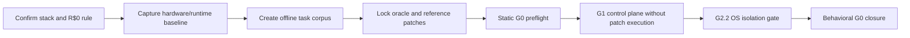

## GOALS 0 — Scope, hardware baseline, and trustworthy benchmark harness

Suggested: gpt-6-astra · xhigh — benchmark integrity and the initial safety boundary determine whether every later result is meaningful.

- [x] **G0.1 [MANUAL] Confirm the operating and CLI contract.** Record in `docs/decisions/ADR-001-mvp-scope.md` that TypeScript/Node is the approved baseline (or replace it before any scaffold), that R$0 means no new paid service, that the scope is local/single-user/disposable-only, and that the dashboard is deferred until GOALS 4. Confirm `agentctl` as the provisional CLI name; specify its versioned grammar, human-readable and `--json` output modes, stable exit-code families, and redaction/no-secret logging rule. The minimum command set is task create/validate, status/events, approve, run, cancel, recover, benchmark/runtime query, and comparison package export/import. Approval must require `task_id`, envelope hash, requested operations, expiration, and explicit confirmation; it can never be broad or free-form. **Done when:** the ADR contains the decision date, owner, alternatives rejected, the explicit no-secrets/no-network/no-shell rule, and the complete command/approval contract.

- [x] **G0.2 Create the repository safety baseline.** Initialize Git; add `README.md`, `AGENTS.md`, `.gitignore`, `.env.example`, and a license decision. Ignore dependencies, build outputs, runtime logs, benchmark results, `graphify-out/`, and every `.env` variant except the example. The README must document the terminal-only initial flow through `agentctl`; no browser page is a prerequisite before GOALS 4. **Done when:** `git status --short` contains no generated/runtime artifact; a test secret placed in `.env` is ignored; `README.md` explains the local-only threat boundary and a complete create → approve → run → inspect terminal workflow.

- [x] **G0.3 Capture a reproducible host baseline.** Add `docs/hardware-baseline.md` and `scripts/diagnose-runtime.ps1` that record Windows version, CPU, RAM, free disk, NVIDIA driver/GPU/VRAM where `nvidia-smi` is available, plus Git, Node, and later Ollama versions. Do not store usernames, tokens, paths outside the project, or raw environment variables. **Done when:** the diagnostic script exits successfully on the target PC and produces a redacted baseline artifact with required fields or an explicit `unavailable` value.

- [x] **G0.4 Define the immutable benchmark contract.** Create `bench/schema/task.schema.json`, `bench/tasks/README.md`, and the offline snapshot utility/tests in `bench/snapshots/`. A task must include `task_id`, prompt, a lowercase 64-character `base_snapshot_sha256`, allowed globs, public test command identifier, timeout, changed-file limit, oracle version, and risk level. Snapshot v1 records regular files with normalized relative POSIX paths, byte sizes, and SHA-256 values in a canonical manifest; its ID is the SHA-256 of the manifest's compact UTF-8 JSON. Reject symlinks/junctions, absolute or traversal paths, `.env*`, `.git`, unsupported characters, case-insensitive path collisions, undeclared keys, and shell command text supplied by a model. **Done when:** schema and snapshot tests accept valid contracts and reject malformed IDs, altered/missing files, unsafe paths, collisions, undeclared operations, and arbitrary command strings; restore reproduces exact bytes offline into a new empty directory without overwriting a destination.

- [x] **G0.5 Build 20 offline, original benchmark tasks.** Version fixtures under `bench/tasks/{P01..P04,B01..B06,I01..I06,S01..S04}`: four pure functions, six localized bugs, six small integrations, and four controller-policy cases. Each fixture contains `task.json`, a `base/` directory, a sibling deterministic `snapshot.json`, public tests, an oracle outside the model context, a separately authored reference patch, and an empty null patch. Its task contract records the corresponding `base_snapshot_sha256`. Do not use Git commits as benchmark bases or third-party code/benchmarks as copied fixtures; use external work only as evaluation-design references. Never promote a candidate patch from a measured model run into the reference corpus. Agent-authored reference proposals require independent static review and explicit owner approval of the complete G0 review-set hash. **Done when:** exactly 20 task manifests and snapshot manifests validate, every snapshot ID recomputes, every base restores to exact files offline, and the current full review-set hash has owner approval. This approval authorizes review only; patch execution remains blocked until G2.2.

- [x] **G0.6 Implement the snapshot-restoring evaluator interface and static preflight, not a security sandbox.** Implement fresh-directory restoration, source/restored hash checks, patch parsing, changed-path allowlists, protected oracle-input hashes, fixed test/oracle registries, and early refusal of every `source=model` candidate. Before G2.2, the evaluator may validate snapshots and parse patches but must not apply any agent-authored patch (including reference, null, or synthetic patches) or run public tests or hidden oracles. Pre-gate tests may exercise schema, hashing, parsing, allowlist rejection, and `source=model` refusal only. Keep behavioral evaluator tests behind the post-G2.2 command. The public evaluator result remains one of `PASS`, `FAIL`, `POLICY_VIOLATION`, `TIMEOUT`, `CRASH`, or `RUNNER_FAILURE`; a reference `PASS` after the gate requires both public tests and its hidden oracle to pass. Document that same-user hostile code could still inspect oracle files without a verified OS boundary; this evaluator is not a security sandbox. **Done when:** all 20 bases restore offline and pass integrity checks, every reference patch parses against its declared allowlist, protected-path changes and `source=model` are refused before execution, and no pre-G2.2 check applies or runs any patch.

- [x] **G0.7 Establish the static G0 preflight report.** Produce `bench/results/g0-preflight-report.json` with task-manifest, snapshot-manifest, snapshot-ID, oracle, evaluator, and public-test hashes; operating-system baseline ID; each static validation result; and `behavioral_status: "BLOCKED_G2.2"`. It must record that no patch, public task test, or hidden oracle ran. **Done when:** the report is machine-readable and complete for all 20 tasks, allows G1 to begin, and does not claim final benchmark acceptance. The final `bench/results/g0-report.json` is generated only by G2.3 after the isolation gate and owner approval.
