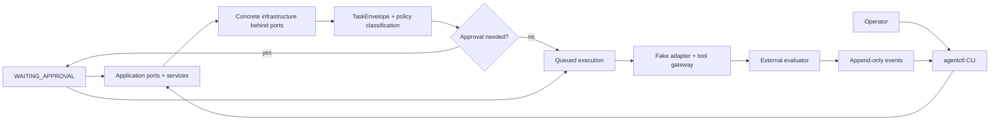

## GOALS 1 — Deterministic Control Plane without an LLM

Suggested: gpt-6-astra · xhigh — policy mistakes could authorize file or process actions before the system has a real isolation boundary.

- [x] **G1.1 Create the typed domain and state machine.** Implement `src/domain/{task,event,state,policy}.ts` with `TaskEnvelope-v1`, typed events, terminal-state invariants, and the states `DRAFT`, `CLASSIFIED`, `WAITING_APPROVAL`, `QUEUED`, `RUNNING`, `VERIFYING`, `SUCCEEDED`, `FAILED`, `REJECTED`, `CANCELLED`, and `INTERRUPTED`. **Done when:** unit tests prove illegal transitions (for example, `DRAFT → RUNNING` and `FAILED → SUCCEEDED`) are rejected and every valid transition emits an immutable event.

- [x] **G1.2 Define application ports and command/query services.** Implement `src/application/ports/` for event storage, separate `TaskRepository` envelope storage, envelope hashing, policy evaluation, workspace allocation, tool execution, agent invocation, evaluator invocation, task execution control, `TaskExecutionLeasePort`, lowercase task ID validation, and clock/ID generation; implement `src/application/` services for task create/validate/classify, approve, queue/run, cancel, recover, `recoverAfterRestart`, and status/events. Task IDs are 1–64 lowercase ASCII letters/digits/`_`/`-`, start with a lowercase letter or digit, and are rejected without case normalization. `task.created` stores only task ID/hash and is the visibility marker. Creation saves the envelope first, then appends `task.created` with key `task.created:<taskId>`; same ID/hash retries safely complete the append, changed hash conflicts, and an unreferenced saved envelope stays invisible. Event append resolves an existing idempotency key before checking the expected stream version. The latest transition into `WAITING_APPROVAL` is the approval boundary: only a `task.approval_recorded` event after that boundary is active, and the approval idempotency key includes the boundary event ID. Recheck approval immediately before execution: stale approval returns `QUEUED → WAITING_APPROVAL`, and hard policy denial returns `QUEUED → REJECTED`. Active work or `INTERRUPTED` work retaining an execution ID appends or reuses `task.cancel_requested` before asking task-wide execution control to stop; only confirmed quiescence for that same execution may append `CANCELLED`. If an interrupted task has no retained execution ID, cancellation returns `stop_unconfirmed` without appending intent; an unconfirmed stop otherwise remains `INTERRUPTED`, and a retry may complete it only after a later confirmed stop. On a version conflict, reread and preserve terminal results; never cancel a different execution. The run coordinator observes cancellation intent before advancing or finalizing. `runTask` holds the exclusive local execution lease for the full pipeline; `recoverAfterRestart` holds the same lease while enumerating visible task streams and changing `RUNNING`/`VERIFYING` to `INTERRUPTED`. A persisted cancellation intent gets a distinct interruption reason and never implies `CANCELLED`. `cancelTask` does not acquire the lease so an operator can request cancellation while a run or recovery owns it. A live lease blocks another run/recovery; OS-level child-process guarantees remain gated by G2.2. Application code depends only on domain types and these ports, not on JSONL, Git, Ollama, CLI parsing, or concrete tools. **Done when:** service tests with in-memory fakes prove lifecycle, save/append failures and lost acknowledgments, idempotent retry and hash conflict, approval binding and recovery-boundary invalidation, persisted/unpersisted cancellation intent, confirmed/unconfirmed stop including retry after restart, missing execution ID stays interrupted, cancellation during verification, terminal/new-execution race handling, startup-recovery semantics, lease exclusion of overlapping run/recovery, cancellation while leased, lowercase ID rejection before persistence, and read-only query behavior; import-boundary tests fail if application services import concrete infrastructure or CLI modules.

- [x] **G1.3 Add append-only JSONL persistence and recovery support.** Implement `src/infra/jsonl-event-store.ts` as the event-storage port adapter, `src/infra/task-envelope-store.ts` as the separate `TaskRepository` adapter, `src/infra/envelope-hasher.ts` as the deterministic `EnvelopeHasherPort` adapter using Node's built-in SHA-256 over canonical compact UTF-8 JSON in `TaskEnvelopeV1` field order, and `src/infra/task-execution-lease.ts` as the local exclusive-lease adapter. Publish immutable envelope files safely on Windows using same-directory temporary files and create-if-absent publication; use the shared lowercase-only ASCII task ID contract in the application, repository, and event stream, and reject symlinks/junctions at storage paths. Save the envelope before appending `task.created`; only event streams with a committed `task.created` are visible, so orphan envelopes and temp files stay invisible. Store events in append-only per-task JSONL streams. Resolve idempotency keys before expected versions; matching retries return the canonical event, while conflicting payload/version fails. Repair only an incomplete trailing record; malformed complete/interior records fail closed. Serialize access across processes with exclusive-create locks; any existing lock, including stale or malformed records, blocks and is never automatically deleted. A valid lock exposes its owner PID/kind and path for diagnosis. After verifying the recorded PID is gone and all other controller instances are closed, the operator removes exactly that lock file under ignored runtime state and restarts recovery; there is no TTL or automatic stale-lock cleanup. Release checks the owner's token. Connect `recoverAfterRestart` through the application service: under the lease, mark active runs `INTERRUPTED`, using a distinct reason when cancellation intent was persisted; never infer `CANCELLED`. A later cancel may target that interrupted execution only by its retained execution ID and may append `CANCELLED` only after task-wide quiescence is confirmed; missing execution ID or unconfirmed stop remains interrupted, and a version conflict must not transfer cancellation to a new execution. Never persist prompts in the event log, raw secrets, or complete untrusted tool output by default. **Done when:** deterministic hasher tests prove the expected SHA-256 for fixed-order compact UTF-8 JSON including Unicode; envelope tests prove create-if-absent, same-hash retry, changed-hash conflict, safe publication, path rejection, and uppercase-ID rejection; JSONL tests prove prompt-free append, idempotency-before-version, partial-tail repair, malformed-record rejection, visible-stream enumeration, and uppercase-ID rejection; lease tests prove exclusion, stale/malformed lock blocking without mutation, owner diagnostics, and token-checked release; restart tests prove a stale lock blocks the sweep without altering it, then explicit test-simulated owner cleanup permits recovery of visible `RUNNING`/`VERIFYING` streams to `INTERRUPTED`; an interrupted execution remains so after an unconfirmed cancellation, can become `CANCELLED` after a confirmed retry, missing execution ID stays interrupted, and a different execution is never cancelled. Envelope-only orphans stay hidden.

- [x] **G1.4 Implement the policy engine before any tool.** Implement `src/policy/policy-engine.ts` as the policy port adapter to classify `read`, `write`, `process`, and `network`; validate canonical workspace-relative path patterns against lexical traversal, absolute/drive/UNC paths, Win32 aliases/device names, and protected paths. Reject leading or trailing ASCII spaces in every concrete or glob segment, trailing dots, `.env*`, `.git`, `.agentctl`, `.ssh`, `.aws`, `node_modules`, `.venv`, `.npmrc`, `.pypirc`, `.netrc`, credential/secret/private-key basenames, and known private-key extensions. Reject network access in v1. Retain supported `*`/`**` patterns here, then require G1.5/G1.6 to filter and revalidate every concrete path after expansion. `write` and `process` must require an explicit persisted approval bound to task ID, envelope hash, exact operation set, and future UTC expiration. **Done when:** policy tests reject parent traversal, absolute/outside paths, leading/trailing-space aliases with and without globs, protected credentials/configs, Win32 aliases/devices, unknown operations, and expired or mismatched approvals; representative safe patterns such as `docs/*.md` and `**/*.ts` pass lexical validation; safe read-only operations are allowed, writes/processes require a matching approval, and network is denied.

- [x] **G1.5 Implement local snapshot capture and disposable workspace management.** Implement an application capture service behind `SnapshotCapturePort`, a content-addressed local store, and `src/workspace/snapshot-manager.ts`. The future operator-only command is `agentctl snapshot create --source <directory> --confirm-disposable [--json]`; it reads only that explicitly selected directory, excludes and reports relative `.git`, `.agentctl`, `node_modules`, and `.venv` directories, and rejects leading/trailing-space aliases in every segment, trailing dots, `.env*`, `.npmrc`, `.pypirc`, `.netrc`, `credentials.*`, `secrets.*`, private-key basenames/extensions, unsupported Windows names/ADS syntax, case collisions, and reparse points. Hash and copy streams incrementally within limits of 50,000 files, 256 MiB per file, and 1 GiB total; exceeding a limit fails capture. Publish with same-volume staging and create-if-absent/hash verification. Output never contains the source's absolute path. Filename filters are best-effort, not complete secret scanning; on Windows, Node does not enumerate existing NTFS alternate data streams, which snapshot v1 neither copies nor hashes (only unnamed/default file streams are included). Restore a known or locally captured snapshot by hash into a fresh retained workspace, verify its baseline before `RUNNING`, expand allowed-path patterns and filter/revalidate every concrete path, enforce physical containment, reject junction/symlink escapes, check changes after tools and evaluator, and append redacted relative-path/hash audit records outside the workspace. Allocation audit records must correlate the `executionId` and relative workspace path, append `started` before snapshot resolution/restoration, then append `allow` or `deny` before returning; retain partial restores for diagnosis. These checks remain vulnerable to filesystem TOCTOU races and do not provide OS isolation. **Done when:** valid spaces/Unicode and all 20 benchmark fixture IDs remain usable; exclusions are reported; source files remain unchanged; same-hash retry reuses bytes; corrupt/unknown/altered hashes and overwrite attempts fail closed; two workspaces do not share edits; protected concrete glob results are omitted; out-of-policy changes cannot succeed; permitted reparse probes reject escapes or are explicitly skipped when the host denies their creation; cancellation during allocation retains execution correlation; partial restore failure retains a redacted deny record without deleting the workspace; and audit contains no prompt, content, or absolute source path.

- [x] **G1.6 Expose a closed tool gateway.** Implement `src/domain/tools.ts` and `src/tools/tool-gateway.ts` as the tool-execution port adapter. Requests are strict discriminated objects for only `read_text`, `list_files`, `apply_unified_diff`, `run_declared_test`, and `git_diff`; reject undeclared operations, extra fields, unknown IDs, malformed paths, oversized payloads, diff deletion, and rename. New `TaskEnvelopeV1` declarations are unique pathless `{id, profile: "host-json-v1"}` entries; the profile version and IDs enter the canonical envelope hash in array order. A closed host-owned registry port accepts only registered IDs. The trusted host harness owns test inputs and expected values, sends only bounded schema-validated JSON requests to the isolated worker, receives candidate-code JSON responses, and compares outputs on the host. The worker executes candidate code only; it never imports workspace test scripts, public tests, oracles, expected values, or evaluator logic. Existing path-based `node-test` declarations remain readable and hash-compatible, but are legacy-only, never executable, and their workspace paths remain write-protected; new tasks cannot declare workspace test scripts. The gateway receives the verified envelope hash and current persisted approval context; it re-evaluates policy with fresh `clock.now()` immediately before each write/process adapter call so expired grants fail closed. Use workspace path capabilities and revalidate every concrete file before access. `git_diff` uses a fixed internal baseline-versus-workspace diff, never Git or a subprocess; it emits deterministic whole-file hunks with a 256 KiB per-file read cap and a 1 MiB response cap. Read results are capped at 1 MiB, listings at 10,000 paths, requests at 32 calls, patch payloads at 1 MiB/64 files/20,000 lines, and the declared-test timeout is fixed at 60 seconds. Do not expose shell/cmd/PowerShell, arbitrary arguments/processes, installers, deletion, Git push, or network. Until G2.2 passes, `apply_unified_diff` and `run_declared_test` fail closed; tests may parse and inspect diffs but must prove writer and runner spies receive zero calls. **Done when:** targeted tests prove strict parsing and limits, approval expiry recheck, concrete protected-path filtering/revalidation, safe reads/listings/internal diff, rejected unknown commands/IDs/deletion/rename, legacy declarations cannot reach a runner, host registry rejection, and zero patch/runner calls without G2.2; G2.3 later proves actual patch application and registered host-harness execution only after the isolation gate.

- [x] **G1.7 Validate concrete adapter contracts with a deterministic fake agent.** Implement `src/adapters/fake-agent.ts` as the only agent adapter used in continuous tests. The invocation result distinguishes a structured proposal from refusal, while proposal payloads remain untrusted until strict gateway validation. Contract tests cover valid and malformed output, normalized duplicate requests, timeout, crash, refusal, and evaluator rejection. The gateway validates every bounded request before executing any, so a duplicate or malformed later entry cannot follow an earlier side effect. **Done when:** refusal, malformed output, timeout, crash, and duplicate requests fail without evaluator approval or a `SUCCEEDED` transition; only a passing external evaluator can produce `SUCCEEDED`.

- [x] **G1.8 Create the strict, versioned CLI adapter after application services exist.** Implement `src/interfaces/cli/` as a parser and renderer over the application command/query services, including `agentctl snapshot create --source <directory> --confirm-disposable [--json]`. Validate the explicit confirmation before capture, and summarize the hash, counts, relative exclusions, and Windows ADS/default-stream limitation without exposing an absolute source path. Implement the G0 command grammar, validate all structured inputs before invoking application code, provide human-readable and schema-versioned `--json` output, return documented exit codes, redact secrets, and reject unknown flags/commands. It must not import infrastructure stores, policy internals, model adapters, or workspace managers. Startup composition must attempt `recoverAfterRestart` before accepting mutations. If another process holds the execution/recovery lease, keep status/events readable and block run/recovery; cancellation remains available through its lease-independent command path. Report the lock path and recorded owner PID/kind when valid, or identify the owner as unknown for a malformed lock. Give the operator the recovery steps: verify the recorded PID is gone, close all other controller instances, remove exactly that lock file under ignored runtime state, and restart; never offer automatic or TTL-based cleanup. **Done when:** CLI contract tests cover every mandatory command, malformed input, unknown commands, redaction, JSON schema validation, snapshot confirmation/redaction/exclusions, startup recovery, read-only status/events while the lease is busy, blocked run/recovery, available cancellation, owner diagnostics and the manual cleanup instructions, and prove the adapter invokes only application-facing interfaces.

- [x] **G1.9 Establish deterministic project commands, local CI, and the terminal safety gate.** Provide one-command `typecheck`, `test`, `lint`, and benchmark-harness static preflight through `npm run verify`, with no model/runtime download. Keep execution local for now; defer hosted CI until its cost policy is explicitly approved. Startup composition must attempt the recovery sweep before accepting mutations; if another process owns the lease, keep read-only status/events available, block execution/recovery, and preserve cancellation through its lease-independent path. The CLI displays the lock path and owner PID/kind when valid (unknown if malformed), and instructs the operator to verify the PID is gone, close all other controller instances, remove exactly the ignored runtime lock file, and restart; it must not clear locks automatically or by TTL. Execute a compiled-CLI end-to-end fake no-op mission: capture a disposable temporary source and use only its returned snapshot hash to create a task; then classify → wait for approval → approve with task/envelope/operations/expiry/confirmation → run → verify → query events, and separately prove cancel and recover flows. The test-only CLI composition must be separate from production and accept only the zero-tool fake proposal; it has no patch writer, declared-test runner, model, or oracle. The E2E test must invoke the compiled CLI only, never call internal services to impersonate the operator. Before G2.2, the fake mission must not apply any patch or run task/oracle tests. **Done when:** a clean clone with dependencies installed passes `npm run verify`; the CLI E2E suite proves snapshot capture/redaction plus startup recovery, lifecycle, approval, cancel, and recover paths without patch execution, including read-only operation and accurate owner/manual-cleanup guidance when the lease is busy; no write/process begins without recorded approval, no generic shell/network tool exists, and every execution has a deterministic terminal state. Patch-application and evaluator-runner acceptance is deferred to G2.3.
