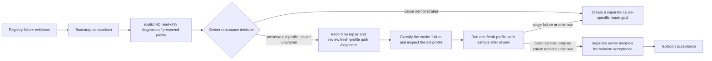

## GOALS 6 — Diagnose and repair the G2.2 AppContainer profile bootstrap

Grounded against commit `4438128` and the current uncommitted workspace on 2026-10-29. This goal precedes G2.2. The full probe calls `GetProfilePath` immediately after `CreateProfile`; the bootstrap comparison ran a fixed worker before its API observation. The read-only follow-up obtained `0x80070002` for a previously preserved profile and `READ_FAILED` before the registry scan visited a key. G6.5 then showed that a different fresh profile resolved its path both before and after bootstrap. The original report was overwritten by G6.5, so the next read-only check must receive the old profile ID explicitly from the captured pre-G6.5 evidence. These observations do not prove the old profile's registry state or the original failure mechanism. The ignored local evidence is `runtime/diagnostics/appcontainer-readonly-followup-20261029.md`.

### Stage map

| Stage | Items | Depends on | Can run in parallel with |
| --- | --- | --- | --- |
| Registry failure evidence | G6.1–G6.3 | None | None |
| Bootstrap comparison | G6.4–G6.5 | Registry failure evidence | None |
| Preserved-profile diagnosis | G6.6–G6.9 | Bootstrap comparison | None |
| Owner no-repair decision | G6.10 | Preserved-profile diagnosis | None |
| No-repair record and probe review | G6.11–G6.12 | Owner no-repair decision | None |
| Fresh-profile path diagnosis | G7.1–G8.6 | No-repair record and probe review | None |
| Case-only path-component correction and review | G12.1–G12.2 | G11.6 and latest failed G6.13 evidence | None |
| Ancestor metadata diagnosis and repository-local correction | G13.1–G13.5 | Latest failed G6.13 evidence and G12.2 | None |
| Isolation acceptance | G6.13 | G11.6, G12.2, G13.1–G13.5, G14.1–G14.3, G15.1–G15.4, and bounded session authorization | None |

<!-- item-contract: v1 -->

### Decisions

- Keep the approved AppContainer, Job Object, and nonce-scoped `AC\Temp` design. Use the existing fixed bootstrap only as a hypothesis to test, not as independent proof of a trusted path.
- Preserve every previously created profile. The new bootstrap comparison uses only its own freshly created profile. Preserve it whenever ownership or cleanup is uncertain.
- The preserved-profile follow-up targets only the exact profile ID recovered from the captured pre-G6.5 report. Never select a profile by scanning for a plausible name. The read-only mode requires full-trust caller identity, validates the explicit ID, emits no ID or path, and performs no filesystem, ACL, profile, or registry writes.
- The follow-up may read filesystem attributes only along the derived candidate path `%LOCALAPPDATA%\Packages\<id>\AC`. It must stop at the first missing, non-directory, reparse, or inaccessible component. It never enumerates the directory or opens content. The full-trust check identifies a non-AppContainer token; it does not prove that every managed sandbox restriction is absent. An incomplete or denied observation is `UNKNOWN`.
- A successful post-bootstrap API result is evidence for one sequence on one profile. It must identify the same newly created SID and match the independently validated profile candidate. A worker-reported path alone cannot establish the host trust boundary.
- Keep G2.2 closed until the complete filesystem, network, process-tree, oracle, and cleanup evidence passes owner review. Do not run task code, patches, model inference, or benchmark cases during this goal.
- If the pre/post evidence does not support the proposed sequence, do not change the bootstrap order. Use G6.6–G6.9 to inspect only the preserved profile tied to prior evidence. If no cause is demonstrated, preserve that profile, record no repair, and prepare the fresh-profile G2.2 probe. Any later cause-specific repair needs its own revised goal. Do not substitute a VM or relax path checks automatically.

### Registry failure evidence

- [x] **G6.1 Add bounded registry scan failure evidence.**
  - Files: `bench/isolation/run-probes.ps1` (exists); `bench/isolation/probe-contract.test.mjs` (exists).
  - Anchor: `function Get-AppContainerProfileMappingScan([string]$ProfileName) {` and `test('profile cleanup requires a bounded read-only HKCU mapping scan before and after deletion', async () => {`.
  - Change: Add a fixed `failure_phase` field to the scan result. Use only `ROOT`, `MONITOR`, `STACK`, `OPEN_CHILD`, `VALUE`, `ENUMERATE`, `STABILITY`, or `NONE`. Set the phase immediately before each corresponding operation. Allow only UnauthorizedAccessException, SecurityException, IOException, Win32Exception, ArgumentException, InvalidOperationException, RuntimeException, and OTHER as failure_type. Map every other type to OTHER. Return failure_code as a numeric HRESULT or null. Never emit exception messages, key names, paths, SIDs, or registry values. Keep every caught exception as `UNKNOWN`, `scan_complete=false`, and `issue=READ_FAILED`. Preserve the 4-level and 2,048-key limits and the existing deletion decisions. Add synthetic `-SelfTest` cases that inject failures at each phase. Assert that each case reports its phase and cannot authorize deletion. Add contract assertions for the new fields and output restrictions.
  - Do not touch: Profile creation, profile deletion, filesystem ACLs, network access, or the G2.2 gate.
  - Verify: Run `powershell.exe -NoProfile -NonInteractive -ExecutionPolicy Bypass -File bench/isolation/run-probes.ps1 -SelfTest` and `npm run test:isolation-probe`. Both exit 0. The synthetic cases expose only allowlisted fields and reject deletion.
  - Source: [RegNotifyChangeKeyValue](https://learn.microsoft.com/en-us/windows/win32/api/winreg/nf-winreg-regnotifychangekeyvalue), accessed 2026-10-29. The existing scan opens HKCU read-only and monitors changes.

  > Execution evidence: the PowerShell `-SelfTest` passed with synthetic failures in the shared scan flow and cleanup. `npm run test:isolation-probe` passed 14/14. An independent reviewer repeated both checks. No live registry scan or AppContainer probe was run.

- [x] **G6.2 Add a bounded read-only profile diagnostic.**
  - Files: `bench/isolation/run-probes.ps1` (exists); `bench/isolation/AppContainerLauncher.cs` (exists); `bench/isolation/probe-contract.test.mjs` (exists).
  - Anchor: `[switch]$ProfileBootstrapDiagnosticOnly,`, `function Get-AppContainerProfileMappingScan([string]$ProfileName) {`, `public static bool ProfileSidMatchesName(string profileSid, string profileName)`, and `test('profile cleanup requires a bounded read-only HKCU mapping scan before and after deletion', async () => {`.
  - Change: Add `-ProfileMappingReadOnlyDiagnosticOnly`. Reject combinations with other modes. Read only `profile_id` from the existing `runtime/diagnostics/appcontainer-probe-report.json`. Reject input larger than 64 KiB. Reject missing IDs and IDs outside `^AgentCP[0-9a-f]{17}$`. Add `ObserveProfileMappingReadOnly(string profileName)` to `AppContainerLauncher`. Reuse the existing SID derivation and SID conversion P/Invokes. Call `GetAppContainerFolderPath` for the derived SID. Return only the derivation HRESULT, API HRESULT, and a path-present boolean. Free the SID, SID text, and API path with their matching Windows deallocators. Call the existing bounded registry scan. Return one JSON object of at most 4 KiB on stdout. Include the API fields, scan counts, completeness, stability, issue, and G6.1 sanitized failure fields. Return a nonzero exit for invalid input or an incomplete scan. Do not print the profile ID, paths, SID, exception text, or values. Exit before profile creation, ACL changes, worker launch, report writes, or cleanup. Catch parser, launcher compilation, API, and scan failures after script startup. Emit one sanitized JSON result and a nonzero exit for those failures. Suppress error-stream output for the diagnostic mode. Add synthetic tests for mode combinations, invalid IDs, output size, and fail-closed scan results.
  - Do not touch: Existing diagnostic reports, old profiles, task fixtures, or G2.2 acceptance.
  - Verify: Run `npm run test:isolation-probe` and the existing PowerShell `-SelfTest` command from G6.1. Both exit 0. The new synthetic cases execute without a live registry scan.
  - Source: [GetAppContainerFolderPath](https://learn.microsoft.com/en-us/windows/win32/api/userenv/nf-userenv-getappcontainerfolderpath), accessed 2026-10-29. The API returns an HRESULT and an allocated path on success.

  > Execution evidence: the PowerShell `-SelfTest` passed with synthetic inputs and output bounds. `npm run test:isolation-probe` passed 16/16. An independent reviewer repeated both checks. No real report, registry, profile, or AppContainer probe was accessed by these tests.

- [x] **G6.3 [MANUAL] Observe the preserved profile without modification.**
  - Files: none (manual).
  - Verify: The owner approves one read-only invocation after reviewing G6.2. Run `powershell.exe -NoProfile -NonInteractive -ExecutionPolicy Bypass -File bench/isolation/run-probes.ps1 -ProfileMappingReadOnlyDiagnosticOnly 2>$null`. Record the bounded JSON and execution identity. If startup fails before JSON output, record STARTUP_FAILED and the exit code. Confirm no old profile or registry value changed. Treat `UNKNOWN` as inconclusive. Stop if the output exposes a path, value, or SID.

  > Execution evidence: one invocation in the Codex managed Windows sandbox returned exit 1 and the bounded JSON below. The mode only reads the report, derives a SID, calls the folder API, and opens the mapping branch read-only; no profile or registry mutation was invoked. `ROOT` / `SecurityException` is inconclusive about access outside this sandbox. No path, profile ID, registry value, or SID was emitted.

  > `{"status":"UNKNOWN","sid_derivation_hresult":0,"api_hresult":-2147024894,"api_path_present":false,"registry":{"status":"UNKNOWN","scan_complete":false,"keys_visited":0,"complete_match_count":0,"partial_match_count":0,"case_only_pair_count":0,"partial_missing_pair_count":0,"partial_different_pair_count":0,"malformed_value_count":0,"stability_status":"UNKNOWN","issue":"READ_FAILED","failure_phase":"ROOT","failure_type":"SecurityException","failure_code":-2146233078}}`

### Bootstrap comparison

- [x] **G6.4 Record the API result before and after bootstrap on one new profile.**
  - Files: `bench/isolation/run-probes.ps1` (exists); `bench/isolation/worker-bridge.test.mjs` (exists); `bench/isolation/README.md` (exists).
  - Anchor: `$profileSidText = [AppContainerLauncher]::CreateProfile($profileName)`, `$currentPhase = 'profile-bootstrap-api-path-observation'`, and `test('profile bootstrap diagnostic is fixed, bounded, full-trust gated, and cleans only owned paths', async () => {`, and `# AppContainer isolation probes`.
  - Change: In `-ProfileBootstrapDiagnosticOnly`, call the existing `ObserveProfilePath` after SID verification and before `RunProfileBootstrapDiagnostic`. Retain its existing post-worker observation. Record candidate-validation status before each API observation. If candidate validation fails, record NOT_CALLED and no HRESULT. Record both HRESULTs and candidate-match booleans under distinct `before_bootstrap` and `after_bootstrap` fields. Use the same SID, nonce, and validated candidate for both calls. Preserve all existing bootstrap, timeout, ACL, marker, and cleanup checks. Keep API failure observable and fail closed for cleanup uncertainty. Add a synthetic ordering and schema check. Document that these observations do not pass G2.2.
  - Do not touch: Existing profiles, the full probe path, production runner behavior, or candidate execution.
  - Verify: Run `npm run test:isolation-worker`, `npm run test:isolation-probe`, and the PowerShell `-SelfTest` command from G6.1. Each exits 0. The checks require pre-observation, fixed bootstrap, then post-observation in that order.
  - Source: [CreateAppContainerProfile](https://learn.microsoft.com/en-us/windows/win32/api/userenv/nf-userenv-createappcontainerprofile) and [GetAppContainerFolderPath](https://learn.microsoft.com/en-us/windows/win32/api/userenv/nf-userenv-getappcontainerfolderpath), accessed 2026-10-29. Neither source proves that bootstrap changes the API result.

  > Execution evidence: the PowerShell `-SelfTest` passed; `npm run test:isolation-worker` passed 23/23; `npm run test:isolation-probe` passed 16/16. An independent reviewer repeated the checks and reviewed ordering, sanitized observations, and fail-closed cleanup. No live bootstrap or AppContainer probe was run.

- [x] **G6.5 [MANUAL] Authorize and review one bootstrap comparison.**
  - Files: none (manual).
  - Verify: The owner reviews G6.4 and authorizes one `npm run isolation:appcontainer:probe -- -ProfileBootstrapDiagnosticOnly` invocation. Record the two HRESULTs, candidate matches, SID match, worker status, scan status, and cleanup results. Preserve the new profile on uncertainty. Do not reuse old profiles. Do not treat the comparison as G2.2 isolation evidence.

  > Execution evidence: one invocation created a fresh profile. Before bootstrap, `GetAppContainerFolderPath` returned `0x00000000` and the validated candidate matched. After bootstrap, the API returned `0x00000000` and the candidate matched again. The SID matched. The fixed worker, marker write/read/delete, staging ACL and ACL cleanup passed. Registry pre-delete and post-delete scans passed; profile deletion and temporary-file cleanup passed. Worker-token and Job-membership checks remained `UNKNOWN`. The command returned `BLOCKED` with `PENDING_OWNER_REVIEW`, as expected for this diagnostic mode. No candidate, task test, patch, oracle, evaluator, or model ran.

### Preserved-profile diagnosis and root cause decision

- [x] **G6.6 Add explicit-ID and full-trust requirements to the read-only diagnostic.**
  - Files: `bench/isolation/run-probes.ps1` (exists); `bench/isolation/probe-contract.test.mjs` (exists); `bench/isolation/README.md` (exists).
  - Anchor: `[switch]$ProfileMappingReadOnlyDiagnosticOnly,`, `function Convert-ProfileMappingReadOnlyOutput($Api, $Scan) {`, and `test('read-only profile diagnostic is bounded, sanitized, and precedes probe effects', async () => {`.
  - Change: Add string parameter `-ProfileMappingReadOnlyProfileId`. Require it only with `-ProfileMappingReadOnlyDiagnosticOnly`; reject mode conflicts before any diagnostic effects. Remove report-file selection from this mode. Require an exact ASCII profile ID matching `AgentCP` plus 17 lowercase hexadecimal characters; reject missing, wrong-case, extra, newline-suffixed, or malformed values without echoing input. Compile the fixed launcher, require `AppContainerLauncher.IsCurrentProcessFullTrust()` before calling the folder API or registry scan, and fail closed if trust cannot be established. Preserve the bounded `GetAppContainerFolderPath` and existing read-only HKCU mapping scan. Emit only sanitized HRESULTs, booleans, counts, and allowlisted status fields; never emit or persist the ID, SID, paths, registry names, values, or exception text. Keep the 4 KiB output cap and no-write behavior. Add synthetic tests for exact ID validation, missing/invalid IDs, ID-without-mode, full-trust guard ordering, mode conflicts, sanitization, and incomplete scans. Update the README command syntax and explain that the caller must be full-trust.
  - Do not touch: Any profile, report, registry value, ACL, task fixture, oracle, candidate, or G2.2 acceptance.
  - Verify: Run `npm run test:isolation-probe`, `npm run test:isolation-worker`, `npm run typecheck`, and the PowerShell `-SelfTest` command from G6.1. All exit 0. Tests use synthetic IDs and do not query live profiles or registry state.

  > Execution evidence: `test:isolation-probe` passed 17/17, `test:isolation-worker` passed 23/23, `typecheck` exited 0, PowerShell `-SelfTest` passed, and `git diff --check` passed. An independent reviewer found no blockers. The negative full-trust branch was verified by code order and contract assertions; no AppContainer negative-token run was performed. No live profile, registry, worker, or task code was accessed.

- [x] **G6.7 [MANUAL] Recheck the previously preserved profile in full-trust mode.**
  - Files: none (manual).
  - Verify: Use only the exact old profile ID recovered from the captured pre-G6.5 report and pass it to the updated diagnostic: `powershell.exe -NoProfile -NonInteractive -ExecutionPolicy Bypass -File bench/isolation/run-probes.ps1 -ProfileMappingReadOnlyDiagnosticOnly -ProfileMappingReadOnlyProfileId <captured-id> 2>$null`. Run once in a full-trust PowerShell process. Record its bounded JSON, process identity, and exit code without recording the profile ID. Confirm the script performs no profile creation/deletion, file writes, ACL changes, registry writes, worker launch, or report write. If the ID cannot be tied to the pre-G6.5 evidence, stop without selecting another profile. Treat API/registry disagreement, an incomplete scan, or startup uncertainty as inconclusive. Do not run candidates, patches, task tests, or evaluator.

  > Execution evidence: one full-trust PowerShell invocation used the profile ID from the captured pre-G6.5 report; the ID is omitted here. The `IsCurrentProcessFullTrust()` guard passed. Exit code was 1 with `status=UNKNOWN`, SID derivation `0x00000000`, `GetAppContainerFolderPath=0x80070002`, and no API path. The bounded registry scan was `COMPLETE` and `STABLE`: 326 keys, 0 complete matches, 1 partial match, 1 case-only pair, 0 missing, 0 different, and 0 malformed pairs; issue `NONE`. The report SHA-256 and modification timestamp were unchanged. The script performed no profile, file, ACL, or registry writes and launched no worker. This is a stable API/registry discrepancy; it does not identify why the API returned `ERROR_FILE_NOT_FOUND`. No candidate, patch, task test, oracle, evaluator, benchmark, or model ran. G2.2 remains pending.

- [x] **G6.8 Add sanitized field-level mapping and candidate-path observations.**
  - Files: `bench/isolation/run-probes.ps1` (exists); `bench/isolation/probe-contract.test.mjs` (exists); `bench/isolation/README.md` (exists).
  - Anchor: `function Get-ProfileMappingPairSummary([object[]]$Pairs, [string]$ProfileName) {`, `function Test-ProfileMappingReadOnlyProfileId([AllowNull()][string]$ProfileId) {`, and `test('read-only profile diagnostic is bounded, sanitized, and precedes probe effects', async () => {`.
  - Change: Extend the explicit-ID full-trust diagnostic with sanitized counts for exact and case-only `DisplayName` and `Moniker` matches. Keep the registry traversal at four levels and 2,048 keys; return no names, keys, values, paths, IDs, or exception messages. Independently derive `%LOCALAPPDATA%\Packages\<validated-id>\AC` from the full-trust caller's `LocalApplicationData`. Validate local-drive syntax and the exact `Packages/<id>/AC` shape. Inspect only attributes along the candidate and its ancestors; stop at the first missing, non-directory, reparse, or inaccessible component. Return only a fixed path status, shape-valid boolean, existence/directory/reparse booleans or null, and an allowlisted failure type/code. Do not enumerate directories or open file contents. Run the API, complete bounded registry scan, and candidate-path observer independently so an API failure does not suppress the other observations. Preserve a 4 KiB output cap and fail closed on malformed observations. Add synthetic tests for exact/case-only/ambiguous field counts, the first missing/non-directory/reparse/inaccessible path component, API failure without suppressing other observations, and output sanitization. Document that `IsCurrentProcessFullTrust()` only reports a non-AppContainer token and cannot prove absence of every managed sandbox restriction.
  - Do not touch: Any profile files' contents, profile or registry values, ACLs, task fixtures, or G2.2 acceptance.
  - Verify: Run `npm run test:isolation-probe`, `npm run test:isolation-worker`, `npm run typecheck`, and the PowerShell `-SelfTest` command from G6.1. All exit 0. Synthetic cases do not query the live profile, filesystem candidate, or registry.

  > Implementation evidence: `test:isolation-probe` passed 17/17, `test:isolation-worker` passed 23/23, `typecheck` exited 0, PowerShell `-SelfTest` passed, the GOALS validator passed, and `git diff --check` passed. An independent reviewer found no blockers. Exact/case-only counts are read-only-mode-only; the full-probe schema and decisions remain unchanged. No live profile, candidate path, or registry was accessed during implementation or review.

- [x] **G6.9 [MANUAL] Run the expanded read-only check once on the preserved profile.**
  - Files: none (manual).
  - Verify: After independent review, use only the exact ID recovered from the captured pre-G6.5 report. Run `powershell.exe -NoProfile -NonInteractive -ExecutionPolicy Bypass -File bench/isolation/run-probes.ps1 -ProfileMappingReadOnlyDiagnosticOnly -ProfileMappingReadOnlyProfileId <captured-id> 2>$null` once in full-trust PowerShell. Record its bounded JSON, caller identity status, unchanged current report hash/timestamp, and exit code without recording the profile ID. Confirm the result contains only API HRESULT/presence, mapping counts, and candidate-path status booleans/enums. The command must not create/delete profiles, write files or registry values, change ACLs, enumerate directory contents, launch a worker, or write a report. If any source is denied, unstable, or malformed, record `UNKNOWN`; do not infer causality. No task test, patch, candidate, oracle, evaluator, benchmark, or model may run.

  > Execution evidence: one user-authorized PowerShell invocation passed the script's non-AppContainer token guard. It returned exit code 1 and `status=UNKNOWN`: SID derivation `0x00000000`; `GetAppContainerFolderPath=0x80070002`, no path; candidate path `shape_valid=true`, `status=ABSENT`, `exists=false`, `is_directory=false`, `reparse_point=false`; and a complete, stable registry scan over 326 keys. The scan found 0 complete pairs and 1 case-only partial pair: `DisplayName` had 1 exact and 0 case-only matches; `Moniker` had 0 exact and 1 case-only match. Missing, different, and malformed counts were 0; issue was `NONE`. The report SHA-256 and timestamp were unchanged. The command read only bounded registry metadata and filesystem attributes; it did not enumerate directories, open file contents, or perform any profile, file, ACL, or registry write. No worker, candidate, patch, task test, oracle, evaluator, benchmark, or model ran. The result is consistent with an incomplete or stale profile registration, but it does not prove why the directory is absent or why the API returned `ERROR_FILE_NOT_FOUND`. G2.2 remains pending.

- [x] **G6.10 [MANUAL] Decide whether the preserved-profile evidence supports any repair.**
  - Files: none (manual).
  - Verify: Review G6.3, G6.5, G6.7, and G6.9 with the owner. Treat each run as evidence for one observation, not proof of causality or reproducibility. Record whether the API, stable registry mapping, and candidate path agree. Do not infer that bootstrap fixes the issue: G6.5 succeeded before bootstrap.

  > Owner decision: the user chose to preserve the old profile and proceed. The old profile remains untouched. No cause has been proven; do not change bootstrap behavior. Prepare a fresh-profile G2.2 probe and obtain its separate one-run authorization before execution.

  > Evidence reviewed: G6.5 succeeded before bootstrap on a fresh profile. G6.9 found `0x80070002`, a stable mapping with one exact `DisplayName` and one case-only `Moniker`, and an absent candidate directory. This localizes the anomaly to the preserved profile state but does not establish causality.

### No-repair decision and probe preparation

- [x] **G6.11 Record no repair for the preserved-profile anomaly.**
  - Files: `bench/isolation/README.md` (exists).
  - Anchor: `To inspect a previously preserved profile, pass the exact profile ID recovered`.
  - Change: Record the G6.5 and G6.9 observations and the owner's no-repair decision. State that the old profile stays untouched, the bootstrap order remains unchanged, and the G6.9 evidence does not prove a cause. Do not include profile IDs, paths, registry key names, or values. State that G2.2 still requires the full fresh-profile probe.
  - Do not touch: Any profile, report, registry entry, ACL, candidate gate, or evaluator behavior.
  - Verify: `git diff --check -- bench/isolation/README.md` exits 0. The note distinguishes observed facts from unproven causes.
  - Source: G6.5/G6.9 evidence and the owner's G6.10 decision.

- [x] **G6.12 Independently review the no-repair record and fresh-profile probe scope.**
  - Files: `bench/isolation/README.md` (exists); `bench/isolation/run-probes.ps1` (exists).
  - Anchor: `# AppContainer isolation probes` and `if ($ProfileMappingReadOnlyDiagnosticOnly) {`.
  - Change: Review the no-repair note, full-probe operations, canary locations, loopback-only listener, profile-local staging, report overwrite, and fail-closed cleanup. Confirm the full probe runs only fixed synthetic diagnostics and does not execute task code, patches, public tests, or oracles. Record findings without including IDs or paths. Resolve every finding before asking the owner to authorize G6.13.
  - Do not touch: Any profile, report, registry entry, ACL, candidate gate, evaluator behavior, or G2.2 status.
  - Verify: Independent reviewer reports no blockers. Run the GOALS validator and `git diff --check` on the reviewed files. Do not execute the full probe as part of review.
  - Source: Local G6.5/G6.9 evidence, G6.10 owner decision, and the current probe implementation.

  > Independent review: no blockers. The reviewer confirmed the no-repair note distinguishes observations from cause, the listener is bound to loopback, the four canary locations are synthetic, and cleanup fails closed. The fixed worker does not receive candidate code or oracle contents. The trusted host fingerprint reads and hashes registered oracle JSON bytes without parsing, exposing, or sending them to the worker. The report writer replaces only the ignored probe report using its guarded temporary-file/backup flow. GOALS validation and `git diff --check` passed. The full probe was not run.

### Isolation acceptance

- [x] **G6.13 [MANUAL] Run and review the full isolation probe.**
  - Files: none (manual).
  - Change: Run this gate only after G15.1–G15.4 and G16.1–G16.3 pass and the independent review clears the changed diagnostics and the process-tree transport.
  - Verify: Require G13.1–G13.5 and G14.1–G14.3 complete, the G11.6 profile-path interpretation and owner disposition, and successful G12.2 review. The owner's current bounded session authorization covers the named `npm run isolation:appcontainer:probe` sequence up to 10,000 attempts as a ceiling, including G13.4 evidence collection and post-fix acceptance runs; it does not authorize unchanged blind retries. Stop if cleanup is uncertain or an action falls outside the approved scope. From the same host PowerShell context, each invocation creates a fresh AppContainer profile and Job Object; stages fixed Node/worker files and a disposable workspace under that profile's `AC\Temp`; creates synthetic canaries under `runtime/diagnostics`, the repository root, `bench/oracles`, and the current user's `%LOCALAPPDATA%`; starts a listener bound only to `127.0.0.1`; and overwrites the ignored `runtime/diagnostics/appcontainer-probe-report.json`. The trusted host fingerprint reads and hashes registered oracle JSON bytes only; it does not parse or expose them and does not send them to the worker. It tests workspace access, canary denial, loopback connection denial, process-tree timeout, and cleanup. Cleanup removes the fresh profile only when all ownership and cleanup checks pass; otherwise it preserves it and reports uncertainty. It does not execute task code, patches, public tests, hidden oracle modules, evaluator cases, or a model. Require filesystem containment, workspace access, oracle inaccessibility, network denial, child and grandchild timeout termination, and verified cleanup. If any check is failed or unknown, leave G2.2 unchecked and stop before G2.3. After successful probe review, return to G2.2 for production evaluator integration and the host/runner-bound attestation. Do not mark G2.2 complete from the probe alone.
  - proof: owner-delegated review on 2026-11-09 of probe report 0a1dc747a282f57f21584b5af1bc878fb999b8ed519c1b392a3638d1a12eabbc: status PASS, exit 0, 22 of 22 checks PASS, no failure, cleanup verified; owner approved the earlier equivalent report in the terminal and then told the agent to complete the owner items; GOALS 11 to 17 archived, 2026-11-09, Sonnet 5.5

  > Execution evidence: one owner-authorized invocation exited 1 with report `status=BLOCKED`. The first diagnostic was in `profile-create`, with `MethodInvocationException` wrapping `InvalidOperationException`; the report recorded no underlying API HRESULT, so the cause is unknown. The profile path was unresolved, deletion was not attempted (`PRESERVE_PROFILE_PATH_UNKNOWN`), and the registration scan was not run; the report does not establish whether a registration remains. The worker did not launch, so worker-dependent isolation checks remain `UNKNOWN`. Temporary cleanup passed: all four canary locations were absent afterward, and the loopback listener was not created. No task code, patches, public tests, oracle modules, evaluator cases, or model ran. G2.2 remains blocked. The ignored local report is `runtime/diagnostics/appcontainer-probe-report.json`.

  > Evidence clarification: on 2026-10-29, both recorded source hashes matched the current script and launcher. The reported line 4357 calls `GetProfilePath` after `CreateProfile` returned. The phase label remained `profile-create`. The failing validation or API operation inside `GetProfilePath` remains unknown. GOALS 7 corrects the human-readable report and plans bounded diagnosis.

  > Latest execution evidence (report SHA256 `0fc314de93b8da2ceb1441e03986109f880f27ff22417bb7889aec162d444f15`): the separately authorized child exited 1 with `status=BLOCKED`, phase `profile-run-stage-prepare`, and failure at line 1508 (`0x80131501`). G11.5 had shown a stable, unique case-only API/candidate identity match. No Temp/stage was created and no worker launched; canaries were absent and the listener was not created. Profile deletion was not attempted because cleanup reported `PRESERVE_TEMP_PATH_UNKNOWN`. Preserve this profile; do not inspect or remove it. G6.13 and G2.2 remain unchecked.

  > Latest execution evidence (report SHA256 `12bbd5a6482cad020af3d40c4bedccc9005ceffb3a63c20d837befeba3722819`): the newly authorized invocation exited 1 with `status=BLOCKED` at `filesystem-probe`, line 2608 (`0x80131501`). Profile/staging ACL and startup attributes passed. The filesystem launcher verified the AppContainer token and Job membership, but the worker exited 1 without timeout or output truncation and the Job drained. Stderr classified as `EPERM`/`lstat`; the target is unknown. The staged-file ESM import diagnostic was also `DENIED` with `EPERM`/`lstat`: lstat checks at `ancestor00` through `ancestor06` were denied, while `ancestor007` and later were allowed. No filesystem-probe response was received; downstream workspace, containment, network, process-tree, and oracle checks remain `UNKNOWN`. The listener was not created. Canary, stage, and this run's profile cleanup passed; registration pre/post scans passed and this run's profile was deleted. No candidate, patch, task tests, oracle, evaluator, or model ran. This authorization is consumed. The prior uncertain profile remains untouched and must not be inspected or removed. G6.13 and G2.2 remain unchecked.

  > Latest execution evidence (report SHA-256 `2b35623523c6b12766c03df8f4b5c7b6e3a9ba0be9532617f14aeca13f2b7ec3`): the single changed-code invocation exited 1 with `status=BLOCKED`. The actual worker token capability query passed with count 0; loopback exemption was `ABSENT`; helper cleanup and host listener control passed. The network worker ran but returned `ETIMEDOUT` with no accept, so network remains `UNKNOWN`. Process-tree checks remain `UNKNOWN` because `process-tree-probe` failed with `MethodInvocationException` wrapping `ArgumentException` (`0x80070057`) at PowerShell line 7589, before a member snapshot was produced. Profile deletion/path absence, stage/canary cleanup, and listener stop were confirmed. No candidate, task test, oracle, evaluator, or model ran. G14.3 diagnostic work is complete; G6.13 and G2.2 remain unchecked.

  > Latest execution evidence (report SHA-256 `09df228471d937fdb78eb0ae2be0d6734d82b098038e965128d856c5f22cc54e`, 2026-11-09): after G15 and an empty-string fix (PowerShell passed `$null` as `""` to `profileLocalAppDataPath`, so `GetFullPath("")` threw at `ARGUMENT_CONSTRUCTION`; `BuildEnvironment` now treats empty as absent, with a regression test), the probe exited with `status=FAIL`. All checks passed (including `network_denied`, filesystem, profile, oracle) except `process_tree_terminated` and `child_process_tree_terminated`. Timeout cleanup worked: Job snapshot COMPLETE (2 members: node + console host), terminated, drained, diagnostic `COMPLETE`. The test itself did not run: the worker emitted `CHILD_SPAWN_CALL_BEGIN` and never `CHILD_SPAWN_CALL_RETURN`/`THROW`, so `child_process.spawn(process.execPath, ...)` inside the AppContainer worker blocked until the 10 s deadline; no child started. Cause of the blocked spawn is unknown. Per the gate, this is a failed check: no retry without a changed hypothesis, and G2.2 stays open. **Diagnosis (2026-11-09, disposable scratch copy with extra instrumentation; project files unchanged):** inside the AppContainer worker, `child_process.spawn` blocks synchronously whenever any stdio slot is `pipe` (stdout, stdin, stderr) or `ipc`, with and without `windowsHide`. It returns promptly and the child exits 0 with `stdio: ignore`, `inherit`, or a file descriptor opened in the workspace. The G2.2 process-tree worker reads child readiness over `stdio: [ignore, pipe, ignore]`, so the test cannot start; this is a harness design incompatibility, not a containment failure. Fixing it changes gate-evidence code (worker readiness transport, e.g. a workspace file instead of a pipe) and needs a revised plan before any edit.

  > Latest execution evidence (report SHA-256 `df7d1bed5d761bfcad37247d8780bbb1cf28bde37415de5e3912ac5b01c1b19f`, 2026-11-09, one invocation after GOALS 16): all 22 checks `PASS`, including `process_tree_terminated`, `child_process_tree_terminated`, and `network_denied`. The child and grandchild both started and reported `READY` through workspace files; the tree hit the deadline, the Job was terminated and drained, and both PIDs were absent. No failure was recorded. The report status is still `BLOCKED` with `gate_status=PENDING_OWNER_REVIEW` and `g2_2_attestation=false`. Observation to confirm (not changed): run-probes.ps1 computes the final status around the end of the probes while the cleanup checks are still `UNKNOWN`, and later code can only lower it, so the script appears unable to print PASS. This probe report is not the G2.2 attestation; owner review of the full report and an evaluator-bound attestation remain required. G6.13 and G2.2 stay unchecked.

  > Owner review (2026-11-09): the owner reviewed the probe report with SHA-256 `df7d1bed5d761bfcad37247d8780bbb1cf28bde37415de5e3912ac5b01c1b19f` in the terminal (status BLOCKED, gate PENDING_OWNER_REVIEW, 22 of 22 checks PASS, profile deleted, profile path and registration absent, four canaries absent) and approved it as coherent. This records the report review only. G6.13 and G2.2 stay unchecked until an evaluator-bound G2.2 attestation exists.

  > Latest execution evidence (report SHA-256 `0a1dc747a282f57f21584b5af1bc878fb999b8ed519c1b392a3638d1a12eabbc`, 2026-11-09, one invocation after GOALS 17): the probe printed `AppContainer probes: PASS` and exited 0. All 22 checks are `PASS`, `failure` is null, `gate_status` is `PENDING_OWNER_REVIEW`, and `g2_2_attestation` is false. `runtime/diagnostics/g2-isolation-evidence.json` does not exist. The owner must review this report, then run `npm run isolation:attest -- --approve-report-sha256 0a1dc747a282f57f21584b5af1bc878fb999b8ed519c1b392a3638d1a12eabbc` (GOALS 17 owner items). G6.13 and G2.2 stay unchecked until then.
