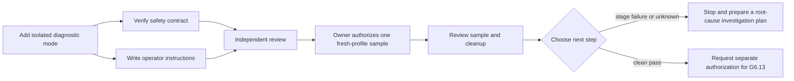

## GOALS 8 — Isolate fresh-profile path resolution

Grounded against commit `4438128` and the current uncommitted workspace on 2026-10-31. This goal follows G7.4 and precedes G6.13. The owner's G7.3 output shows `0x80070002`, a complete registry scan with zero matches, and an absent candidate path for the previously preserved profile. It does not establish the original exception's internal cause or the behavior of a fresh profile. G7.2 now records fixed stages inside `GetProfilePath`. The 2026-10-31 preflight found one stale method-signature anchor; this plan records the current signature before implementation.

### Stage map

| Stage | Items | Depends on | Can run in parallel with |
| --- | --- | --- | --- |
| Add the isolated diagnostic mode | G8.1 | G7.4 owner decision | None |
| Verify the safety contract | G8.2 | G8.1 | Operator instructions |
| Write operator instructions | G8.3 | G8.1 | Safety contract |
| Review the diagnostic | G8.4 | G8.2 and G8.3 | None |
| Capture one fresh-profile sample | G8.5 | G8.4 and separate owner authorization | None |
| Decide the next isolation step | G8.6 | G8.5 | None |

<!-- item-contract: v1 -->

### Decisions

- Treat this as a new sample. Do not claim that it explains the earlier failure.
- Call `GetProfilePath` immediately after `CreateProfileDiagnostic` returns `S_OK` and a valid SID. Do not write a journal or run an observation between those calls. Do not start a worker, Job Object, staging tree, ACL change, canary, listener, evaluator, or model.
- Derive `profile_preexisted` only from the raw create HRESULT: `S_OK` means this call created the data store; `HRESULT_FROM_WIN32(ERROR_ALREADY_EXISTS)` means a collision; any other HRESULT or missing HRESULT means `UNKNOWN`. Ownership for deletion requires `S_OK` and a valid converted SID. A collision or uncertain creation never authorizes deletion.
- Require the existing full-trust guard before profile or registry operations. The guard proves only that the caller token is not an AppContainer token.
- Persist a unique intent report before calling `CreateProfileDiagnostic`. Abort before profile creation if the report cannot be written.
- Separate the ignored report from stdout: the report may persist the generated profile name, SID, API path, and candidate path needed to audit this one run; stdout may contain only sanitized status and the report-relative path. Never emit a profile name, SID, path, exception message, or registry value to stdout.
- Run API, bounded registry, and candidate-path observations only when the raw create HRESULT is `S_OK`, because only then did this invocation create the named profile. For `S_OK` plus a valid SID, run them after `GetProfilePath` returns or throws; for `S_OK` plus SID-conversion failure, skip `GetProfilePath` and deletion, but read-only observations of this invocation's profile may run. On collision, non-`S_OK`, or missing HRESULT, do not inspect the name through API, registry, or filesystem; record profile state as `UNKNOWN`. Limit any registry scan to four levels and 2,048 keys.
- Require the independent `ObserveProfileMappingReadOnly` result to have successful SID derivation and API HRESULTs, `PathPresent=true`, and no failure before deletion or `COMPLETE`. A failure in this observation leaves the created profile un-deleted by this diagnostic and the result `UNKNOWN`.
- Report `diagnostic_profile_path_write_attempted` only for filesystem writes initiated by this diagnostic under the candidate profile path. Exclude `CreateAppContainerProfile`/other Windows API side effects and the report under `runtime/diagnostics`; `false` does not claim that the profile path is empty. Use the independent candidate observation for that state.
- Record registration state separately from cleanup action: `PRESENT` only for one identity in a complete, stable, consistent scan; `ABSENT` only for zero identities with no partial/malformed match in such a scan; otherwise `UNKNOWN`. Record candidate path status separately. `NOT_ATTEMPTED` means deletion was not called and must not be described as proof that a profile remains or was removed.
- Delete only after `CreateProfileDiagnostic` returns `S_OK` and `GetProfilePath` succeeds without collision.
- Require the returned SID to match the generated name and `diagnostic_profile_path_write_attempted` to remain false.
- Require a complete, stable, unique pre-delete scan and API/candidate path match. Permit the candidate to be `PRESENT` only as an ordinary non-reparse directory, or `ABSENT` only when its shape is valid, `candidate_exists=false`, `candidate_is_directory=false`, no existing ancestor is a reparse point, and every existing ancestor was safely checked. `NOT_DIRECTORY`, reparse, malformed, contradictory, or unknown candidate observations block deletion.
- If creation/path/ownership evidence is incomplete, a collision occurs, execution is interrupted, identity mismatches, the scan is incomplete, or the candidate is unsafe, record `NOT_ATTEMPTED`/`UNKNOWN` as applicable; do not claim the profile was preserved unless observations prove its state.
- Treat a negative delete HRESULT as `UNKNOWN` unless post-evidence proves residue. Do not retry after an error or interruption.
- Require a nonnegative delete HRESULT, an empty stable registration scan, and an absent candidate before reporting cleanup `PASS`.
- Keep G2.2 closed. A clean sample permits only a separate owner decision about G6.13.

- [x] **G8.1 Add the isolated fresh-profile diagnostic mode.**
  - Files: `bench/isolation/AppContainerLauncher.cs` (exists); `bench/isolation/run-probes.ps1` (exists); `bench/isolation/probe-contract.test.mjs` (exists).
  - Anchor: `public static string CreateProfile(string profileName)`; `public static void DeleteProfile(string profileName)`; `public static ProfilePathDiagnosticResult ObserveProfilePath(`; `param(`; `if ($ProfileMappingReadOnlyDiagnosticOnly) {`; `function Write-SafeReport([string]$Path) {`; `if ($SelfTest) {`; `test('profile contract diagnostic is a nonce-scoped one-shot mode with fail-closed cleanup', async () => {`.
  - Change: Add `public static int CreateProfileDiagnostic(string profileName, out string profileSid)`. Call `ValidateGeneratedProfileName(profileName)`. Return the raw create HRESULT. Set `profileSid` only after `S_OK` and successful SID conversion. Attach `create_profile_hresult` to conversion exceptions. Keep `CreateProfile` unchanged. Add `public static int DeleteProfileDiagnostic(string profileName)`. Validate the name and return the raw delete HRESULT. Keep `DeleteProfile` unchanged. Add `-ProfilePathResolveDiagnosticOnly`. Reject other mode combinations before profile or registry effects. Add an early branch before the full-probe path. Require the existing full-trust guard. Validate and create the ignored diagnostics directory with existing safe-path helpers. Generate a profile nonce and a separate report run ID. Derive the profile name as `AgentCP` plus the first 17 lowercase hexadecimal characters of the profile nonce. Create a unique report named `runtime/diagnostics/appcontainer-profile-path-<run-id>.json`. Refuse an existing report path. Persist status `UNKNOWN`, phase `CREATE_ATTEMPTED`, the generated profile name, and `profile_preexisted=UNKNOWN` before the create API. Stop if that write fails. Call `CreateProfileDiagnostic`; record the raw HRESULT. Set `profile_preexisted=false` only for `S_OK`, true only for `HRESULT_FROM_WIN32(ERROR_ALREADY_EXISTS)`, and `UNKNOWN` otherwise. Continue only for `S_OK` with a valid SID; this pair alone proves deletion ownership. If the SID conversion throws after `S_OK`, retain the HRESULT in the exception, skip `GetProfilePath` and deletion, but allow the independent read-only API, registry, and candidate observations because `S_OK` proves this invocation created the profile. For `S_OK` plus valid SID, call `GetProfilePath` next with no journal write or observation between. On any collision, non-`S_OK`, or missing HRESULT, skip `GetProfilePath`, all profile observations, and deletion; report registration/path state as `UNKNOWN`. For successful `S_OK` creation with a valid SID, run independent observations only after the immediate `GetProfilePath` call returns or throws. Use `ObserveProfileMappingReadOnly` for the independent API result; `Get-AppContainerProfileMappingScan` for bounded registry counts; `Get-ProfileMappingCandidatePathObservation` for candidate attributes; `ObserveProfilePath` for API/candidate matching; and `Get-ProfilePathDiagnosticRegistrationState($Scan)` for `PRESENT`/`ABSENT`/`UNKNOWN` registration state. Implement that state by mapping `Get-ProfileRegistrationPreDeleteDecision` `PASS` to `PRESENT`, `Get-ProfileRegistrationPostDeleteDecision` `PASS` to `ABSENT`, and every incomplete, partial, duplicate, malformed, or inconsistent result to `UNKNOWN`. Update the static assertions in `probe-contract.test.mjs` so the new mode is included in the flags excluded from the full probe's stage/canary setup, and the diagnostic helper emits no stdout (the outer mode dispatcher owns the single sanitized JSON line). Use `Write-SafeReport` for journal updates and flush each write. Persist `DELETE_INTENT_PERSISTED` before deletion; skip deletion if this write fails. Track `diagnostic_profile_path_write_attempted` only for diagnostic-initiated file writes inside the candidate path, excluding Windows API side effects and the report. Add `Get-ProfilePathDiagnosticDeleteDecision($CreateSucceeded,$Preexisted,$PathSucceeded,$ApiObservationSucceeded,$SidMatchesName,$DeleteIntentPersisted,$RegistrationDecision,$CandidateObservation,$ApiCandidateMatched,$DiagnosticProfilePathWriteAttempted)`. Require creation ownership (`CreateSucceeded=$true` from `S_OK` plus valid SID), `Preexisted=$false`, `PathSucceeded=$true`, `ApiObservationSucceeded=$true` only when SID derivation/API HRESULTs are `S_OK`, `PathPresent=true`, and failure type is null, `SidMatchesName=$true`, `DeleteIntentPersisted=$true`, `RegistrationDecision='PASS'`, `ApiCandidateMatched=$true`, and no diagnostic profile-path writes. Accept candidate `PRESENT` only with valid shape, directory, and no reparse point, or `ABSENT` only with valid shape, `candidate_exists=$false`, `candidate_is_directory=$false`, and no existing reparse point. Return `DELETE` only when every condition passes; otherwise return `NOT_ATTEMPTED`. Persist the delete intent before invoking `DeleteProfileDiagnostic`; track whether the API call actually started, record its raw HRESULT, and never retry after error/interruption. Add `Get-ProfilePathDiagnosticCleanupStatus($DeleteAttempted,$DeleteHResult,$PostDeleteDecision,$PostCandidateObservation)`: return `NOT_ATTEMPTED` only when no delete call ran and observations completed; `FAIL` when post-evidence proves a mapping or candidate remains; `PASS` only for a nonnegative HRESULT, post-delete decision `PASS`, and candidate status `ABSENT`; otherwise `UNKNOWN`. Record report-only profile identity/path fields separately from stdout fields. The ignored report may contain the generated name, SID, API/candidate paths, HRESULTs, observations, and cleanup state; stdout emits one JSON line containing only sanitized status and report-relative path. Never emit profile name, SID, path, registry values, or exception text to stdout. Do not overwrite the full-probe report. Set overall status `COMPLETE` only when path resolution, independent observations, and cleanup pass. Set `FAIL` for a known failure; otherwise set `UNKNOWN`. Exit 0 only for `COMPLETE` with cleanup `PASS`; exit 1 otherwise.
  - Do not touch: The full-probe report, existing `DeleteProfile` callers, profiles outside this invocation, worker behavior, Job Object behavior, ACLs, canaries, listener setup, evaluator, or G2.2 status.
  - Verify: Run `powershell.exe -NoProfile -NonInteractive -ExecutionPolicy Bypass -File .\bench\isolation\run-probes.ps1 -SelfTest`. Expect exit 0. Run `npm run test:isolation-probe`. Expect exit 0. Run `git check-ignore -q runtime/diagnostics/appcontainer-profile-path-placeholder.json`. Expect exit 0. Synthetic checks create no profile, registry value, file, listener, or worker.
  - Source: Local `GetProfilePath`, `ObserveProfilePath`, `ObserveProfileMappingReadOnly`, `Get-ProfileMappingCandidatePathObservation`, `Get-ProfileRegistrationPreDeleteDecision`, and `Get-ProfileRegistrationPostDeleteDecision`. [CreateAppContainerProfile](https://learn.microsoft.com/en-us/windows/win32/api/userenv/nf-userenv-createappcontainerprofile) documents `S_OK` for successful creation and `HRESULT_FROM_WIN32(ERROR_ALREADY_EXISTS)` for an existing data store; [GetAppContainerFolderPath](https://learn.microsoft.com/en-us/windows/win32/api/userenv/nf-userenv-getappcontainerfolderpath); [DeleteAppContainerProfile](https://learn.microsoft.com/en-us/windows/win32/api/userenv/nf-userenv-deleteappcontainerprofile), accessed 2026-10-31.

  > Execution evidence (2026-10-31): PowerShell `-SelfTest` passed; `npm run test:isolation-probe` passed 18/18; `npm run typecheck` passed; `npm test` passed 174 with 3 host-capability skips; `npm run lint` exited 0 with the same 68 baseline warnings; the placeholder report path is Git-ignored; `git diff --check` passed; and an independent reviewer found no blockers. No profile API, live registry diagnostic, full probe, candidate, patch, oracle, evaluator, or model ran.

- [x] **G8.2 Verify the synthetic safety contract.**
  - Files: `bench/isolation/run-probes.ps1` (exists); `bench/isolation/probe-contract.test.mjs` (exists).
  - Anchor: `if ($SelfTest) {`; `public static void DeleteProfile(string profileName)`; `test('profile path failures use fixed stages and preserve redacted diagnostics', async () => {`.
  - Change: Factor the G8.1 transaction control flow into a private function that receives ScriptBlock operations for report persistence, create, path resolution, independent API/registry/candidate observations, API/candidate matching, and deletion. The live mode must pass only fixed production operations; `-SelfTest` must pass synthetic in-memory operations and counters through the same transaction. Do not add CLI parameters or accept injected operations from an operator or worker. Use a synthetic writer that stores report state in memory and can fail before creation; it must create no file. Add cases for report-write failure, create collision, and create failure. Test raw create HRESULTs and SID-conversion exceptions. Add an interrupted `CREATE_ATTEMPTED` case. Feed all six stage-coded `GetProfilePath` exceptions through the transaction core; assert each sanitized stage is preserved and deletion is blocked. Assert collision, non-`S_OK`, and missing-HRESULT cases make no API, registry, candidate, path-resolution, post-delete-scan, post-delete-candidate, or delete calls. For `S_OK` with SID conversion failure, assert no path resolution or deletion occurs, while only read-only observations may run. Test registration-state `PRESENT`/`ABSENT`/`UNKNOWN`, SID mismatch, incomplete or duplicate scans, and safe/unsafe candidate states including `ABSENT`. Test that independent API observation failure prevents deletion and `COMPLETE`. Test successful cleanup, negative delete HRESULTs, and incomplete post-delete evidence. Assert the delete helper returns `DELETE` only when every ownership and cleanup precondition passes. Assert `NOT_ATTEMPTED` is not reported as a profile state. Assert the cleanup helper returns `PASS` only for required postconditions. Assert negative HRESULTs and uncertain states never retry deletion. Assert stdout omits generated profile name, SID, paths, registry values, and exception message while the ignored report can preserve fields needed for review. Add contract assertions that SelfTest uses only synthetic callbacks and does not call new or legacy profile P/Invokes, path observation wrappers, or touch the real registry/filesystem, process/worker, listener, evaluator, or model. Keep all cases inside `-SelfTest` or the Node contract test. Do not create live profiles.
  - Do not touch: The live profile registry, candidate paths, profile API, worker, listener, ACLs, benchmark, or evaluator.
  - Verify: Run `powershell.exe -NoProfile -NonInteractive -ExecutionPolicy Bypass -File .\bench\isolation\run-probes.ps1 -SelfTest` and `npm run test:isolation-probe`. Both exit 0; no profile API call occurs.
  - Source: Local diagnostic functions and [DeleteAppContainerProfile](https://learn.microsoft.com/en-us/windows/win32/api/userenv/nf-userenv-deleteappcontainerprofile), accessed 2026-10-31.

  > Execution evidence (2026-10-31): after the final refinements, PowerShell `-SelfTest` passed; `npm run test:isolation-probe` passed 19/19; `npm run typecheck` passed; `npm test` passed with 174 tests, 3 host-capability skips, and 0 failures; `npm run lint` exited 0 with existing warnings in `src`; `git diff --check` passed for tracked files and a direct whitespace check found no trailing whitespace in the untracked contract test. Independent review found no blockers. All six path-stage failures, collision/non-S_OK/missing-HRESULT no-observation paths, the synthetic-only SelfTest boundary, and contradictory absent-candidate rejection are covered. No profile API, live registry diagnostic, full probe, candidate, patch, oracle, evaluator, or model ran.

- [x] **G8.3 Document the operator command and residual risk.**
  - Files: `bench/isolation/README.md` (exists).
  - Anchor: `# AppContainer isolation probes`; `-ProfileMappingReadOnlyDiagnosticOnly`.
  - Change: Document the exact PowerShell command for `-ProfilePathResolveDiagnosticOnly`. State that it creates one profile and a separate ignored report that may hold run identity/path fields, while stdout is redacted. List its allowed observations. List the forbidden worker, Job Object, staging, ACL, canary, listener, evaluator, and model operations. Explain collision handling, the difference between registration and candidate-path state, and that `NOT_ATTEMPTED` does not prove a profile remains. State that interruption or uncertainty may leave a profile or its registration. Explain that a clean sample proves neither the old failure's cause nor G2.2. Require independent review and separate owner authorization before execution.
  - Do not touch: Existing probe semantics, prior evidence, or the full-probe command.
  - Verify: Run `git diff --check -- bench/isolation/README.md`. Confirm the command, effects, possible residual profile, and G2.2 limitation each appear once.
  - Source: Local diagnostic plan and the three Microsoft API references listed in G8.1, accessed 2026-10-31.

  > Execution evidence (2026-10-31): the exact PowerShell command occurs once; the README separates report-only identity fields from sanitized stdout, documents allowed observations and prohibited worker/ACL/staging/canary/listener/evaluator/model work, distinguishes registration/candidate/cleanup results, and explains collision, possible residuals, and the G2.2 limit. The conflicting G7 observations remain recorded as separate runs. `git diff --check` passed. No diagnostic was executed.

- [x] **G8.4 Independently review the diagnostic.**
  - Files: none (manual).
  - Verify: Require an independent review with no blockers. Confirm the journal persists before profile creation. Confirm `GetProfilePath` follows successful creation immediately. Confirm raw HRESULT ownership/collision classification; collisions and ambiguous results cause no profile observations; `S_OK` plus SID-conversion failure cannot resolve a path or delete. Confirm independent API success is required for deletion and `COMPLETE`, along with registration/path observations, stdout redaction, and report-only identity fields. Confirm `NOT_ATTEMPTED` is separate from observed profile registration state and cleanup fails closed for unsafe/incomplete evidence. Confirm the mode cannot start a worker, Job Object, ACL change, staging, canary, listener, evaluator, or model. Do not execute the diagnostic during review.

  > Review evidence (2026-10-31): two independent read-only reviews found no blockers. They confirmed journal-before-create ordering; immediate path resolution after successful creation; raw-HRESULT ownership and collision handling; no observation/deletion after collision or ambiguous creation; no path resolution or deletion after SID-conversion failure; independent API, registration, path, and cleanup preconditions; sanitized stdout with report-only identity fields; fail-closed handling of incomplete or contradictory evidence; and no worker, Job Object, ACL, staging, canary, listener, evaluator, or model execution. The synthetic contract covers all six path stages and prohibits profile APIs in SelfTest. No live diagnostic was run during review.

- [x] **G8.5 [MANUAL] Run one fresh-profile diagnostic.**
  - Files: none (manual).
  - Verify: After G8.4 passes, obtain separate owner authorization for exactly one command: `powershell.exe -NoProfile -NonInteractive -ExecutionPolicy Bypass -File .\bench\isolation\run-probes.ps1 -ProfilePathResolveDiagnosticOnly`. Record the exit code and sanitized stdout. Record the report hash, path stage, registration state, candidate path status, and cleanup result. Do not retry. Do not run candidates, patches, task tests, oracles, evaluator cases, benchmarks, or a model. Do not remove any residual profile manually.

- [x] **G8.6 [MANUAL] Interpret the fresh-profile sample.**
  - Files: none (manual).
  - Verify: Review the ignored report if it exists and review sanitized stdout. If the report is absent, record its hash and observations as unavailable. Do not infer profile state from an absent report or `NOT_ATTEMPTED`. If any required observation is `UNKNOWN`, keep G2.2 blocked. Prepare a separate root-cause investigation plan. Do not propose a patch until evidence proves the mechanism. If path resolution, independent observations, and cleanup pass, record only that this fresh sample did not reproduce the failure. Do not retry uncertain cleanup. Do not run G6.13 without separate authorization.

  > Execution and interpretation evidence (2026-10-31): the owner authorized one invocation. It exited 1 and returned `{"status":"FAIL","report_path":"runtime/diagnostics/appcontainer-profile-path-03325539a8674945b499ca2bce7612ea.json"}`. The named report was absent, the diagnostics directory had zero matching `appcontainer-profile-path-*.json` reports, and the report hash was unavailable. Therefore path stage, registration, candidate path, and cleanup are `UNKNOWN`; no retry or manual profile cleanup occurred. Read-only source review found two explicit `FAIL` returns before the transaction's first report write: `FULL_TRUST_REQUIRED` and `REPORT_PATH_OCCUPIED`. The actual branch is unknown. If either branch ran, profile creation was not called; this is conditional source-flow evidence, not proof of this run's profile state. G2.2 and G6.13 remain open. GOALS 9 records the separate root-cause plan.

