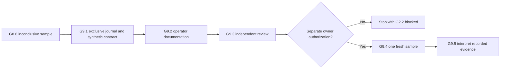

## GOALS 9 — Make profile-path diagnostic preflight failures observable

Grounded against commit `4438128` and the current uncommitted workspace on 2026-10-31. The authorized G8.5 invocation returned `FAIL` and named a report that was absent. Source review found two pre-transaction `FAIL` branches that do not persist a report or expose the phase. The actual branch remains unknown. This plan improves failure evidence; it does not explain the observed run or pass G2.2.

### Stage map

| Stage | Items | Depends on | Can run in parallel with |
| --- | --- | --- | --- |
| Exclusive journal and synthetic preflight contract | G9.1 | G8.6 | None |
| Operator output documentation | G9.2 | G9.1 | None |
| Independent review | G9.3 | G9.1–G9.2 | None |
| Authorized fresh sample | G9.4 | G9.3 and separate owner authorization | None |
| Sample interpretation | G9.5 | G9.4 | None |

<!-- item-contract: v1 -->

### Decisions

- Use one append-only JSONL journal for each profile-path diagnostic run.
- Name the journal `runtime/diagnostics/appcontainer-profile-path-<run-id>.jsonl`.
- Reserve the journal path with `FileMode.CreateNew` and `FileShare.None`.
- Keep the exclusive stream open until the diagnostic exits.
- Append one compact, newline-terminated JSON snapshot per journal update.
- Include the generated `run_id`, a strictly increasing `sequence`, and the diagnostic phase/state in each snapshot.
- Exclude `report_persisted`, `report_write_status`, and `last_persisted_sequence` from snapshot records because a record cannot confirm its own write.
- Keep those three fields in the sanitized stdout receipt and update them only after the snapshot and `Flush(true)` succeed.
- Never call generic `Write-SafeReport` for this per-run journal.
- Validate the trusted parent and lexical containment before `CreateNew`.
- Run that validation only before the first reservation; after reservation, append through the held stream without rechecking the path.
- Do not inspect leaf attributes or call leaf-inspecting path helpers before `CreateNew`.
- Never read, replace, or remove a target when `CreateNew` fails.
- Emit only allowlisted enums, booleans, sequence numbers, and a relative journal path on stdout.
- Set `report_path` to `null` unless this run reserved the journal path successfully.
- Set `report_persisted=true` only after the latest complete snapshot line and `Flush(true)` succeed.
- Reset `report_persisted=false` before each snapshot append; preserve the previous `last_persisted_sequence` after failure.
- Keep `profile_create_attempted` separate from the persisted pre-create intent phase.
- Mark `profile_create_attempted=true` immediately before invoking the profile-create callback.
- Treat a persisted `CREATE_ATTEMPTED` snapshot with a false flag as intent, not proof of the API call.
- Require separate owner authorization before every future profile-creating diagnostic invocation.
- Whitelist phases `PREPARING`, `FULL_TRUST_REQUIRED`, `PREPARATION_FAILED`, `REPORT_RESERVATION_FAILED`, `REPORT_WRITE_FAILED`, `CREATE_ATTEMPTED`, `CREATE_RESULT_UNKNOWN`, `CREATE_COLLISION`, `CREATE_FAILED`, `PROFILE_PATH_RESOLVED`, `PROFILE_PATH_FAILED`, `SID_CONVERSION_FAILED`, `DELETE_INTENT_PERSISTED`, `DELETE_INTENT_WRITE_FAILED`, `CLEANUP_NOT_ATTEMPTED`, `DELETE_RETURNED`, `DELETE_FAILED`, `OBSERVATIONS_COMPLETE`, `UNEXPECTED_FAILURE`, and `UNKNOWN`.
- Whitelist report-write states `NOT_ATTEMPTED`, `PASS`, `FAIL`, and `UNKNOWN`; map internal `PENDING` to `UNKNOWN` on stdout.

- [x] **G9.1 Add the exclusive journal and synthetic preflight results.**
  - Files: `bench/isolation/run-probes.ps1` (exists); `bench/isolation/probe-contract.test.mjs` (exists).
  - Anchor: `function Invoke-ProfilePathResolveDiagnosticMode {`; `if (-not $callerFullTrust) {`; `if (-not (Test-SafePathAbsent $diagnosticsRoot $diagnosticReportPath)) {`; `if ($ProfilePathResolveDiagnosticOnly) {`; `test('fresh-profile transaction safety contract uses synthetic callbacks in SelfTest', async () => {`.
  - Change: Add `Convert-ProfilePathDiagnosticSafeResult([string]$Status, [string]$Phase, [string]$ReportWriteStatus, [bool]$ReportWriteAttempted, [bool]$ReportPersisted, [int]$LastPersistedSequence, [bool]$ProfileCreateAttempted, [bool]$ReportPathReserved, [AllowNull()][string]$ReportRelativePath)`. Return only `status`, `phase`, `report_write_attempted`, `report_write_status`, `report_persisted`, `last_persisted_sequence`, `profile_create_attempted`, and `report_path`. Map values outside the documented allowlists to `UNKNOWN`. Map internal `PENDING` to `UNKNOWN` on stdout. Set `report_path=null` until this run reserves the generated path.
    Add `Write-ProfilePathDiagnosticJournalSnapshot([string]$Path, [string]$RunId)`. Validate the trusted parent and lexical containment once before the first `CreateNew`; do not inspect the leaf path. If validation fails before reservation, return `UNKNOWN/PREPARATION_FAILED`, attempted false, `NOT_ATTEMPTED`, persisted false, sequence zero, create false, and null path. Do not call `CreateNew`. After reservation, append through the held stream without rechecking the path. Open the first snapshot with `FileMode.CreateNew`, `FileAccess.Write`, and `FileShare.None`. Keep the stream open until the diagnostic exits. Append each compact JSON snapshot through that stream. Include `run_id`, `schema_version`, increasing `sequence`, and diagnostic phase/state in each record. Exclude `report_persisted`, `report_write_status`, and `last_persisted_sequence` from records; keep them in the stdout receipt because a record cannot confirm its own write. Append a newline and call `Flush(true)` for each snapshot. Update the receipt only after a complete newline-terminated snapshot and `Flush(true)` succeed. Do not use `Write-SafeReport` for this journal. Treat any failed reservation as `REPORT_RESERVATION_FAILED`; do not inspect the target. Treat any later append failure as `REPORT_WRITE_FAILED`. Return immediately after any append failure. Do not perform another report write, profile API call, observation, or delete after that failure. Remove the outer catch's report-write retry. Never retry a write or delete.
    Set `report_write_attempted=true` when `CreateNew` or an append starts. Set it false before any writer call. Set `report_persisted=false` before each snapshot. Set it true only after a complete newline-terminated snapshot and `Flush(true)` succeed. Advance `last_persisted_sequence` only after that success. Keep `report_path` relative and non-null after this run reserves the stream, even when a later append fails. Keep `report_path=null` when reservation fails.
    Return `FAIL/FULL_TRUST_REQUIRED` before writing with attempt false, `NOT_ATTEMPTED`, persisted false, sequence zero, create false, and null path. Return `UNKNOWN/PREPARATION_FAILED` with those same fields when setup or one-time journal path validation fails before `CreateNew`. Return `FAIL/REPORT_RESERVATION_FAILED` when `CreateNew` fails; set write attempted true, status `FAIL`, persisted false, sequence zero, create false, and null path. Return `UNKNOWN/REPORT_WRITE_FAILED` when an append fails; set attempted true, persisted false, preserve the previous sequence, and stop before the next operation.
    Set `profile_create_attempted=true` immediately before the create callback. Include that flag in persisted snapshots after the callback returns or throws. Keep the pre-create `CREATE_ATTEMPTED` snapshot's flag false; it records intent only. If execution stops after that snapshot, do not infer whether the API call started.
    Add synthetic SelfTest cases for `FULL_TRUST_REQUIRED`, `PREPARATION_FAILED` during setup and one-time path validation, reservation collision, successful reservation, initial append failure, later append failure, and transaction entry. A path-validation failure must attempt no reservation and return the pre-create safe result. Simulate a target already present when `CreateNew` runs. Include a synthetic target with matching generator metadata. Assert that collisions do not read, replace, or remove synthetic bytes and make zero create calls. Inject append failure after one complete snapshot. Assert that previous bytes and sequence remain unchanged, no second write occurs, and later callbacks do not run. Keep all synthetic state in memory. Bind every production preflight branch to the safe result builder. Keep profile APIs and real registry/filesystem operations outside the synthetic cases. Reject worker, process, listener, evaluator, and model calls in the synthetic cases. Do not add CLI injection or execute a live diagnostic.
  - Do not touch: AppContainer profile semantics, existing G8.1 cleanup rules, the full-probe report, worker, evaluator, G2.2 status, or benchmark fixtures.
  - Verify: Run `powershell.exe -NoProfile -NonInteractive -ExecutionPolicy Bypass -File .\bench\isolation\run-probes.ps1 -SelfTest`. Expect exit 0. Run `npm run test:isolation-probe`. Expect exit 0. Run `git check-ignore -q runtime/diagnostics/appcontainer-profile-path-example.jsonl`. Expect exit 0. Confirm synthetic cases create no profile, report file, registry value, listener, or worker.
  - Source: Local `Copy-SafeFile` and the G8.2 synthetic contract; [FileMode](https://learn.microsoft.com/en-us/dotnet/api/system.io.filemode?view=net-7.0), [FileShare](https://learn.microsoft.com/en-us/dotnet/api/system.io.fileshare), and [FileStream.Flush(Boolean)](https://learn.microsoft.com/en-us/dotnet/api/system.io.filestream.flush?view=net-8.0), accessed 2026-10-31. `CreateNew` fails if the target exists; `FileShare.None` blocks other opens while the handle remains open; `Flush(true)` flushes intermediate buffers.

- [x] **G9.2 Document the sanitized preflight result.**
  - Files: `bench/isolation/README.md` (exists).
  - Anchor: `The mode refuses an existing report path.`; `-ProfilePathResolveDiagnosticOnly`.
  - Change: Document that the per-run report is append-only JSONL and reserves its path with `CreateNew` and `FileShare.None`. Document the stdout fields `status`, `phase`, `report_write_attempted`, `report_write_status`, `report_persisted`, `last_persisted_sequence`, `profile_create_attempted`, and `report_path`. State that journal records contain diagnostic phase/state but exclude the three self-referential writer receipt fields. State that `report_path` is null before successful reservation, including a one-time path-validation failure, and remains non-null after reservation if a later append fails. State that path-validation failure returns attempted false, `NOT_ATTEMPTED`, and sequence zero. Explain that `report_persisted=false` means the latest attempted snapshot is unconfirmed and the diagnostic result is unknown. When it is true, require the receipt sequence to identify the latest complete journal record and its diagnostic phase/state to match. Explain that `CREATE_ATTEMPTED` records intent until a later snapshot confirms the API call. State that preflight failures do not call profile creation. Keep profile names, SIDs, absolute paths, exception text, and registry values out of stdout. Treat incomplete tails and inconsistent sequences as unknown.
  - Do not touch: The full-probe command, existing probe semantics, prior G7/G8 evidence, or G2.2 status.
  - Verify: Run `git diff --check -- bench/isolation/README.md`. Confirm each stdout field, JSONL behavior, exclusive reservation, and unknown-tail rule appear in the diagnostic section.
  - Source: Local diagnostic result contract in G9.1; no external facts are used.

- [x] **G9.3 Independently review the preflight result contract.**
  - Files: none (manual).
  - Verify: Require an independent review with no blockers. Confirm pre-reservation path-validation failure returns `PREPARATION_FAILED` with no write attempt, reservation, path, or profile creation. Confirm an exclusive `CreateNew` collision is never opened, read, replaced, or removed. Confirm later snapshots use the held stream and preserve earlier complete lines without revalidating its path. When `report_persisted=true`, confirm the receipt sequence identifies the latest complete record and its diagnostic phase/state matches. Confirm failed writes stop before the next consequential operation. Confirm early phases cannot call profile creation. Confirm synthetic tests use only in-memory operations. Do not run the diagnostic.

- [x] **G9.4 [MANUAL] Run one fresh-profile diagnostic after review.**
  - Files: none (manual).
  - Verify: Obtain separate owner authorization for exactly one invocation of `powershell.exe -NoProfile -NonInteractive -ExecutionPolicy Bypass -File .\bench\isolation\run-probes.ps1 -ProfilePathResolveDiagnosticOnly`. Record exit code and sanitized stdout. Read only the relative JSONL path returned for this run. Record its hash and all complete matching sequence records. Mark the final result unknown if the latest write failed, the final line is incomplete, or sequences are inconsistent. Do not retry or remove a residual profile manually. Do not run candidates, patches, task tests, oracles, evaluator cases, benchmarks, or a model.
  > Execution evidence: one owner-authorized invocation exited 1. Sanitized stdout was `{"status":"FAIL","phase":"FULL_TRUST_REQUIRED","report_write_attempted":false,"report_write_status":"NOT_ATTEMPTED","report_persisted":false,"last_persisted_sequence":0,"profile_create_attempted":false,"report_path":null}`. No JSONL path was reserved, so its hash and sequence records are unavailable. Do not infer broader profile state from this result. No retry occurred.

- [x] **G9.5 [MANUAL] Interpret the fresh-profile evidence.**
  - Files: none (manual).
  - Verify: Compare stdout with the last complete matching sequence only when `report_persisted=true` and sequence values match. Treat an incomplete tail or `CREATE_ATTEMPTED` with a false profile-create flag as unknown about the API call. Do not infer profile state from `report_path=null` or `NOT_ATTEMPTED`. Keep G2.2 blocked unless a later owner-approved isolation goal passes every required check. If evidence remains incomplete, prepare a separate root-cause plan. Do not run G6.13 without separate authorization.

  > Interpretation: the guard stopped the diagnostic before profile creation, and no journal was reserved. The cause of the guard and the broader profile state remain unknown. G2.2 and G6.13 remain open. GOALS 10 records the separate read-only root-cause diagnostic plan.

