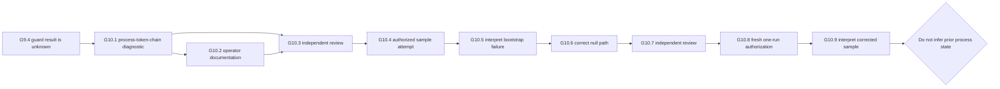

## GOALS 10 — Identify the caller-token boundary behind the full-trust guard

Grounded against commit `4438128` and the current uncommitted workspace on 2026-11-02. G9.4 stopped at `FULL_TRUST_REQUIRED` before reserving its journal or attempting profile creation. The receipt does not identify why the guard rejected its caller. This goal observes the current process-token chain without changing the guard or claiming that the result explains the earlier invocation.

### Stage map

| Stage | Items | Depends on | Can run in parallel with |
| --- | --- | --- | --- |
| Process-token-chain diagnostic | G10.1 | G9.5 | None |
| Operator documentation | G10.2 | G10.1 | None |
| Independent review | G10.3 | G10.1–G10.2 | None |
| Initial authorized sample attempt | G10.4 | G10.3 and the existing one-run authorization | None |
| Initial failure interpretation | G10.5 | G10.4 | None |
| Null-safe bootstrap correction | G10.6 | G10.5 | None |
| Independent correction review | G10.7 | G10.6 | None |
| Corrected authorized sample | G10.8 | G10.7 and fresh owner authorization | None |
| Corrected evidence interpretation | G10.9 | G10.8 | None |

<!-- item-contract: v1 -->

### Decisions

- Inspect the process token because the existing guard queries the process token.
- Inspect the current process and at most eight ancestors.
- Let Toolhelp create its operating-system snapshot of the current process list; this entry cap does not bound that allocation.
- Enumerate at most 4,097 snapshot entries and retain at most 4,096 process-ID and parent-ID pairs in application memory.
- Return `UNKNOWN` when the 4,097th entry proves that the retention cap was exceeded.
- Use process creation times to validate each observed parent link.
- Treat missing, reused, inaccessible, cyclic, duplicate, or inconsistent links as `UNKNOWN`.
- Set the overall status to `UNKNOWN` when a parent exists beyond depth eight.
- Use `COMPLETE` only when the chain reaches its root and every token observation succeeds without truncation.
- Use `UNKNOWN` for every incomplete chain or failed token observation.
- Use link statuses `ROOT`, `VERIFIED`, `TRUNCATED`, and `UNKNOWN`.
- Use stages `PROCESS_SNAPSHOT`, `PROCESS_ENUMERATION`, `ANCESTRY_LINK`, `PROCESS_OPEN`, `PROCESS_TIME`, `TOKEN_OPEN`, `TOKEN_APPCONTAINER`, `TOKEN_SID`, `PACKAGE_IDENTITY`, and `COMPLETE`.
- Emit exactly `schema_version`, `status`, `stage`, `truncated`, and `processes` fields.
- Emit at most nine process rows with `depth`, `link_status`, `token_is_appcontainer`, `appcontainer_sid_presence`, and `package_identity` fields.
- Encode `token_is_appcontainer` as `TRUE`, `FALSE`, or `UNKNOWN`.
- Return only fixed enums, booleans, depth values, and a truncation flag.
- Do not create profiles, inspect the registry, elevate, start workers, or open listeners.
- The existing authorization was consumed by the failed G10.4 invocation. Do not repeat it. A corrected diagnostic requires fresh, separate owner authorization; G10.8 used one new authorization.
- Keep G2.2 and G6.13 open unless their own acceptance checks pass.

- [x] **G10.1 Add the bounded process-token-chain diagnostic.**
  - Owner: `coder`.
  - Files: `bench/isolation/AppContainerLauncher.cs` (exists); `bench/isolation/run-probes.ps1` (exists); `bench/isolation/probe-contract.test.mjs` (exists).
  - Anchor: `public static bool IsCurrentProcessFullTrust()`; `[switch]$ProfilePathResolveDiagnosticOnly,`; `if ($ProfilePathResolveDiagnosticOnly) {`; `test('read-only profile diagnostic is bounded, sanitized, and precedes probe effects', async () => {`.
  - Change: Add a mutually exclusive `-ProcessTokenChainDiagnosticOnly` switch. Dispatch this mode before full-trust, profile, registry, and normal probe effects. Let Toolhelp create its operating-system snapshot of the current process list; this allocation is not bounded by the application entry cap. Enumerate at most 4,097 entries and retain at most 4,096 process-ID and parent-ID pairs in application memory. Return `UNKNOWN` if enumeration fails, an ID is duplicate, or a 4,097th entry proves overflow. Inspect the current process and at most eight ancestors. Open each inspected process with `PROCESS_QUERY_LIMITED_INFORMATION`. Read process creation times with `GetProcessTimes`. Open each process token with `TOKEN_QUERY` only. Verify each parent link against the snapshot and require the parent's creation time to precede the child's. Return `UNKNOWN` for missing, inaccessible, cyclic, reused, or inconsistent links. Read `TokenIsAppContainer`. When it is true, query only whether `TokenAppContainerSid` is present. Query `GetPackageFamilyName` with a null output buffer and zero length. Map `ERROR_INSUFFICIENT_BUFFER` to `PRESENT` and `APPMODEL_ERROR_NO_PACKAGE` to `NO_PACKAGE`. Map all other returns to `UNKNOWN`. Never retrieve or emit an SID or package family name. Emit `schema_version=1`, `status`, `stage`, `truncated`, and `processes` fields. Use the exact status, stage, and row enums listed in Decisions. Include at most nine rows with only `depth`, `link_status`, `token_is_appcontainer`, `appcontainer_sid_presence`, and `package_identity`. Exclude process IDs, names, paths, command lines, SIDs, package names, handles, raw errors, and exception text from all output. Add in-memory `-SelfTest` cases for valid ancestry, missing and duplicate links, cycles, creation-time mismatches, PID reuse, the ancestor cap, query failures, and output redaction. Make no explicit writes to repository, profile, registry, report, or canary paths; do not claim zero filesystem activity. State that `Add-Type` uses an in-memory assembly by default when `-OutputAssembly` is omitted, while transient compiler temp-file behavior is outside this explicit-write contract. Ensure synthetic tests call no live process enumeration, token APIs, profile APIs, registry, workers, listeners, model, or elevation.
  - Do not touch: The full-probe and profile-diagnostic behavior, evaluator, benchmark fixtures, report formats, or G2.2 status. Do not run the live diagnostic in this item.
  - Verify: Run `powershell.exe -NoProfile -NonInteractive -ExecutionPolicy Bypass -File .\bench\isolation\run-probes.ps1 -SelfTest`. Expect exit 0. Run `npm run test:isolation-probe`. Expect exit 0. Run `npm run verify`. Expect exit 0. Confirm the synthetic tests make no explicit writes to repository, profile, registry, report, or canary paths and start no worker, listener, model, or elevated process.
  - Evidence: `-SelfTest` PASS; `npm run test:isolation-probe` PASS (20/20); `npm run verify` exit 0 (174 passed, 3 skipped, 68 existing lint warnings); `git diff --check` PASS. The live diagnostic was not run.
  - Clarification: The no-write evidence is limited to explicit writes to the paths above; transient Add-Type compiler temp-file behavior was not measured and is outside this contract.
  - Source: [GetTokenInformation](https://learn.microsoft.com/en-us/windows/win32/api/securitybaseapi/nf-securitybaseapi-gettokeninformation), [CreateToolhelp32Snapshot](https://learn.microsoft.com/en-us/windows/win32/api/tlhelp32/nf-tlhelp32-createtoolhelp32snapshot), [GetProcessTimes](https://learn.microsoft.com/en-us/windows/win32/api/processthreadsapi/nf-processthreadsapi-getprocesstimes), [OpenProcess](https://learn.microsoft.com/en-us/windows/win32/api/processthreadsapi/nf-processthreadsapi-openprocess), [GetPackageFamilyName](https://learn.microsoft.com/en-us/windows/win32/api/appmodel/nf-appmodel-getpackagefamilyname), and [Add-Type for PowerShell 5.1](https://learn.microsoft.com/en-us/powershell/module/microsoft.powershell.utility/add-type?view=powershell-5.1), accessed 2026-11-02. These APIs expose process/token metadata and package-identity status; the diagnostic must suppress identifiers.

- [x] **G10.2 Document the process-token-chain diagnostic.**
  - Owner: `coder`.
  - Files: `bench/isolation/README.md` (exists).
  - Anchor: `### Fresh-profile path-resolution diagnostic`.
  - Change: Add a `### Process-token chain diagnostic` section after the fresh-profile diagnostic. Document the exact command `powershell.exe -NoProfile -NonInteractive -ExecutionPolicy Bypass -File .\bench\isolation\run-probes.ps1 -ProcessTokenChainDiagnosticOnly`. List the sanitized output fields. State that Toolhelp creates an operating-system process snapshot whose allocation is not bounded by the application cap. State that the code enumerates at most 4,097 entries and retains at most 4,096 pairs. Explain the eight-ancestor limit, process-creation-time check, and `UNKNOWN` classifications. State that the diagnostic reads process tokens only and does not establish thread impersonation or general full trust. State that one current sample cannot establish the ancestry or token state of an earlier run. State that it makes no explicit writes to repository, profile, registry, report, or canary paths, without claiming zero filesystem activity. Explain that PowerShell 5.1 `Add-Type` uses an in-memory assembly by default when `-OutputAssembly` is omitted, and that transient compiler temp-file behavior is outside this explicit-write contract. List profile, registry, elevation, worker, listener, model, and repository-write operations as excluded.
  - Do not touch: Any diagnostic code, profile behavior, G2.2 status, or benchmark behavior.
  - Verify: Run `git diff --check -- bench/isolation/README.md`. Confirm the exact command, schema, bounds, limits, and interpretation caveats appear in the new section.
  - Evidence: Exact command, schema, limits, `UNKNOWN` cases, scope caveats, and the Add-Type temporary-file limitation are documented; section ordering checked; `git diff --check -- bench/isolation/README.md` PASS. Temporary compiler file behavior was not measured.
  - Source: G10.1 contract and [Microsoft Add-Type for PowerShell 5.1](https://learn.microsoft.com/en-us/powershell/module/microsoft.powershell.utility/add-type?view=powershell-5.1), accessed 2026-11-02, plus the Microsoft API documentation cited there.

- [x] **G10.3 Independently review the process-token-chain diagnostic.**
  - Owner: `reviewer`.
  - Files: none (manual).
  - Verify: Require an independent reviewer to report no blockers. Confirm process ancestry validation, both bounds, output redaction, synthetic-test isolation, no explicit writes to repository, profile, registry, report, or canary paths, and no worker, listener, model, or elevation effects. Do not infer zero filesystem activity or absence of transient compiler files. Run `-SelfTest`, `npm run test:isolation-probe`, and `npm run verify`. Do not run the live diagnostic.
  - Evidence: Independent reviewer reports no blockers. `-SelfTest` PASS; `npm run test:isolation-probe` PASS (20/20); `npm run verify` exit 0 (174 passed, 3 skipped, 68 existing lint warnings); `git diff --check` PASS. Review found the Add-Type temp-file caveat accurately scoped. No live diagnostic was run.

- [x] **G10.4 [MANUAL] Attempt one authorized process-token-chain diagnostic.**
  - Files: none (manual).
  - Verify: After G10.1–G10.3 pass, use the existing owner authorization for exactly one invocation of `powershell.exe -NoProfile -NonInteractive -ExecutionPolicy Bypass -File .\bench\isolation\run-probes.ps1 -ProcessTokenChainDiagnosticOnly`. Record its exit code and sanitized stdout. Do not retry. Do not run candidates, patches, task tests, oracles, evaluator cases, benchmarks, or a model.
  - Evidence: The single invocation exited 1 before the diagnostic branch. PowerShell reported `Join-Path` could not bind `Path` because it was null at `bench/isolation/run-probes.ps1:66`. No process-token observation was produced. The one-run authorization is consumed; this command was not repeated.

- [x] **G10.5 [MANUAL] Interpret the pre-diagnostic failure.**
  - Files: none (manual).
  - Verify: Record that no process depth or token result was observed because initialization failed before the diagnostic branch. Do not infer the earlier G9.4 caller's identity or ancestry. Keep G2.2 and G6.13 blocked unless their separate acceptance checks pass. Add a code correction and review before requesting a new one-run authorization.
  - Evidence: The failing `Join-Path` is evaluated during script initialization before `-ProcessTokenChainDiagnosticOnly` dispatch. The token-chain API call and profile operations were not reached by G10.4, so that failed attempt supports no conclusion about either process token. G2.2 and G6.13 remain blocked.

- [x] **G10.6 Correct the null owner-profile canary path and add regression coverage.**
  - Owner: `coder`.
  - Files: `bench/isolation/run-probes.ps1` (exists); `bench/isolation/probe-contract.test.mjs` (exists).
  - Anchor: `$ownerProfileCanaryRoot = Join-Path $ownerProfileCanaryCollectionRoot`; `assert.match(source, /\$ownerProfileCanaryCollectionRoot = if \(\$ProcessTokenChainDiagnosticOnly\)/`.
  - Change: Make the owner-profile canary path derivation return `$null` when its optional parent is `$null`, and call `Join-Path` only for a non-null parent. Add a synthetic `-SelfTest` assertion for both null and ordinary parent paths, and strengthen the Node contract test so it detects an unconditional join. Keep the full-probe path unchanged. Do not run the live process-token-chain diagnostic.
  - Do not touch: Token APIs, profile creation/deletion, registry behavior, full-probe behavior, evaluator, benchmark fixtures, or G2.2 status.
  - Verify: Run `powershell.exe -NoProfile -NonInteractive -ExecutionPolicy Bypass -File .\bench\isolation\run-probes.ps1 -SelfTest` and `npm run test:isolation-probe`; expect exit 0. Run `npm run verify`; expect exit 0. Run `git diff --check` and the GOALS structure validator; expect no findings.
  - Evidence: `-SelfTest` PASS; `npm run test:isolation-probe` PASS (20/20); `npm run verify` exit 0 (174 passed, 3 skipped; existing lint warnings); `git diff --check` PASS; GOALS structure validator PASS. Synthetic self-test covers null and ordinary parent paths. No live diagnostic or profile operation was run.

- [x] **G10.7 Independently review the null-path correction.**
  - Owner: `reviewer`.
  - Files: `bench/isolation/run-probes.ps1` (exists); `bench/isolation/probe-contract.test.mjs` (exists).
  - Verify: Confirm the null-root case no longer calls `Join-Path`, the normal owner-profile path remains equivalent, synthetic coverage exercises both, and no live token/profile operation is triggered by the focused tests. Run `-SelfTest`, `npm run test:isolation-probe`, and `npm run verify`. Do not run the live diagnostic.
  - Evidence: Independent review reported no blockers. Null-root and normal-root behavior match the contract; `-SelfTest` PASS; `npm run test:isolation-probe` PASS (20/20); `npm run verify` exit 0; `git diff --check` PASS. No live diagnostic or profile operation was run.

- [x] **G10.8 [MANUAL] Run one corrected process-token-chain diagnostic.**
  - Files: none (manual).
  - Verify: Only after G10.6–G10.7 pass and the owner separately authorizes exactly one new invocation, run `powershell.exe -NoProfile -NonInteractive -ExecutionPolicy Bypass -File .\bench\isolation\run-probes.ps1 -ProcessTokenChainDiagnosticOnly`. Record the exit code and sanitized JSON. Do not retry. Do not run candidates, patches, task tests, oracles, evaluator cases, benchmarks, or a model. This gate creates no AppContainer profile by design, but the diagnostic does inspect the current process and ancestor process tokens.
  - Evidence: One newly authorized invocation exited 1 and returned `{"schema_version":1,"status":"UNKNOWN","stage":"ANCESTRY_LINK","truncated":false,"processes":[{"depth":0,"link_status":"VERIFIED","token_is_appcontainer":"TRUE","appcontainer_sid_presence":"PRESENT","package_identity":"NO_PACKAGE"},{"depth":1,"link_status":"UNKNOWN","token_is_appcontainer":"TRUE","appcontainer_sid_presence":"PRESENT","package_identity":"NO_PACKAGE"}]}`. No profile was created, and no retry occurred.

- [x] **G10.9 [MANUAL] Interpret the corrected diagnostic result.**
  - Files: none (manual).
  - Verify: Record each returned depth and sanitized result or fixed failure stage. Do not claim that the observed chain matches the earlier G9.4 caller unless evidence proves identity and ancestry. Keep G2.2 and G6.13 blocked unless their separate acceptance checks pass.
  - Evidence: For this invocation, depth 0 (the current PowerShell process) is AppContainer (`TRUE`) with SID present and no package-family identity; its link to depth 1 is verified. Depth 1 also has an AppContainer token, but its own ancestry link is `UNKNOWN`. The sanitized result does not identify which ancestry check failed; overall status remains `UNKNOWN` at `ANCESTRY_LINK`. The source's `IsCurrentProcessFullTrust()` returns false when `TokenIsAppContainer` is true, so a guard called in this same process would reject it; this does not prove G9.4 used the same process or explain its earlier result. G2.2 and G6.13 remain blocked.
