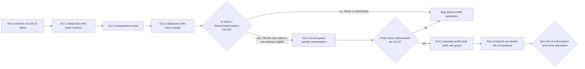

## GOALS 11 — Sample the PowerShell diagnostic child before retrying profile diagnostics

Grounded against commit `4438128` and the current uncommitted workspace on 2026-11-02. G8.5 did not produce a reliable report, G9.4 stopped at `FULL_TRUST_REQUIRED`, and G6.13 failed during profile creation or path resolution without an API HRESULT. G10.8 observed `TokenIsAppContainer=TRUE` for a Codex-launched PowerShell process, but it did not prove that G9.4 or G6.13 used the same process context. The existing full-trust predicate checks only the process token of the process running that diagnostic. This goal samples the noninteractive PowerShell child used by the token diagnostic; it makes no claim about the parent shell or earlier callers.

### Stage map

| Stage | Items | Depends on | Can run in parallel with |
| --- | --- | --- | --- |
| Diagnostic-child token instructions and G6.13 gate | G11.1 | Archived G10 and recorded G6.13 failure | None |
| Independent review | G11.2 | G11.1 | None |
| Diagnostic-child token sample | G11.3 | G11.2 | None |
| Diagnostic-child token interpretation | G11.4 | G11.3 | None |
| Fresh profile-path sample | G11.5 | G11.4 and a separate owner authorization | None |
| Sample interpretation and G6.13 disposition | G11.6 | G11.5 | None |

<!-- item-contract: v1 -->

### Decisions

- Launch the token sample as a noninteractive `powershell.exe` child from an ordinary interactive Windows PowerShell session opened outside Codex's managed shell. The diagnostic's depth 0 is the child process, not its interactive parent.
- Use only `processes[0].token_is_appcontainer` to classify the diagnostic child's process-token predicate because `IsCurrentProcessFullTrust()` queries the token of the process running the diagnostic. Do not assume parent/child token equivalence.
- Treat `FALSE` as passing only that predicate; it does not prove general full trust or describe earlier runs.
- Stop before profile APIs when depth 0 is `TRUE` or `UNKNOWN`.
- Preserve every uncertain existing profile. Do not inspect or remove it as part of this goal.
- Require fresh, separate authorization for the profile-path sample and for any later full isolation probe.
- Run G6.13 only after G11.6 records the profile-path result and owner disposition, G12.2 passes, and the owner gives fresh authorization. A failed attempt leaves G6.13 blocked pending a revised plan and fresh authorization.
- Do not infer that a clean new sample explains or repairs an earlier run.

- [x] **G11.1 Document the diagnostic-child token preflight and test the operator instructions.**
  - Owner: `coder`.
  - Files: `bench/isolation/README.md` (exists); `bench/isolation/probe-contract.test.mjs` (exists).
  - Anchor: `### Process-token chain diagnostic`; `### Fresh-profile path-resolution diagnostic`; `test('process-token-chain diagnostic is bounded, read-only, and redacts identifiers', async () => {`.
  - Change: Document how to run the token diagnostic from interactive Windows PowerShell outside Codex. State that depth 0 alone classifies the process running this diagnostic, not the interactive parent. State that `TRUE` or `UNKNOWN` blocks profile operations. Add a static contract test for these operator instructions. Preserve the G6.13 dependency on G11.6 and separate fresh authorization.
  - Do not touch: Token collection, the full-trust predicate, profile APIs, cleanup rules, worker launch, evaluator behavior, or G2.2 status.
  - Verify: Run `powershell.exe -NoProfile -NonInteractive -ExecutionPolicy Bypass -File .\bench\isolation\run-probes.ps1 -SelfTest`; expect exit 0. Run `npm run test:isolation-probe`; expect 0 failures. Run the GOALS validator and `git diff --check`; expect no findings.
  - Source: Local `GOALS.md`, `bench/isolation/run-probes.ps1`, `bench/isolation/AppContainerLauncher.cs`, `bench/isolation/README.md`, and `bench/isolation/probe-contract.test.mjs`; no external facts are used.
  - Evidence: README child-process contract is covered by the static test; `-SelfTest` PASS; `npm run test:isolation-probe` 21/21; GOALS validator and scoped diff-check PASS.

- [x] **G11.2 Independently review the diagnostic-child token instructions and G6.13 gate.**
  - Owner: `reviewer`.
  - Files: `bench/isolation/README.md` (exists); `bench/isolation/probe-contract.test.mjs` (exists); `GOALS.md` (exists).
  - Anchor: `### Process-token chain diagnostic`; `- [ ] **G6.13 [MANUAL] Run and review the full isolation probe.**`.
  - Verify: Confirm the instructions use depth 0 only, stop on `TRUE` or `UNKNOWN`, require separate authorization before profile creation, and keep G6.13 blocked until G11.6. Run `-SelfTest`, `npm run test:isolation-probe`, the GOALS validator, and `git diff --check`. Do not run a live diagnostic.
  - Source: Local G11.1 changes and the current launcher contract; no external facts are used.
  - Evidence: Independent reviewer found no blockers; `-SelfTest` PASS; isolation tests 21/21; GOALS validator and diff-check PASS; typecheck PASS; lint exit 0 with existing warnings; `npm test` 174 passed, 3 skipped.

- [x] **G11.3 [MANUAL] Collect one diagnostic-child token sample without profile effects.**
  - Files: none (manual).
  - Verify: Open an ordinary interactive Windows PowerShell 5.1 session outside the managed Codex shell and set the location to this repository. Run `powershell.exe -NoProfile -NonInteractive -ExecutionPolicy Bypass -File .\bench\isolation\run-probes.ps1 -ProcessTokenChainDiagnosticOnly` once. This starts a noninteractive child; `processes[0]` describes that diagnostic child, not the interactive parent. This is the same child-launch form intended for the separate G11.5 profile-path diagnostic, but the two invocations are separate processes; do not assume token equivalence. Return the exit code and sanitized JSON. Do not run a profile diagnostic or the full probe.
  - Evidence: The token-chain command returned exit code 1 with overall `UNKNOWN` at `ANCESTRY_LINK` due to the depth-2 link; the depth-0 `token_is_appcontainer` value was `FALSE`.

- [x] **G11.4 [MANUAL] Interpret only the diagnostic-child guard input.**
  - Files: none (manual).
  - Verify: Record only `processes[0].token_is_appcontainer` for the diagnostic child. Stop before profile operations when it is `TRUE`, `UNKNOWN`, or absent. A `FALSE` result makes a separately authorized G11.5 attempt eligible for consideration only; it does not prove the token of that later child and does not authorize it. G11.5 requires fresh owner authorization and its own guard. Do not require overall `status=COMPLETE` when depth 0 is known. Do not claim that this sample describes the interactive parent, G8.5, G9.4, or G6.13.
  - Evidence: Interpretation used only the known depth-0 `FALSE` value and did not infer the interactive parent's token or equivalence with the next child process.

- [x] **G11.5 [MANUAL] Run one separately authorized fresh profile-path diagnostic.**
  - Files: none (manual).
  - Verify: Require G11.4 depth 0 `FALSE` and fresh owner authorization. From the same ordinary external PowerShell terminal, run `powershell.exe -NoProfile -NonInteractive -ExecutionPolicy Bypass -File .\bench\isolation\run-probes.ps1 -ProfilePathResolveDiagnosticOnly` exactly once. This starts a separate child process whose own guard determines whether the profile diagnostic proceeds; the G11.3 sample does not prove that child's token. Record its exit code, sanitized JSON, report hash, path stage, API observations, registration result, and cleanup result. This command creates a nonce-scoped AppContainer profile and JSONL report. It may preserve the new profile if ownership or cleanup is uncertain. Do not touch any old profile. Do not retry or run task code, patches, task tests, oracles, evaluator, benchmark, or model.
  - Evidence: The read-only report review matched SHA256 `3C437F1327678AD375704CF213B6939DA68D957A09FDABF1F7DC575E2AAB9117`; report status was `COMPLETE` and observations were `OBSERVATIONS_COMPLETE`. Profile creation and API HRESULTs were 0, the API path was present, one unique stable case-only registry pair matched the API/candidate observation, deletion HRESULT was 0, the post-delete profile was absent, and cleanup was `PASS`. The diagnostic child exit code was 0.

- [x] **G11.6 [MANUAL] Interpret the new profile-path sample and decide G6.13 readiness.**
  - Files: none (manual).
  - Verify: Treat missing reports, incomplete writes, failed observations, or uncertain cleanup as `UNKNOWN`. A clean result proves only that this new profile resolved and cleaned up. Record an owner decision to keep G6.13 blocked or to consider one new G6.13 attempt. Require separate authorization for that full probe. Do not delete an uncertain profile or infer the cause of an earlier failure.
  - Evidence: The owner chose to consider one fresh G6.13 attempt and separately authorized exactly one. That attempt failed; G6.13 remains blocked pending the G12.2 review and any fresh authorization required for another attempt.
