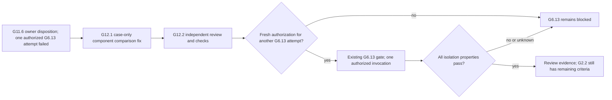

## GOALS 12 — Fix case-only profile package-root path comparisons before another G6.13 attempt

The latest authorized G6.13 invocation failed in `profile-run-stage-prepare` while validating the profile package-root path. G11.5 had already observed one stable, unique case-only registry identity pair and an API/candidate path match. G12 narrows the proposed correction to case-insensitive comparison of the expected path components; it preserves the existing nonce, canonicalization, reparse-point, and containment checks. G12 does not authorize or execute another profile or full probe.

### Stage map

| Stage | Items | Depends on | Can run in parallel with |
| --- | --- | --- | --- |
| Correct case-only component comparison | G12.1 | G11.6 and the sanitized failed G6.13 evidence | None |
| Independent review and required checks | G12.2 | G12.1 | None |
| Existing G6.13 gate | G6.13 | G11.6, G12.2, and fresh owner authorization | None |

<!-- item-contract: v1 -->

### Decisions

- Use ordinal case-insensitive comparison only for the expected path components in `Get-AppContainerProfilePackagesRoot`; preserve the current path shape and security checks.
- Keep nonce/profile-name validation strict. A casing difference may match the same expected component, but malformed names, additional components, canonicalization failures, reparse points, and paths outside the expected root remain rejected or unknown as before.
- Add deterministic synthetic coverage and a static regression contract. Do not create a live profile or run the full probe while implementing or reviewing G12.
- G12.2 passing does not authorize G6.13. A fresh owner authorization is still required for exactly one new invocation of the existing G6.13 gate.
- Keep G6.13 and G2.2 unchecked after any failed, incomplete, or unknown probe result.

- [x] **G12.1 Fix case-only package-root component comparisons with synthetic regression coverage.**
  - Owner: `coder`.
  - Files: `bench/isolation/run-probes.ps1` (exists); `bench/isolation/probe-contract.test.mjs` (exists).
  - Anchor: `Get-AppContainerProfilePackagesRoot`; `-SelfTest`; `test('profile packages-root components compare ordinal-ignore-case with strict path guards', async () => {`.
  - Change: Compare expected path components using ordinal-ignore-case semantics so a component differing only by letter casing matches. Add synthetic `-SelfTest` cases for exact-case and case-only matches plus wrong-component rejection. Add a static regression test that locks the comparison and confirms the existing strict nonce regex, canonicalization, suffix comparison, `Assert-NoReparsePath`, and `Assert-ChildPath` guards remain. Do not claim new dynamic tests for nonce, escape, or reparse rejection.
  - Do not touch: Profile creation/deletion, ACLs, bootstrap policy, worker/evaluator behavior, full-probe behavior, report contents, or G2.2 status. Do not create a live profile or run the live G6.13 probe.
  - Verify: Run `powershell.exe -NoProfile -NonInteractive -ExecutionPolicy Bypass -File .\bench\isolation\run-probes.ps1 -SelfTest`; expect PASS. Run `npm run test:isolation-probe`; expect zero failures. Run `git diff --check` on changed files.
  - Source: Sanitized G11.5/G6.13 evidence and local path-validation implementation; no external facts are used.
  - Evidence: `Get-AppContainerProfilePackagesRoot` compares expected names with ordinal-ignore-case; `-SelfTest` passed exact-case, case-only, and wrong-component cases; the static contract locks nonce, canonicalization, suffix, reparse, and child-containment guards. `-SelfTest` PASS; `npm run test:isolation-probe` 22/22; scoped diff-check PASS.

- [x] **G12.2 Independently review the path comparison correction and rerun required checks.**
  - Owner: `reviewer`.
  - Files: `bench/isolation/run-probes.ps1` (exists); `bench/isolation/probe-contract.test.mjs` (exists); `GOALS.md` (exists).
  - Anchor: `Get-AppContainerProfilePackagesRoot`; `### Isolation acceptance`.
  - Verify: Confirm ordinal-ignore-case is limited to expected component comparison; the static contract checks nonce shape validation, canonicalization, suffix comparison, reparse-point checks, and containment; synthetic tests cover exact-case and case-only matches plus wrong-component rejection. Run `-SelfTest`, `npm run test:isolation-probe`, `npm run verify`, the GOALS validator, and `git diff --check`. Do not create a profile or run a live diagnostic/full probe. Report blockers before considering another G6.13 authorization.
  - Source: G12.1 diff and the current path-validation contract; no external facts are used.
  - Evidence: Independent review found no blockers; `-SelfTest` PASS; isolation tests 22/22; `npm run verify` exit 0; GOALS validator and diff-check PASS. G6.13 and G2.2 remain unchecked; any retry requires new owner authorization.
