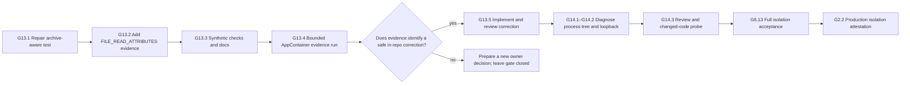

## GOALS 13 — Diagnose and repair AppContainer ancestor metadata access

Grounded against commit `4438128` and the current uncommitted workspace. The ancestor diagnostic report has SHA-256 `12bbd5a6482cad020af3d40c4bedccc9005ceffb3a63c20d837befeba3722819`. The staged `worker.mjs` and `probe-contract.mjs` passed individual `lstat` and bounded-read checks, but importing the ESM contract returned `EPERM` on `lstat` for `ancestor00`; direct checks denied `lstat` and `realpath` for ancestors `00`–`06` and passed for `07`–`10`. The AppContainer token and Job membership were verified, `SeChangeNotifyPrivilege` was present and enabled, and this run's stage/profile cleanup passed. The report did not test `FILE_READ_ATTRIBUTES` separately on the ancestor directories. The current `FILE_TRAVERSE` denials therefore do not identify the right missing by Node's `lstat`. This goal collects that evidence and permits only a repository-local correction supported by it.

### Stage map

| Stage | Items | Depends on | Can run in parallel with |
| --- | --- | --- | --- |
| Repair stale archived-goal contract lookup | G13.1 | None | None |
| Add sanitized ancestor metadata access evidence | G13.2–G13.3 | G13.1 | None |
| Collect rights evidence and implement a supported correction | G13.4–G13.5 | G13.2–G13.3 | None |
| Diagnose process-tree timeout and verify loopback harness | G14.1–G14.2 | G13.5 | None |
| Reviewed full-probe rerun | G14.3 | G14.1–G14.2 | None |
| Full isolation acceptance | G6.13 | G13.1–G13.5, G14.1–G14.3 | None |

<!-- item-contract: v1 -->

### Decisions

- Keep G2.2 closed. A diagnostic-only result is not an isolation attestation and does not authorize candidate code, patches, task tests, or model inference.
- Do not grant ACLs on ancestor directories, change their existing DACLs, bypass ESM/path checks, or weaken reparse-point and containment checks in this goal. If the evidence indicates that such a change is needed, stop and prepare a separate owner decision with its exact rights, paths, and cleanup behavior.
- Preserve the current path-label redaction. Rights evidence may contain only fixed ancestor labels, `ALLOW`/`DENY`/`UNKNOWN`, and numeric error codes or null; never emit full paths, profile IDs, or SIDs.
- The user's current authorization covers up to 10,000 executions of the named diagnostic sequence as an upper limit. It is not a target: do not retry an unchanged failure blindly, and stop if cleanup becomes uncertain or the needed action falls outside the stated scope.
- The latest full probe did not execute candidate code, patches, task tests, oracle code, evaluator cases, or a model. Preserve that boundary throughout this goal.

- [x] **G13.1 Make the process-token guidance contract test archive-aware.**
  - Files: `bench/isolation/probe-contract.test.mjs` (exists); `dev/goals-archive/goals-11-sample-the-powershell-diagnostic-child-before-retrying-profile-diagnostics.md` (exists).
  - Anchor: `test('process-token guidance scopes diagnostic-child invocation and profile blocking', async () => {`.
  - Change: Make the test read the archived G11.3–G11.5 items from the existing G11 archive file, where those items now live, while preserving its current ordering, wording, and documentation assertions. Do not change or recreate archived GOALS content.
  - Do not touch: The archived G11 plan, current G6.13 evidence, source code, AppContainer profiles, ACLs, or G2.2 status.
  - Verify: `npm run test:isolation-probe` passes the process-token guidance test and all other probe-contract tests; `node ~/.claude/base_project/scripts/validate-goals-structure.js GOALS.md` passes.

- [x] **G13.2 Report `FILE_READ_ATTRIBUTES` access separately for each directory ancestor.**
  - Files: `bench/isolation/AppContainerLauncher.cs` (exists); `bench/isolation/run-probes.ps1` (exists); `bench/isolation/probe-contract.test.mjs` (exists); `bench/isolation/README.md` (exists).
  - Anchor: `public static string GetAccessCheckDecision(bool querySucceeded, bool accessGranted)` and `test('diagnostic records allowlisted filesystem operations and App SID DACL inventory before startup', async () => {`.
  - Change: Extend the suspended AppContainer-token diagnostic to query `FILE_READ_ATTRIBUTES` on the same labeled directory ancestors already used for `FILE_TRAVERSE`. Keep the rights separate in the report. Preserve `UNKNOWN` on failed/unsupported checks and return only allowlisted labels/statuses/error codes. Do not treat a DACL ACE inventory or the `FILE_TRAVERSE` result as proof of `FILE_READ_ATTRIBUTES` access.
  - Do not touch: Any ACL, profile, registry, user file, canary, listener, worker protocol, task code, or G2.2 decision.
  - Verify: The synthetic tests cover `ALLOW`, `DENY`, and `UNKNOWN`, missing/duplicate labels, and output redaction. `-SelfTest` and `npm run test:isolation-probe` pass without creating a profile or launching a worker.

- [x] **G13.3 Document the access-check limits and diagnostic fields.**
  - Files: `bench/isolation/README.md` (exists); `bench/isolation/probe-contract.test.mjs` (exists).
  - Anchor: `While the AppContainer process remains suspended`.
  - Change: Explain that `FILE_TRAVERSE` and `FILE_READ_ATTRIBUTES` are distinct reported checks, that `SeChangeNotifyPrivilege` was enabled in the last report, and that actual Node `lstat`/`realpath` observations remain the behavioral evidence. Document the new fixed labels and fail-closed status without disclosing paths.
  - Do not touch: Any user profile, ACL, prior report, archived evidence, or G2.2 gate.
  - Verify: The documentation contract checks pass; `npm run test:isolation-probe` and GOALS structure validation pass.

- [x] **G13.4 Collect the ancestor-rights evidence with the authorized full probe.**
  - Files: none (manual/live diagnostic).
  - Anchor: `npm run isolation:appcontainer:probe`.
  - Change: Run the named command from ordinary host PowerShell only after G13.1–G13.3 pass. Use the user's current authorization only for this diagnostic sequence, up to its stated 10,000-attempt ceiling; stop earlier on uncertain cleanup or an out-of-scope failure. Review and hash the resulting ignored report. This creates a fresh AppContainer profile/Job, staging under its `AC\Temp`, synthetic canaries, and a loopback-only listener; cleanup must be verified. It does not execute candidate code, patches, task tests, oracles, evaluator cases, or a model.
  - Do not touch: Any older preserved profile; do not run a repeat with unchanged code after a failure.
  - Verify: The report includes complete sanitized `FILE_READ_ATTRIBUTES` and `FILE_TRAVERSE` results for expected ancestor labels, actual Node import/ancestor observations, and successful cleanup. Keep G6.13 and G2.2 open regardless of this diagnostic's outcome.
  - Evidence: report SHA-256 `622c5ae02e594a5ebc3dd7d3e63b21ffe074e3ef84a86b473a0ee72a5b51bea5`; both rights are `DENY` for `volume_root` and `ancestor_001`–`ancestor_006`, then `ALLOW` from `ancestor_007` through `toolsRoot`. Node `lstat`/`realpath` are denied for `ancestor00`–`ancestor06` and pass for `ancestor07`–`ancestor10`; ESM import fails with `EPERM`/`lstat` at `ancestor00`. Worker token/Job membership and profile/staging cleanup passed. The full probe remains `BLOCKED`; worker-dependent isolation checks remain `UNKNOWN`.

- [x] **G13.5 Implement only a root-cause-supported repository-local correction.**
  - Files: `bench/isolation/AppContainerLauncher.cs` (exists); `bench/isolation/run-probes.ps1` (exists); `bench/isolation/run-worker.ps1` (exists); `bench/isolation/module-hook.mjs` (exists); `bench/isolation/worker.mjs` (exists); `bench/isolation/production-worker.mjs` (exists); `bench/isolation/probe-contract.mjs` (exists); `bench/isolation/protocol.mjs` (exists); `bench/isolation/task-operations.mjs` (exists); `bench/isolation/probe-contract.test.mjs` (exists); `bench/isolation/worker-bridge.test.mjs` (exists); `bench/isolation/README.md` (exists). Edit only the subset supported by G13.4 evidence.
  - Anchor: `AppContainerLauncher.RunNode`, `import { classifyAccessError`, and `async function resolveCandidateModule`.
  - Change: Start diagnostic and production workers through a fixed `node --input-type=module -e` bootstrap, not a local `.mjs` main-file or local `--import` path; Node resolves those files before their code can register hooks. The inline bootstrap may import only Node built-ins, read the preflight-hash-verified `module-hook.mjs` bytes directly from the staged tools root, import those bytes from a `data:` URL, and call the exported `startModuleWorker` with the validated mode and roots. Register synchronous `node:module.registerHooks()` before resolving any local file module. The resolver may pass Node built-ins to the default resolver; every file module must resolve to an allowlisted staged module or a relative `.mjs` descendant of the host-validated workspace. The load hook must verify the trusted root and each descendant with `lstat`, reject reparse points and paths outside the root, read source directly, and return it with `shortCircuit`; never call the default file resolver for these modules. Reject unknown bare, absolute, UNC, device, and out-of-root imports. Fail closed when `registerHooks` is unavailable. Node v24.18.0 exposes this API as Release Candidate; keep AppContainer + Job Object as the security boundary and verify the actual staged Node runtime. Make the diagnostic worker use this hook so the authorized post-fix probe exercises the same loading mechanism. In production, stage Node and fixed modules in the per-run AppContainer profile's `AC\\Temp`; use the existing host full-trust no-reparse walk, make the candidate workspace read-only to the worker, and keep worker-side lexical containment plus descendant reparse checks. Remove `realpath()` checks that walk ancestors above the validated workspace root; do not weaken registered module, file-type, or root containment checks.
  - Do not touch: Ancestor ACLs, previous profiles, host/oracle files, task fixtures, candidate code, benchmark results, or G2.2 status. Do not execute model-generated patches, task tests, oracles, evaluator cases, or inference.
  - Resume: Preserve the existing uncommitted G13.5 implementation and review its current diff before further edits. The host process-tree test now owns descendants through a private Job Object and terminates them with `TerminateJobObject`; it does not use `taskkill.exe` or PID-based termination. Its cleanup requires the root to exit, the Job to drain, and both known PIDs to be absent afterward. Production keeps its existing Job process limit of 8; the host-test Job limit is 4 to account for the two fixed Node processes and their two console-host processes. Stop if Job ownership, drainage, or post-drain absence is uncertain.
  - Verify: Local tests must exercise the exact `node --input-type=module -e` bootstrap with a synthetic hook module and prove it registers hooks before any local file resolution; cover fixed module imports, relative dependency graphs (including I04/I05), rejected bare/out-of-root/reparse paths, fail-closed hook availability, and command-line quoting. A separate bounded host-local test must execute the exact fixed built-in-only `node -e` child/grandchild scripts and arguments used by the probe, verify both readiness responses and valid PIDs, and guarantee process-tree cleanup. This test covers only these fixed descendants; it does not prove hook loading in descendants or behavior of arbitrary candidate subprocesses. Keep the default process-tree timeout at 10,000 ms (the existing parameter cap), the worker's startup/readiness wait at 8,000 ms, and require both readiness acknowledgments, valid PIDs, a drained Job, and post-drain PID absence before live probe acceptance. Report only allowlisted stage/status/code fields; unknown PIDs have null absence values. Keep the existing direct ESM import diagnostic as a negative control; its expected `EPERM/lstat` result alone is not acceptance or a gate failure. `-SelfTest`, `npm run test:isolation-worker`, `npm run test:isolation-probe`, GOALS validation, `git diff --check`, and `npm run verify` must pass. Then run the already-authorized `npm run isolation:appcontainer:probe` from ordinary host PowerShell and review/hash its report and cleanup. Require a valid response from the hooked filesystem worker. Keep G6.13/G2.2 open until their separate full acceptance and production integration gates pass. See the [Node v24.18 module hooks documentation](https://nodejs.org/download/release/v24.18.0/docs/api/module.html#module-registerhooksoptions).
  - Local execution evidence (2026-11-05): `npm run verify` exited 0; GOALS validation, `run-probes.ps1 -SelfTest`, `run-worker.ps1` PowerShell parsing, and scoped whitespace checks passed. Lint emitted warnings. Local Node hook integration passed. Independent review found no blockers; it confirmed the bootstrap imports built-ins first, loads bounded hash-verified hook bytes from a `data:` URL, and registers hooks before local module resolution. Child/grandchild relaunch propagation was verified by code inspection and contract checks, not under AppContainer.
  - Local process-tree verification (2026-11-06): the fixed host test observed exactly two `NODE` and two `CONSOLE_HOST` Job members, with no shell, other, or unknown members. Both readiness messages and distinct root/grandchild PIDs were verified; cleanup terminated the private Job, confirmed it drained, and confirmed both PIDs absent on normal and timeout paths. The limit of 4 applies only to this host test; production remains at 8. `npm run test:isolation-worker` passed 31/31, `npm run test:isolation-probe` passed 25/25, `-SelfTest`, PowerShell parsing, GOALS validation, scoped `git diff --check`, and `npm run verify` passed (lint reported 68 warnings; host symlink/junction tests were skipped). Independent review found no safety blocker. No live AppContainer probe ran after this change; G13.5, G6.13, and G2.2 remain open.
  - Pre-fix live evidence (report SHA-256 `e48f7875c83ab402d326c5fc16fee6518460526b2392c4f9cb79588156a75202`): status `BLOCKED`, phase `filesystem-probe`, PowerShell line 2632, HRESULT `0x80131501`. The worker token and Job membership verified, but the worker exited 1 with zero stdout, `EPERM`/`lstat` stderr, unknown target, no timeout, and a drained Job. The separate default-loader ESM negative control was denied at `ancestor00`; staged module `lstat`/read passed, and the descriptor probe denied ancestors 00–06 while allowing 07 and later. The report's launcher and worker hashes do not match the current files, so this run predates the inline-bootstrap correction and does not validate it. Profile registration/deletion, profile path absence, staging/temp and all four canary cleanup checks passed; the listener was not created. No candidate, patch, task test, oracle, evaluator, or model ran. Keep G13.5, G6.13, and G2.2 open.
  - Live evidence before the process-tree timeout adjustment (report SHA-256 `eb54cb2cb2c9eaf4273cb37356fc09f1269a12ad0f6ab5f30f711906d2dc26a4`): status `FAIL`; hooked filesystem, workspace, containment, canary denial, oracle denial, token, Job membership, and cleanup checks passed. Process-tree duration was 1,816 ms against the 1,800 ms cap, with no readiness response or valid child/grandchild PIDs; the report's false PID-absence values were unverified. The network worker returned `ETIMEDOUT`, so network denial remains `UNKNOWN`; the loopback listener accepted no connection. This evidence supports a too-short timeout hypothesis but does not prove it. No candidate, patch, task test, oracle, evaluator, or model ran. This run predates the 10,000 ms timeout and stage diagnostics; G13.5, G6.13, and G2.2 remain open.
  - Local follow-up evidence (2026-11-05): the exact data-URL bootstrap launched a synthetic child and grandchild and observed both exit successfully in 245 ms on the local host; timeout cleanup tracks and terminates reported synthetic process IDs. `npm run verify` exited 0, including 30/30 worker tests and 25/25 probe-contract tests; GOALS validation, `run-probes.ps1 -SelfTest`, `run-worker.ps1` PowerShell parsing, and scoped `git diff --check` passed. Lint emitted warnings. The process-tree AppContainer behavior remains unverified; G13.5, G6.13, and G2.2 stay open.
  - Latest live evidence before phase markers (report SHA-256 `80adcd6ec19b05fdc5345741aec13655833ca657a0b48b2098ec50c8ed8426ff`): status `FAIL`; the process-tree probe timed out after 10,019 ms against its 10,000 ms Job limit, the Job drained, and the response schema and all stage/spawn/readiness fields were `UNKNOWN`, with no valid child or grandchild PIDs. The report's false PID-absence values were not verified. Network remained `UNKNOWN` after `ETIMEDOUT`; the loopback listener accepted no connection. Cleanup passed. A synchronous `spawn()` call blocking before its return/event markers is a plausible cause, but this report does not prove it. The new fixed markers distinguish request dispatch, `spawn()` entry/return/event, readiness, and response boundaries; local synthetic-bootstrap tests do not establish AppContainer behavior. No candidate, patch, task test, oracle, evaluator, or model ran. Keep G13.5, G6.13, and G2.2 open.
  - Local parser-fix verification (2026-11-05): `npm run verify`, `-SelfTest`, PowerShell parsing, GOALS validation, and scoped whitespace checks passed; lint reported 68 warnings. No live probe ran. G13.5, G6.13, and G2.2 remain open.
  - Latest live evidence before Job deadline accounting (report SHA-256 `0e06664a290ba28098b41dbeb011ef577ab86176d7e48bed35b2de88ec4531c8`): process-tree phase markers ended at `CHILD_SPAWN_CALL_BEGIN`; elapsed time was 10,015 ms against the 10,000 ms timeout, the Job drained, and cleanup passed. Network remained `UNKNOWN`. The report does not prove that the synchronous `spawn()` call blocked. Deadline Job accounting is sampled before the timeout decision and any required termination; on this failing timeout path, the query is immediately before `TerminateJobObject`. A count above one means multiple processes were active in the Job at that sample, but does not identify their roles or establish readiness; a count of one does not rule out a transient child that exited before the sample; zero is a valid sample; and a query failure records a null count plus numeric error code, with no count inference. No live probe was run for this change; G13.5, G6.13, and G2.2 remain open.
  - Local deadline telemetry verification (2026-11-05): `run-probes.ps1 -SelfTest`, PowerShell parsing, `npm run test:isolation-probe` (25/25), GOALS validation, and scoped `git diff --check` passed. No live probe ran. G13.5, G6.13, and G2.2 remain open.
  - Latest live process-tree evidence (report SHA-256 `7dd9a706d63b21cb306473d0798d36632b97e3d55c4a87bf810dbb98a5af5f65`): the Job deadline sample reported two active processes. This establishes that multiple processes were in the Job at that sample, but does not identify their roles, prove either readiness response, or by itself prove timeout termination and post-drain absence. The fixed descendant scripts below are a diagnostic repair, not acceptance evidence. Network denial and full process-tree acceptance remain unresolved; G13.5, G6.13, and G2.2 stay open.
  - Process-tree descendant correction (2026-11-05): the hooked root now launches fixed built-in-only `node -e` child/grandchild scripts with bounded readiness messages. A local host test exercises the exact fixed arguments and test roles with guaranteed cleanup. It does not prove descendant hook loading or arbitrary candidate subprocess behavior. No new live probe ran for this correction; G13.5, G6.13, and G2.2 remain open pending local verification and full host evidence.
  - Resume baseline (2026-11-05): `npm run verify` exited 0 after the descendant change. Worker tests passed 31/31 and probe tests passed 25/25. The main suite skipped three host link tests. Snapshot tests skipped four host link tests. Lint reported 68 warnings. This result does not prove that PID-based cleanup is safe. No live probe ran after the descendant change.

  - Post-fix live evidence (report SHA-256 `f8ce7f806ab7e5082c1b1fa3b35a6e26acb0237783f90eef6d533590455ecef4`): the hooked filesystem worker returned a valid response; workspace read/write, containment, four canary denials, oracle inaccessibility, token/Job checks, and profile/staging/canary/listener cleanup passed. `staged_file_runtime_diagnostic.import` returned `EPERM/lstat` at `ancestor00`; this is the direct default-loader negative control and is expected, not the hooked worker's result. The process-tree probe timed out after 10,021 ms; markers stopped at `CHILD_SPAWN_CALL_BEGIN`. The deadline count was two active Job processes, but their identities were not captured. Network returned `ETIMEDOUT` and the listener accepted no connection, so network denial remains `UNKNOWN`. The report confirms profile and temporary cleanup; no candidate, patch, task test, oracle, evaluator, or model ran. G13.5 is complete; G6.13 and G2.2 remain open pending G14 and the separate G2.2 integration gate.
