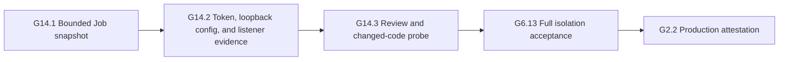

## GOALS 14 — Diagnose the process-tree timeout and loopback network result

Grounded in the authorized full-probe report `f8ce7f806ab7e5082c1b1fa3b35a6e26acb0237783f90eef6d533590455ecef4`. The hooked filesystem worker passed. The process-tree worker timed out at 10,021 ms after emitting `CHILD_SPAWN_CALL_BEGIN`; its code emits `CHILD_SPAWN_CALL_RETURN` only after synchronous `spawn()` returns. The deadline sample counted two active Job members but did not identify them, so it cannot prove that either child became ready or identify the blocking Windows operation. The loopback worker returned `ETIMEDOUT`; the host listener accepted no connection. That result is inconclusive, not proof of policy denial. Profile, staging, canary, and listener cleanup passed. This goal adds bounded, sanitized evidence before a changed-code probe rerun.

### Stage map

| Stage | Items | Depends on | Can run in parallel with |
| --- | --- | --- | --- |
| Capture bounded Job-member evidence on process-tree timeout | G14.1 | None | None |
| Verify the worker token, loopback-exemption configuration, and listener control | G14.2 | G14.1 | None |
| Run local checks, independent review, and one changed-code probe | G14.3 | G14.1–G14.2 | None |

<!-- item-contract: v1 -->

### Decisions

- Keep G6.13 and G2.2 closed until their full acceptance requirements pass.
- On process-tree timeout, report only allowlisted counts, categories, statuses, and numeric error codes. Never serialize PIDs, process names, executable paths, profile IDs, or SIDs. A missing, changing, duplicate, unopenable, or unverifiable Job member makes the snapshot `UNKNOWN`; do not infer a process identity from the active-process count.
- Bind process metadata to opened handles: verify each handle's PID, `IsProcessInJob`, and a stable bounded Job PID set before and after classification. Do not use PID-only termination or alter production Job limits.
- Query the launched worker's actual AppContainer primary token with `GetTokenInformation(TokenCapabilities)` and bind the result to this run's expected AppContainer SID. Treat the capability count as descriptive token evidence only; it does not establish effective network access or denial. Keep all token SIDs in memory and out of reports.
- Read `NetworkIsolationGetAppContainerConfig` and compare only this run's AppContainer SID against the returned loopback-exemption list. Report `PRESENT`, `ABSENT`, or `UNKNOWN`; this debugging configuration is not the complete network policy and cannot classify `network_denied` or close G6.13.
- Verify the loopback listener with a bounded full-trust host control connection before attempting the AppContainer request. If the control connection is not accepted and closed, skip the worker attempt and record `UNKNOWN`.
- Keep policy evidence separate from transport evidence. Preserve `ETIMEDOUT`, socket timeouts, incomplete queries, and no accepted AppContainer connection as `UNKNOWN`; do not reinterpret them as proof of network denial. Only explicit allowlisted access-denied results establish `DENIED`; an accepted AppContainer connection establishes `FAIL`.
- Keep the existing scope: read-only token/config inspection only; no firewall, ACL, capability, or loopback-configuration changes; no external network; and no candidate, patch, task test, oracle, evaluator, or model execution. Use the user's existing bounded authorization only for a changed-code diagnostic invocation; do not retry unchanged failures, and stop if cleanup is uncertain.

- [x] **G14.1 Capture a bounded, ownership-verified Job member snapshot when the AppContainer process-tree probe times out.**
  - Files: `bench/isolation/AppContainerLauncher.cs` (exists); `bench/isolation/run-probes.ps1` (exists); `bench/isolation/probe-contract.test.mjs` (exists).
  - Anchor: `public sealed class AppContainerRunResult` and `private static void CaptureHostJobMemberDiagnostics(IntPtr job, HostProcessTreeTestRunResult result)`.
  - Change: Add a capped snapshot for the process-tree timeout path before `TerminateJobObject`. Reuse or factor the existing bounded Job process-ID query, handle-bound PID verification, `IsProcessInJob`, Toolhelp metadata classification, and before/after Job-set stability checks. Record only fixed categories (`NODE`, `CONSOLE_HOST`, `COMMAND_SHELL`, `OTHER`, `UNKNOWN`), allowlisted status, counts, and numeric error codes. Treat any incomplete or unstable evidence as `UNKNOWN`; keep raw identifiers and image names in memory only. Do not change the 8-process production limit or termination behavior.
  - Do not touch: Any profile, ACL, capability, candidate/task/oracle data, process outside this private Job, external network, or G2.2 status.
  - Verify: Synthetic tests cover a stable two-member sample, membership mismatch, unstable set, failed handle/image query, unknown image, cap overflow, and output redaction. Every incomplete sample fails closed. `-SelfTest`, `npm run test:isolation-probe`, and `npm run test:isolation-worker` pass.
  > Completion evidence (2026-11-06): timeout diagnostics and the outer process-tree report serialize only allowlisted statuses/counts and booleans; synthetic distinctive PIDs and raw identifier fields are redacted. `-SelfTest` passed; `npm run test:isolation-probe` passed 25/25; `npm run test:isolation-worker` passed 31/31; scoped `git diff --check` passed. Independent review approved the privacy correction. No live probe or task workload ran.

- [x] **G14.2 Capture read-only AppContainer token, loopback-exemption, and listener-control evidence without promoting transport uncertainty.**
  - Files: `bench/isolation/AppContainerLauncher.cs` (exists); `bench/isolation/run-probes.ps1` (exists); `bench/isolation/probe-contract.test.mjs` (exists); `bench/isolation/README.md` (exists).
  - Anchors: `RunNodeCore` token verification after `CreateProcess`; `TokenIsAppContainer`; `$report.appcontainer_capability_count`; `NetworkIsolationGetAppContainerConfig`; `$probeListener = [System.Net.Sockets.TcpListener]::new([System.Net.IPAddress]::Loopback, 0)`.
  - Change:
    1. Replace the fixed `appcontainer_capability_count = 0` with a read-only query of the actual launched worker's primary token. Open that process token with `TOKEN_QUERY`; query `TokenIsAppContainer`, `TokenAppContainerSid`, and `TokenCapabilities` through `GetTokenInformation`; verify the token SID equals this run's expected SID before reporting a count. Validate returned lengths, `TOKEN_GROUPS.GroupCount`, entry-array arithmetic, and pointer boundaries. Limit the token-information buffer to 65,536 bytes and the capability list to 256 entries. Any open/query/parse/SID-match/size failure or incomplete cleanup yields `UNKNOWN`. Report only count, fixed status, and numeric error code; never report capability names or SIDs. The count is descriptive evidence, not effective-permission proof.
    2. Run the synchronous `NetworkIsolationGetAppContainerConfig` call in a dedicated, fixed full-trust helper mode `-LoopbackConfigChildOnly` in `run-probes.ps1`, assigned to a private Job Object at process creation with kill-on-job-close and a 5,000 ms deadline. The mode accepts no user command or other arguments. Send exactly one schema-validated JSON field (`sid`) containing this run's SID over bounded stdin (maximum 256 UTF-8 bytes); never put the SID on the command line or in logs. Drain stdout while retaining at most 4,096 bytes; if the output exceeds that cap, mark it invalid and terminate/drain the Job rather than blocking on a full pipe. Accept only a fixed sanitized JSON schema with allowlisted status/count/numeric error fields. The API is synchronous and has no timeout/cancellation parameter, so do not attempt to cancel the call in-process. Consume output only after the helper root signals and its Job is drained. On deadline, terminate the private Job and require both root-process signaled and Job-drained confirmation. A confirmed timeout maps to loopback `UNKNOWN`, skips only the AppContainer network worker, and continues safe cleanup. Invalid, oversized, incomplete, or otherwise unknown helper output also maps to `UNKNOWN` and skips only that worker. If termination or Job drain cannot be confirmed, stop the success path and preserve uncertain artifacts; do not claim cleanup or continue profile deletion.
    3. In the helper, call `NetworkIsolationGetAppContainerConfig` read-only and compare only the in-memory SID for this run against the returned list. Initialize the output count to zero and pointer to null; on success or API failure, clean up every safely validated API-owned SID and the returned array in `finally`. Bound post-return classification and direct cleanup traversal to 4,096 SID entries and 250 ms. If the API reports more than 4,096 entries or cleanup exceeds its bound, do not inspect further entries; release the outer array if its pointer is valid, mark query/cleanup `UNKNOWN`, and let the dedicated helper exit so the OS reclaims any remaining helper-owned allocations. Never serialize the list or any SID. Report `loopback_exemption` as `PRESENT`, `ABSENT`, or `UNKNOWN`. This list describes AppContainers allowed to send loopback traffic for debugging; it is not a complete firewall/network-policy decision.
    4. Before the AppContainer attempt, prove the ephemeral `127.0.0.1` listener with a full-trust host client connection. Bound connect and listener-accept waits to 1,000 ms each. Require both the host connect and listener accept, then close both control sockets before the worker attempt. If either half fails or times out, record host control `UNKNOWN`, skip the worker, and preserve cleanup checks. Do not let the control connection satisfy the AppContainer result.
    5. Report policy (`loopback_exemption`) and transport (`host_control`, worker result, host accept) independently. An accepted AppContainer connection is `FAIL`; an explicit allowlisted `EACCES`/`EPERM` denial is `PASS`; `ETIMEDOUT`, socket timeout, absent accept, malformed output, or any incomplete evidence remains `UNKNOWN`. Neither `PRESENT`/`ABSENT` policy evidence nor host-control success may auto-pass `network_denied` or G6.13.
  - Do not touch: Firewall rules, ACLs, AppContainer capabilities, loopback-exemption configuration, other AppContainer SIDs, external network, existing profiles, candidate/task/oracle data, or G2.2 status. This item adds observation only; no policy mutation or external connection is allowed.
  - Verify: Synthetic cases cover actual nonzero/zero token capability counts; token-query failure, AppContainer SID mismatch, malformed/truncated token buffer, group-count overflow, and cleanup failure; loopback-exemption `PRESENT`/`ABSENT`/`UNKNOWN`, count overflow, malformed/duplicate entry, bounded API cleanup, helper timeout with confirmed root signal/Job drain, uncertain termination/drain, invalid/oversized helper JSON, and worker skipped after an unknown helper result; host-control success/failure/timeout and worker skipped after failed control; accepted worker connection (`FAIL`), explicit denial (`PASS`), and timeout/`ETIMEDOUT`/no accept (`UNKNOWN`). Assert that the helper SID appears only in bounded stdin and never in argv/logs/output, and that no raw SID, capability name, or host process identifier appears in reports. Policy evidence never changes `network_denied` or G6.13. `npm run test:isolation-probe`, `npm run test:isolation-worker`, `-SelfTest`, and the GOALS validator pass.
  > Completion evidence (2026-11-06): The launcher queries the actual worker token and reports only sanitized capability status/count/error. The fixed loopback helper is bounded by a private Job and 5,000 ms; its 4,096-entry/250 ms scan and cleanup use synthetic coverage for overflow, malformed/duplicate entries, free failures, and deadline crossings. The host listener handshake is bounded to 1,000 ms; transport timeout/no accept remains `UNKNOWN`. `-SelfTest` passed; isolation probe tests passed 26/26; isolation worker tests passed 31/31; GOALS structure validator and scoped `git diff --check` passed. Independent review approved. No live probe or task workload ran; G14.3 remains open.
  - Official references: [OpenProcessToken](https://learn.microsoft.com/en-us/windows/win32/api/processthreadsapi/nf-processthreadsapi-openprocesstoken) documents opening the process token and closing its handle; [GetTokenInformation](https://learn.microsoft.com/en-us/windows/win32/api/securitybaseapi/nf-securitybaseapi-gettokeninformation) documents `TOKEN_QUERY`, buffer lengths, return lengths, and failure reporting; [TOKEN_INFORMATION_CLASS](https://learn.microsoft.com/en-us/windows/win32/api/winnt/ne-winnt-token_information_class) documents that `TokenCapabilities` returns `TOKEN_GROUPS`; [NetworkIsolationGetAppContainerConfig](https://learn.microsoft.com/en-us/windows/win32/api/networkisolation/nf-networkisolation-networkisolationgetappcontainerconfig) documents the synchronous API signature (with no timeout/cancellation parameter), the loopback-allowed SID list, and caller-owned allocation cleanup.

- [x] **G14.3 Review the diagnostics and perform one changed-code full-probe run.**
  - Files: `GOALS.md` (exists); `bench/isolation/AppContainerLauncher.cs` (exists); `bench/isolation/run-probes.ps1` (exists); `bench/isolation/probe-contract.test.mjs` (exists); `bench/isolation/README.md` (exists).
  - Anchor: `npm run isolation:appcontainer:probe`.
  - Change: Require G14.1–G14.2 local checks and independent review first. Then use the existing session authorization for one changed-code invocation of the named probe, review and hash the ignored report, and verify every cleanup result. Run only the fixed diagnostic worker and synthetic canaries already specified by G6.13; no task workload or model execution. Do not repeat unchanged failures.
  - Do not touch: Older preserved profiles, user files, ACLs, firewall, candidates, patches, task tests, real oracles, evaluator cases, or model inference. Stop if cleanup is uncertain.
  - Verify: The report has a valid, sanitized timeout member snapshot or explicitly `UNKNOWN`, includes actual token-capability query status/count, loopback-exemption observation, host listener control, worker transport result, and confirmed cleanup. Keep G6.13 open if process-tree termination, network denial, containment, any required evidence, or cleanup is failed or unknown. This diagnostic goal does not complete G2.2.
  > Completion evidence (2026-11-06, report SHA-256 `2b35623523c6b12766c03df8f4b5c7b6e3a9ba0be9532617f14aeca13f2b7ec3`): The single changed-code invocation exited 1 with `status=BLOCKED`. Token-capability query was `PASS` with count 0; loopback exemption was `ABSENT`; helper cleanup and host listener control were `PASS`. The network worker ran but returned `ETIMEDOUT` with no accepted connection, so network remains `UNKNOWN`. Process-tree checks are `UNKNOWN`: `process-tree-probe` raised `MethodInvocationException` wrapping `ArgumentException` (`0x80070057`) at PowerShell line 7589, and no member snapshot was produced. Profile deletion/path absence, stage/canary cleanup, and listener stop were confirmed. No candidate, task test, oracle, evaluator, or model ran. G14.3 diagnostic work is complete; G6.13 and G2.2 remain unchecked.

