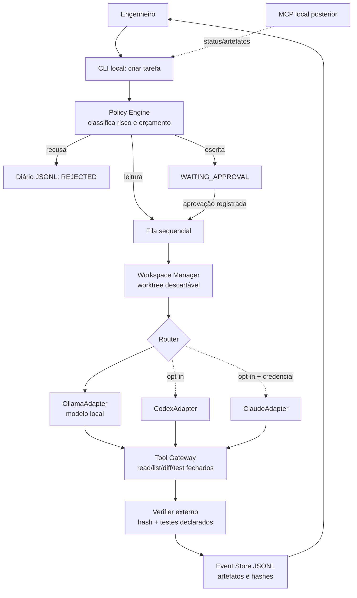
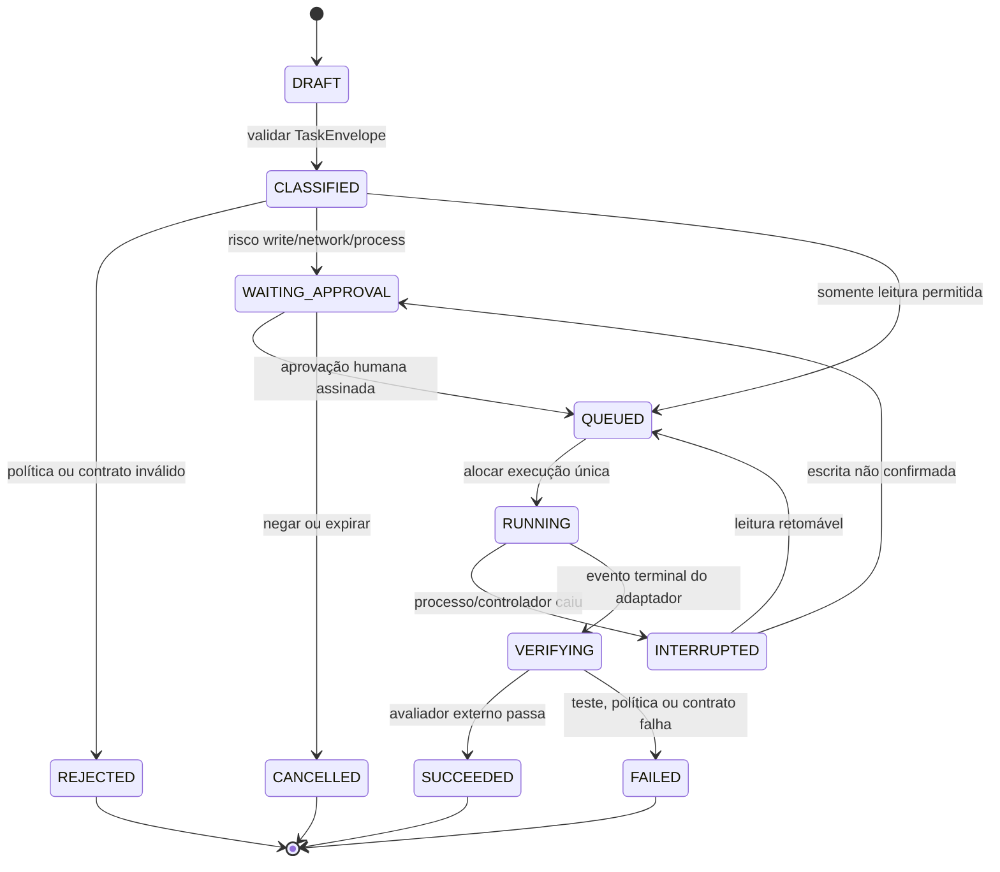
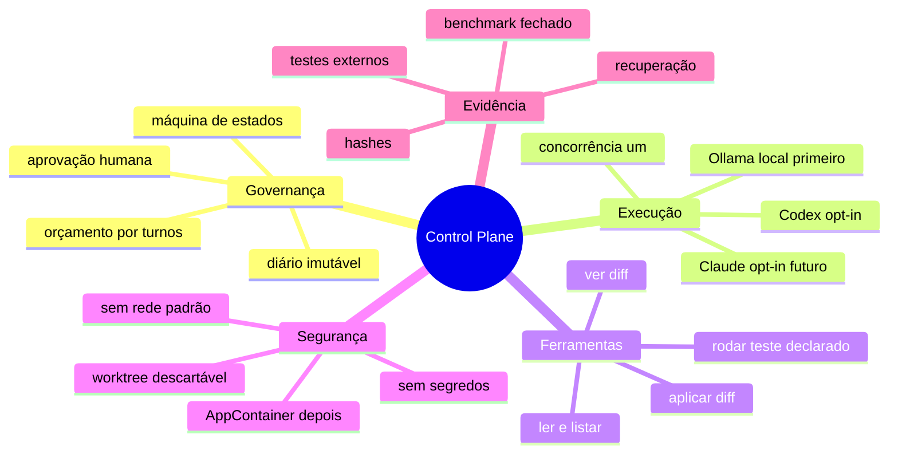

# Construa o controle antes dos agentes

**Recomendação executiva.** Devemos construir uma plataforma local chamada provisoriamente de **Control Plane de Agentes**: ela não será um “superagente”, nem tentará automatizar a interface do Codex ou do Claude. Ela receberá uma tarefa, a classifica, aplica uma política, cria um espaço de trabalho descartável, escolhe **um** executor, registra cada transição e valida o resultado fora do agente. No computador atual, a primeira execução útil é local, sequencial e limitada: Node/TypeScript para o controlador, Ollama nativo no Windows e Qwen2.5-Coder 1.5B como prova de encanamento; 3B só entra após medição. Codex e Claude entram como adaptadores opcionais, sem se tornarem dependências do produto. “Custo recorrente zero” significa não contratar API, servidor ou assinatura nova: não significa que inferência remota via planos existentes seja grátis, nem que eletricidade e tempo não existam. A decisão correta hoje é **GO condicionado** para o MVP local e **NO-GO** para prometer controle de créditos, inferência Claude contínua ou uma frota de agentes no hardware atual.

## As restrições descartam três ilusões logo no início

O projeto começa com um limite físico e econômico, não com uma lista de frameworks. O ambiente declarado é Windows, Ryzen 5 5600, 24 GB de RAM e GTX 1650 Super com 4 GB de VRAM; o orçamento novo é R$0. O Ollama roda nativamente no Windows, expõe API local em `localhost:11434` e tem suporte a GPU NVIDIA, desde que o Windows e driver atendam seus requisitos ([Ollama para Windows](https://docs.ollama.com/windows)). Isso torna plausível um runtime local simples. Não prova desempenho, qualidade de programação, espaço em disco, driver instalado ou disponibilidade real da GPU: esses quatro pontos precisam ser medidos antes de escolher qualquer modelo.

Os tamanhos publicados para Qwen2.5-Coder no catálogo do Ollama são aproximadamente **986 MB para 1,5B**, **1,9 GB para 3B** e **4,7 GB para 7B** ([Qwen2.5-Coder no Ollama](https://ollama.com/library/qwen2.5-coder)). Assim, o modelo 7B já excede a VRAM de 4 GB antes de cache de contexto, buffers e o Windows; tratá-lo como “modelo de GPU” seria erro de projeto. O ponto de partida viável é 1,5B para validar contrato e ferramentas, seguido de 3B em uma única execução com contexto curto. O 7B pode até executar com descarga parcial para CPU/RAM, mas fica na classe “medir antes de aceitar”, não na classe “arquitetar como capacidade”.

Há também uma fronteira de produto. O Codex SDK TypeScript encapsula o CLI e troca eventos JSONL com um processo filho; ele permite manter uma thread e pedir saída estruturada ([SDK TypeScript do Codex](https://github.com/openai/codex/blob/main/sdk/typescript/README.md)). Mas Codex em plano ChatGPT consome os limites/créditos aplicáveis ao plano, e a interface de uso não é uma contabilidade programática confiável de todos os consumos ([Uso do Codex com plano ChatGPT](https://help.openai.com/en/articles/11369540-using-codex-with-your-chatgpt-plan), [Usage & billing](https://help.openai.com/en/articles/20001478-reviewing-work-and-codex-usage-and-using-personal-analytics-in-chatgpt-desktop)). O Claude Agent SDK é a integração oficial para embutir o loop do Claude Code em TypeScript/Python, com ferramentas, permissões e hooks ([Agent SDK](https://code.claude.com/docs/en/agent-sdk/overview)); porém o início oficial pede chave de API e a Anthropic declara que terceiros não podem oferecer login/rate limits de claude.ai dentro de seu produto sem aprovação ([quickstart/visão do SDK](https://code.claude.com/docs/en/agent-sdk/overview)). Portanto, a arquitetura não pode fingir que uma assinatura pessoal de um engenheiro é uma API gratuita e redistribuível.

| Decisão ou capacidade | Veredito agora | Evidência e condição |
|---|---|---|
| Controlador local Node/TypeScript, diário JSONL, fila e política | **Viável agora** | Não depende de modelo remoto, banco ou servidor pago. |
| Ollama + Qwen2.5-Coder 1,5B, um processo, leitura e ferramentas fechadas | **Viável agora, a medir** | API local oficial; confirmar driver, disco, RAM, VRAM e throughput. |
| 3B local para tarefas pequenas | **Viável somente após validação** | Tamanho nominal menor que 4 GB, mas cache/contexto e qualidade são desconhecidos. |
| Adaptador Codex com conta já autenticada | **Viável somente por opt-in** | Não usa API key nova, mas consome a franquia existente; teto automático de créditos não é suportado. |
| Adaptador Claude Agent SDK real | **Viável somente com chave/uso autorizado** | A prova de protocolo pode ser gratuita; inferência contínua não é garantidamente gratuita. |
| MCP local para expor status e artefatos | **Viável depois do núcleo** | MCP conecta ferramentas e contexto; não controla o loop ou a política do agente ([MCP no Agent SDK](https://code.claude.com/docs/en/agent-sdk/mcp)). |
| Vários agentes locais simultâneos | **Inviável sob esta configuração inicial** | Disputaria RAM/VRAM; o grafo pode ser multiagente, a execução deve ter concorrência 1. |
| Corte rígido automático de gasto/creditos pessoais Codex/Claude | **Inviável com interfaces públicas conhecidas** | Métricas pessoais não são uma API de orçamento do controlador. |
| Segurança forte apenas com allowlist de ferramentas | **Inviável** | Allowlist reduz risco, mas não é isolamento de SO. |

## Pare a linha: não há como controlar provedor, crédito ou modelo por decreto

Esta é a falha de primeira ordem que precisa guiar todas as decisões. O controlador local consegue decidir **se inicia** uma execução, com qual diretório, qual contexto, quantos turnos, timeout e política. Ele não consegue obrigar um modelo remoto a delegar como imaginamos dentro de seu próprio turno, nem converter limites de assinatura em saldo programaticamente cortável. A OpenAI oferece custos/uso na API para organizações, mas isso não documenta a franquia pessoal de ChatGPT como uma API de controle ([Organization Costs](https://developers.openai.com/api/reference/resources/admin/subresources/organization/subresources/usage/methods/costs)). A Anthropic diferencia Agent SDK, CLI, Client SDK e agentes gerenciados justamente pela parte que hospeda e controla o loop ([comparação oficial](https://code.claude.com/docs/en/agent-sdk/overview)); nenhum deles elimina o custo de inferência por uma arquitetura local.

**Consequentemente, a promessa do produto deve mudar.** Não é “fazer Codex e Claude trabalharem de graça” e tampouco “controlar todos os créditos”. É: “reduzir chamadas remotas desnecessárias, executar tarefas de baixo risco localmente, tornar toda chamada remota explícita, limitada por turnos e auditável, e medir se isso mantém a taxa de acerto.” Se o objetivo não aceitar essa reformulação, devemos encerrar o projeto agora, porque a premissa financeira estaria tecnicamente falsa.

Há uma segunda parada de linha: uma ferramenta `run_shell` ampla, mesmo atrás de um LLM local, não é um executor seguro. `git worktree` permite árvores independentes de trabalho ([documentação Git](https://git-scm.com/docs/git-worktree.html)), e Windows Job Objects permitem encerrar e limitar uma árvore de processos ([Microsoft Job Objects](https://learn.microsoft.com/en-us/windows/win32/procthread/job-objects)), mas nenhum dos dois remove os privilégios do usuário. AppContainer é a futura fronteira correta porque isola arquivos, credenciais, rede e processos por capacidades ([Microsoft AppContainer](https://learn.microsoft.com/en-us/windows/win32/secauthz/appcontainer-isolation)). Até existir um spike comprovando essa integração, o produto aceita apenas repositórios descartáveis, sem `.env`, tokens, chaves SSH ou dados pessoais.

## O controlador próprio mantém cada responsabilidade no lugar

O projeto terá um núcleo independente de modelos. Cada adaptador traduz o mesmo `TaskEnvelope` para uma sessão local, Codex, Claude ou um fake de teste; nenhum adaptador escreve diretamente no diário, muda estado ou aprova a si mesmo. MCP, quando existir, será uma porta estreita de ferramentas determinísticas para o agente consultar o núcleo; não será o núcleo. A inspiração é o loop explícito de eventos, ferramentas e validação descrito pelo OpenHands, mas sem importar sua infraestrutura ([arquitetura OpenHands](https://github.com/OpenHands/docs/blob/main/sdk/arch/agent.mdx)).



As fronteiras devem ser explícitas. `domain` contém apenas tipos, máquina de estados e invariantes. `application` recebe comandos e decide transições. `policy` decide risco, paths e autorização, mas não executa nada. `workspace` cria/limpa worktrees; `tool-gateway` oferece cinco operações fechadas e registra entradas/saídas. `adapters` sabem falar Ollama, Codex, Claude e fake. `verifier` roda fora do loop do agente em cópia limpa. `infra` persiste eventos append-only e hashes. O módulo `mcp` posterior apenas chama funções já autorizadas do `application` com token efêmero; ele nunca recebe shell nem segredos.





O contrato é mais importante que o prompt. O formato de entrada não deve transportar texto de ferramentas ou instruções de arquivos como autoridade. Um `TaskEnvelope` mínimo contém `task_id`, `parent_task_id?`, `intent`, `risk`, `workspace_ref`, `allowed_paths`, `allowed_operations`, `verification`, `max_turns`, `timeout_ms`, `context_refs` por hash e `policy_version`. O evento de saída contém `event_id`, `run_id`, `task_id`, `state_from`, `state_to`, `timestamp`, `actor`, `adapter`, `model`, `payload_hash`, `artifact_hashes` e `reason`. A política trata toda instrução vinda de repositório, saída de ferramenta e modelo como **dado não confiável**.

```json
{
  "$schema": "https://json-schema.org/draft/2020-12/schema",
  "title": "TaskEnvelope-v1",
  "type": "object",
  "required": ["task_id", "intent", "risk", "workspace_ref", "allowed_paths", "verification", "max_turns", "timeout_ms"],
  "properties": {
    "task_id": {"type": "string", "pattern": "^[a-z0-9-]{8,64}$"},
    "intent": {"type": "string", "minLength": 1, "maxLength": 4000},
    "risk": {"enum": ["read", "write", "process", "network"]},
    "workspace_ref": {"type": "string"},
    "allowed_paths": {"type": "array", "items": {"type": "string"}, "minItems": 1},
    "allowed_operations": {"type": "array", "items": {"enum": ["read_text", "list_files", "apply_unified_diff", "run_declared_test", "git_diff"]}},
    "verification": {"type": "object", "required": ["command", "protected_paths"]},
    "max_turns": {"type": "integer", "minimum": 1, "maximum": 2},
    "timeout_ms": {"type": "integer", "minimum": 1000, "maximum": 1200000}
  },
  "additionalProperties": false
}
```

## O MVP local prova controle, não inteligência geral

O MVP não usa MCP, GUI, Docker, banco de dados, múltiplos modelos nem adaptador remoto real. Ele usa JSONL porque um diário append-only é inspecionável, versionável e suficiente até haver necessidade real de consulta concorrente. Sua ferramenta de modelo local usa tool/function calling do Ollama, no qual a aplicação fornece definição de ferramenta e devolve o resultado ([Ollama tool calling](https://docs.ollama.com/capabilities/tool-calling)). Não existirá `powershell`, `cmd`, `curl`, instalação de pacotes, exclusão, Git push ou acesso a rede como ferramenta do agente.

O perfil **read-only** permite apenas `read_text` e `list_files` dentro da raiz permitida, omitindo `.git`, `.env`, `node_modules`, `.venv` e links para fora. O perfil **write** só existe depois de aprovação humana persistida e permite `apply_unified_diff` em paths declarados; não permite edição livre. O perfil **verify** permite somente comandos já declarados no envelope, por exemplo `npm test -- --runInBand`, mapeados por nome pelo controlador, rodando sob timeout e Job Object. Não há autorização por “o agente pareceu seguro”. Para uma tarefa com rede ou segredo, o estado correto na v0 é `REJECTED`.

| Risco | Decisão padrão | O que o humano aprova | Evidência de aceite |
|---|---|---|---|
| Leitura | automático | nada | paths, hashes e diário completos |
| Escrita em worktree | parar | um turno, paths, diff e teste declarados | nenhum processo write antes da aprovação |
| Processo/teste | parar | comando previamente mapeado, timeout e memória | código de saída, duração e log capturados |
| Rede, credenciais, dados pessoais | recusar | fora do MVP; exige isolamento/projeto posterior | não existe execução v0 |
| Codex/Claude remoto | parar | adaptador, máximo de 2 turnos e confirmação de cota humana | versão, eventos e consumo desconhecido marcado como tal |

O benchmark precisa tentar matar a hipótese, não decorar uma demonstração. Antes do modelo, criar 20 tarefas fechadas versionadas em dois ou três repositórios descartáveis: 8 correções unitárias, 6 mudanças multifile, 4 falhas de build/lint e 2 investigações que devem responder “evidência insuficiente”. Cada tarefa fixa `base_commit`, paths editáveis, comando avaliador, timeout, teste oculto e patch humano de referência guardado fora do contexto. O avaliador restaura o commit, verifica hash de testes/configuração protegidos e executa sem o agente. Os únicos resultados são `PASS`, `FAIL`, `POLICY_VIOLATION`, `TIMEOUT` e `CRASH`.

Registrar por tentativa: modelo e hash/tag, contexto, parâmetros de geração, CPU/RAM/VRAM de pico, tempo ao primeiro token, duração total, chamadas de ferramenta, comandos negados, diff e resultado externo. Repetir três vezes qualquer configuração estocástica. HumanEval serve como teste rápido de função; SWE-bench Lite só entra mais tarde, porque o harness oficial usa contêineres Docker ([SWE-bench quickstart](https://github.com/SWE-bench/SWE-bench/blob/main/docs/guides/quickstart.md)). A passagem inicial não é “o modelo escreveu código bonito”: é ao menos uma tarefa multifile aprovada em até 20 minutos, sem violação de política, e taxa de `PASS` acima do baseline de não alterar nada após 20 tarefas em 1,5B e 3B. Se não ocorrer, interromper a trilha executor local e reavaliar escopo/modelo, em vez de adicionar agentes.

## A implementação deve seguir evidência, não entusiasmo

Esta é a sequência exata proposta, ainda **sem implementar**. O objetivo de cada etapa é produzir uma evidência que autoriza a próxima; nenhuma etapa valida inferência remota ou segurança de produção por analogia.

| Ordem | Criar ou alterar | Comando de verificação previsto | Evidência que libera a próxima |
|---|---|---|---|
| 0 | `docs/decisions/ADR-001-scope.md`, `docs/hardware-baseline.md` | `Get-ComputerInfo`, `nvidia-smi`, `ollama --version`, `ollama ps` | Windows/driver/disco/RAM/VRAM registrados; não publicar segredos. |
| 1 | `package.json`, `tsconfig.json`, `src/domain/{task,event,state}.ts`, `test/domain/state.test.ts` | `npm run typecheck`; `npm test` | transições inválidas recusadas e eventos terminais imutáveis. |
| 2 | `src/infra/jsonl-event-store.ts`, `src/application/run-service.ts`, `test/recovery.test.ts` | `npm test -- recovery` | execução sem terminal vira `INTERRUPTED` após reinício. |
| 3 | `src/policy/policy-engine.ts`, `src/workspace/worktree-manager.ts`, `src/tools/tool-gateway.ts` | `npm test -- policy`; `git diff --check` | write/process não iniciam antes de aprovação; path fora da allowlist falha. |
| 4 | `src/adapters/fake-agent.ts`, `test/contract/adapter.test.ts` | `npm test -- adapter-contract` | JSON estruturado inválido, timeout e erro não mudam para sucesso. |
| 5 | `src/adapters/ollama.ts`, `config/models.local.json`, `scripts/diagnose-runtime.ps1` | `ollama pull qwen2.5-coder:1.5b`; `npm run smoke:ollama` | chamada local, versão e métricas registradas; primeiro sem escrita. |
| 6 | `bench/tasks/*`, `bench/evaluator/*`, `bench/results/.gitkeep` | `npm run bench -- --suite internal-v1` | matriz de resultados, hashes protegidos e critério go/no-go calculável. |
| 7 | `src/adapters/codex.ts`, `test/contract/codex.test.ts` | `codex --version`; `npm run smoke:codex` | só após autorização: read-only, 1 turno, sem API key e sem alegar custo zero. |
| 8 | `src/adapters/claude.ts`, `test/contract/claude.test.ts` | `claude --version`; teste fake por padrão | só após chave/uso autorizado: `cwd` descartável, `settingSources: []`, leitura. |
| 9 | `spikes/appcontainer/*` e depois `src/mcp/*` | teste isolado de arquivo/rede; `npm test` | AppContainer comprovado antes de dados sensíveis; MCP apenas chama operações existentes. |

Use Node LTS e TypeScript, `node:test`/`assert` no início para minimizar dependências; `npm run typecheck` deve chamar `tsc --noEmit`, `npm test` deve chamar o runner nativo e scripts de produção nunca leem `.env` do repositório. A etapa 7 usa SDK/CLI Codex como adaptador, não como banco de dados: arquivos em `~/.codex/sessions` pertencem ao Codex e o nosso produto guarda seu próprio evento, versão e hashes. A etapa 8 deve preferir o Agent SDK em TypeScript se o núcleo seguir TypeScript; seu `cwd`, ferramentas e turnos são configuráveis ([configuração do Agent SDK](https://code.claude.com/docs/en/agent-sdk/configuration)). `Cowork` está explicitamente fora: é uma superfície de produto humano/paga, não backend a automatizar ([Claude Cowork](https://support.claude.com/en/articles/13345190-get-started-with-claude-cowork)).

As escolhas recusadas são deliberadas: Agents/Responses API multiagente, pois acrescenta cobrança de API; um orquestrador LangGraph/OpenHands inteiro, pois adiciona uma camada antes de provar o loop; Docker/WSL como requisito inicial, pois concorre por RAM e não torna o modelo melhor; SQLite/UI/MCP no primeiro corte, pois não resolvem a hipótese principal; e o modelo 7B como padrão, pois sua capacidade cabe pior que sua promessa no VRAM atual. `llama.cpp` fica como alternativa de segunda fase quando for preciso controlar diretamente GGUF/particionamento; seu servidor suporta modelos quantizados e tool calling, mas mantê-lo em paralelo com Ollama no MVP só duplica falhas ([llama.cpp server](https://github.com/ggml-org/llama.cpp/blob/master/tools/server/README.md)).

## O roteiro cria opções sem esconder portas fechadas

**Fase 0 — fundações e hardware (1–2 sessões):** registrar baseline de máquina e espaço, escrever ADR de custo e política, gerar esqueleto e testes de estados. Saída: não há modelo nem rede; há uma máquina de estados verificável. **Fase 1 — segurança funcional (2–4 sessões):** diário, worktree, fake adapter, allowlist e recuperação. Saída: pode-se provar que uma escrita não ocorre antes do gate. **Fase 2 — modelo local e benchmark (3–6 sessões):** Ollama 1,5B, depois 3B se as métricas permitirem, 20 tarefas e avaliador externo. Saída: decisão quantitativa de utilidade local, não uma impressão subjetiva.

**Fase 3 — adaptadores humanos/opt-in:** primeiro Codex somente leitura, pois já pode haver autenticação de plano; depois Claude somente se houver credencial e orçamento explicitamente autorizados. Cada experimento remoto é uma tarefa, com `max_turns <= 2`, concorrência 1, contexto limitado e estado `WAITING_BUDGET` após o limite interno. O controlador registra “custo real indisponível” quando a fonte não o fornece; nunca infere reais por tokens ou raspa interface. **Fase 4 — endurecimento:** spike AppContainer sem `internetClient`, teste de rede/arquivo, então tarefas com dados menos descartáveis; só depois MCP privado para `task_status`, `read_artifact` e `request_transition`. **Fase 5 — interface e paralelismo:** só se o benchmark indicar retorno e houver mais hardware/isolamento; uma interface não corrige um executor sem valor.

## Conclusão

O desenho faz sentido e é executável **como um sistema de controle local com executores intercambiáveis**. A parte nova e valiosa não é chamar modelos: é declarar risco, não deixar uma execução confundir intenção com autorização, preservar evidência e usar o mesmo avaliador para local e remoto. A proposta cabe em custo monetário novo zero, desde que o escopo permaneça local, sequencial, descartável e sem prometer inferência Claude gratuita.

Minha autocrítica é que este projeto ainda não demonstrou seu benefício: não há medição de tokens/s, qualidade, driver, espaço, isolamento real ou taxa de `PASS`. Isso não é lacuna menor; é o motivo de o MVP existir. **Decisão:** avançar para as Fases 0–2, parar imediatamente se o benchmark não ultrapassar o baseline ou se a política permitir escrita sem prova, e não construir MCP, UI ou multiagente até essa evidência aparecer. A primeira conversa de GOALS deve fechar somente três decisões: quais repositórios descartáveis fornecem as 20 tarefas, qual métrica mínima torna o agente local útil e se uma conta remota existente poderá ser usada apenas mais tarde sob aprovação explícita.
