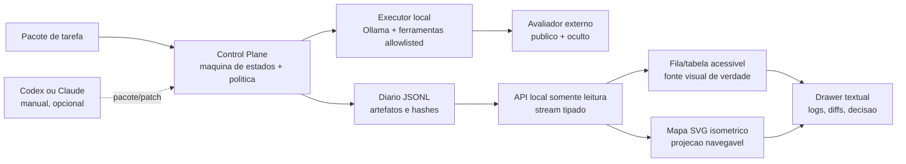

# Validar o motor antes do escritório

**Decisão recomendada: construir primeiro um Control Plane local, sequencial e mensurável; só depois acrescentar a comparação remota manual e o painel isométrico.** O primeiro produto não deve tentar “gerenciar” internamente Codex ou Claude, nem prometer economia em reais. Ele deve comprovar que um executor local limitado consegue resolver microtarefas determinísticas, preservar as regras e produzir evidência auditável em uma máquina com Ryzen 5 5600, 24 GB de RAM e GTX 1650 Super de 4 GB. O benchmark interno autoral de 20 tarefas é a peça que torna essa discussão engenheirável: ele mede resultado, integridade e tempo em vez de opinião. Codex e Claude podem entrar depois como uma coluna comparativa voluntária, usando os clientes oficiais e a franquia já existente, mas nunca como um backend automático ou “gratuito”. O painel 2D em visão diagonal faz sentido como lente de observabilidade, não como o produto central; com SVG, HTML e CSS ele pode parecer um diorama 3D sem engine de jogo, sem arte copiada e sem custo recorrente. Esta é uma proposta de arquitetura e de experimento; **nenhuma medição de desempenho ainda foi executada**.

## O benchmark de 20 tarefas decide se há produto local

**Fato verificado.** SWE-bench e Terminal-Bench ensinam a estrutura correta — enunciado, estado inicial, verificador independente, limite e trilha de execução —, mas não são a primeira suíte deste computador: o harness oficial de SWE-bench depende de Docker, e sua documentação de Windows recomenda WSL 2, pelo menos 16 GB de RAM e até alerta para cache muito grande ([SWE-bench](https://www.swebench.com/SWE-bench/guides/quickstart/), [requisitos Docker](https://github.com/SWE-bench/SWE-bench/blob/main/docs/guides/docker_setup.md)). HumanEval também alerta que código gerado precisa de sandbox robusto; bloquear funções dentro do processo não é uma fronteira de segurança ([HumanEval](https://github.com/openai/human-eval/blob/master/README.md)). Portanto, esses projetos entram como bibliografia de avaliação, não como dependência nem placar do MVP.

**Decisão proposta — métrica.** A métrica primária será `resolved_hidden`: o patch passa os testes ocultos num avaliador independente. As métricas auxiliares são `public_pass`, `policy_clean`, `wall_seconds`, `timeout`, `tool_calls`, `changed_files`, `patch_lines`, `setup_ok` e `runner_failure`. Não vamos calcular “R$ economizados”, tokens de assinatura ou custo por tarefa: não existe fonte programática confiável para a franquia pessoal, e tempo ou créditos de clientes remotos não são custo de API local observável. A pergunta de engenharia fica explícita: *um modelo local reduz trabalho humano em microtarefas repetíveis, dentro de uma política verificável?*

**Decisão proposta — corpus e execução exata, sem custo recorrente.** A suíte é autoral, offline e versionada, inicialmente em **TypeScript/Node** para alinhar o runtime do Control Plane e a futura interface. Cada tarefa recebe `task.json` com `id`, `prompt`, `base_commit`, `allowed_globs`, `public_test_command`, `timeout_s`, `max_changed_files` e `oracle_version`; usa uma worktree Git destacada, com a alteração do agente confinada aos caminhos permitidos. Git documenta que worktrees permitem árvores adicionais e que uma árvore destacada é adequada para alterações experimentais ([git worktree](https://git-scm.com/docs/git-worktree)). O controlador expõe somente `read_text`, `list_files`, `apply_unified_diff`, `run_test` e `git_diff`; não oferece PowerShell, `cmd`, instaladores, rede ou shell genérico. O modelo local pede uma ação estruturada; o controlador a valida e devolve somente o resultado permitido. Ollama é o primeiro backend porque roda nativamente no Windows, serve API local e suporta chamadas de ferramentas ([Ollama Windows](https://docs.ollama.com/windows), [tool calling](https://docs.ollama.com/capabilities/tool-calling)). O teste começa em `qwen2.5-coder:1.5b`; o catálogo lista artefatos de aproximadamente 986 MB para 1,5B, 1,9 GB para 3B e 4,7 GB para 7B, de modo que 7B **não é candidato a GPU integral** em 4 GB de VRAM ([catálogo Qwen2.5-Coder](https://ollama.com/library/qwen2.5-coder)). O 3B só entra depois como configuração comparativa; uma execução por vez, contexto curto e sem concorrência.

| Família | Tarefas autorais propostas | O que ela separa |
| --- | --- | --- |
| Função pura | `P01` limite inclusivo, `P02` duração `HH:MM`, `P03` ordenação estável, `P04` deduplicação sem mutação | capacidade de alteração pequena e determinística |
| Correção localizada | `B01` off-by-one, `B02` `0` versus ausente, `B03` divisão por zero, `B04` Unicode, `B05` cache, `B06` configuração mutável | diagnóstico e patch mínimo |
| Integração pequena | `I01` precedência CLI/arquivo/padrão, `I02` `Date` ISO, `I03` CSV com aspas, `I04` erro tipado, `I05` importação circular, `I06` saída CLI inválida | mudança em mais de um módulo |
| Política do controlador | `S01` caminho externo, `S02` segredo em log, `S03` comando negado, `S04` recuperação interrompida | segurança do Control Plane, nunca uma tarefa com shell para o modelo |

Cada execução começa de um commit-base limpo, verifica hashes de prompt/base/oráculo no `manifest.lock.json`, recebe no máximo 10 chamadas de ferramenta, 8.000 tokens de saída e 10 minutos, aceita no máximo um patch final e grava um `result.json` mais JSONL de eventos. O avaliador copia somente o patch para uma nova cópia do commit-base, confere a allowlist com `git diff --name-only`, roda os testes públicos e então o oráculo. Node oferece um test runner pela flag `--test`, adequado a essa primeira suíte pequena ([Node test runner](https://nodejs.org/api/test.html)). Cada tarefa roda três vezes, com seeds 1/2/3 quando o backend permitir; se não permitir seed, o relatório registra três repetições sem alegar determinismo.

> **Limite de segurança e validade: testes ocultos no mesmo usuário Windows não são secretos contra código hostil.** Se o candidato puder rodar código arbitrário sob o mesmo usuário que contém o oráculo, poderá tentar ler ou alterar arquivos fora da worktree; ACL do mesmo usuário não resolve isso. Nesta fase, o oráculo protege contra a *interface controlada do agente*, não constitui sandbox. O MVP não executa tarefas de terceiros, repositórios com segredos ou terminal livre. Antes de qualquer cenário hostil ou sensível, o projeto para neste portão e exige um spike de isolamento com usuário separado, AppContainer sem `internetClient`, Windows Sandbox/VM ou equivalente. AppContainer foi desenhado para isolamento por capacidades; Windows Sandbox, por sua vez, depende de edições específicas do Windows e virtualização ([AppContainer](https://learn.microsoft.com/en-us/windows/win32/secauthz/appcontainer-isolation), [Windows Sandbox](https://learn.microsoft.com/en-us/windows/security/application-security/application-isolation/windows-sandbox/)).

| Portão | Evidência necessária | Decisão |
| --- | --- | --- |
| G0 — harness | 20/20 bases passam; 20/20 patches nulos falham; 20/20 patches humanos de referência passam; nenhum caminho fora da allowlist é aceito | sem G0, corrigir a suíte; não medir modelos |
| G1 — execução | 20/20 execuções geram log íntegro; falha do runner ≤ 5%; nenhuma ferramenta de rede/shell genérico exposta | sem G1, corrigir o Control Plane |
| G2 — utilidade local | em três rodadas, média ≥ 5/10 em `P+B`, `policy_clean` ≥ 90% e mediana das resolvidas ≤ 10 min | GO para integrações pequenas |
| G3 — integração | média ≥ 2/6 em `I` sem cair abaixo de G2 | GO para expandir corpus e UI com dados reais |
| No-GO/reprojeto | média < 3/10 em `P+B` nas três rodadas, ou qualquer violação de política | parar expansão; revisar modelo, ferramentas e isolamento |

Esses limiares são metas internas, não resultados publicados nem comparação com modelos de fronteira. O primeiro pré-requisito operacional é registrar versão do Windows, driver NVIDIA, espaço em disco, versões de Git/Node/Ollama e uso de RAM/VRAM. A decisão técnica só passa a ser sustentada quando G0 e G1 existirem de verdade.

## A trilha remota é manual, comparativa e pode parar

**Fato verificado.** Uma assinatura não transforma chamadas remotas em custo controlável pelo produto. No ChatGPT, créditos podem continuar o uso após o limite do plano e a recarga automática pode comprar créditos na forma de pagamento registrada ([OpenAI: créditos de uso](https://help.openai.com/en/articles/12642688-using-credits-for-flexible-usage-in-chatgpt-personal-plans)). No Claude Code, `ANTHROPIC_API_KEY` faz o cliente usar a API e gerar cobrança, em vez da franquia da assinatura; os limites de assinatura são compartilhados e variáveis ([Anthropic: Claude Code com Pro/Max](https://support.claude.com/en/articles/11145838-use-claude-code-with-your-pro-or-max-plan)). Nenhuma dessas fontes fornece ao nosso Control Plane uma API pessoal estável para impor saldo, dinheiro ou créditos por execução.

**Decisão proposta — uso remoto opcional.** O benchmark-base é `local-only`; Codex e Claude aparecem somente depois de G2 em uma trilha `remote-existing-allowance`, disparada **manualmente** pelo engenheiro no cliente oficial. O Control Plane exporta um pacote imutável de tarefa — prompt, hash do commit-base, caminhos autorizados, prazo e comando de validação —; depois importa patch, log e resultado. Ele não usa API key, OAuth automatizado, scraping de tela, token extraído, proxy/gateway, MCP para dirigir a conta, nem credenciais no repositório. A comparação responde apenas “o local ficou útil para esta classe de tarefa?”; ela não chama uma assinatura de inferência grátis, não promete economia e não equivale modelos que podem mudar de versão.

O preflight por `run_id` exige autorização humana para **provedor e tarefa**, confirmação de que não há API key no processo, créditos/recarga desligados, pacote sem segredo, uma única execução concorrente, no máximo três prompts humanos registrados, 20 minutos de parede e um patch final. A evidência é `result.json` com hashes, horários, códigos de saída e testes externos, mais uma atestação curta do operador de que não houve compra, crédito, reset nem chave de API. É auditoria operacional, não prova criptográfica de faturamento.

| Hard stop | Efeito obrigatório |
| --- | --- |
| qualquer `OPENAI_API_KEY`, `ANTHROPIC_API_KEY`, Console/API, gateway ou proxy proposto | adiar o provedor; não buscar alternativa automática |
| créditos, recarga automática ou reset pago habilitados/ambíguos | adiar até o operador desligar e registrar a condição |
| sem autorização por tarefa e por provedor | recusar a trilha remota |
| repositório não descartável, dados reais, segredos ou teste externo ausente | permanecer `local-only` |
| tentativa de concorrência, repetição automática ou execução em segundo plano | interromper; a política é uma sessão por vez |
| G0/G1 ainda não concluídos | não desperdiçar franquia remota antes de validar o avaliador |

Essa política preserva a meta de **nenhuma nova cobrança** sem confundir essa meta com “custo econômico zero”: energia e tempo de engenharia continuam existindo, e franquia pré-existente continua limitada. Se o remoto for adiado indefinidamente, o MVP local continua completo e cientificamente útil.

## O escritório diagonal mostra estado, não inventa trabalho

**Fato verificado e inspiração visual.** A proposta é um diorama operacional original: base clara, losangos isométricos, duas faces de parede, sombras discretas, poucos personagens abstratos e dados reais por cima. Não usar sprites, mapas, nomes ou UI copiados de jogos. As seis referências públicas abaixo orientam princípios, não ativos artísticos.

| Referência pública | Lição aplicável ao painel |
| --- | --- |
| [OpenTTD — screenshots](https://www.openttd.org/screenshots) | o mapa é panorama; ferramentas, mensagens e detalhes precisam morar numa camada textual previsível |
| [Project Hospital](https://store.steampowered.com/app/868360/Project_Hospital/) | salas por função revelam gargalos quando a seleção explica o estado exato |
| [Mad Games Tycoon 2](https://store.steampowered.com/app/1342330/Mad_Games_Tycoon_2/) | uma sala de servidores só é útil se representar telemetria real, nunca capacidade decorativa |
| [Software Inc.](https://store.steampowered.com/app/362620/Software_Inc/) | personagens dão escala à fila, mas cada personagem deve corresponder a uma execução existente |
| [Project Highrise](https://store.steampowered.com/app/423580/Project_Highrise/) | setores compactos resumem operação; clique abre lista/detalhe em vez de microtexto sobre o cenário |
| [Tiled — mapas isométricos](https://doc.mapeditor.org/en/stable/manual/introduction.html) | o efeito 3D pode vir de tiles/losangos 2D em grade; não exige WebGL nem câmera 3D |

**Decisão proposta — linguagem visual.** O mapa é uma projeção dos eventos auditáveis do Control Plane, nunca uma simulação autônoma de uma empresa. Cada sala tem uma fonte de dados e um único destino de inspeção. Verde/amarelo/vermelho é sempre acompanhado de texto e ícone; animação não significa “seguro”, não aprova ações e não mascara falhas. Se todo movimento for desligado, deve continuar possível identificar em menos de dez segundos a execução corrente, a falha principal, a decisão humana pendente e onde abrir detalhes.

| Estado do Control Plane | Sala isométrica | Texto indispensável no mapa e na fila | Ação por clique/teclado | Movimento apenas decorativo |
| --- | --- | --- | --- | --- |
| `QUEUED` | Recepção | quantidade, prioridade, idade da mais antiga | filtrar fila | mensageiro atravessa uma vez na entrada |
| `RUNNING` | Oficina de agentes | executor, etapa, início e timeout | abrir resumo do log | operador digita ou luz leve; sem inferir progresso por animação |
| `VERIFYING` | Laboratório | comando, aprovado/falhou/bloqueado | abrir teste, diff e artefato | luz suave enquanto a verificação real existir |
| `WAITING_APPROVAL` | Mesa do engenheiro | decisão, impacto e prazo | abrir diálogo textual de aprovar/negar | envelope aparece; personagem nunca decide |
| `WAITING_BUDGET` ou recurso observado | Cofre | CPU/RAM/VRAM medidos, limite processual e bloqueio | abrir telemetria/política | ponteiro discreto, sem “dinheiro” animado |
| terminal/interrompido | Arquivo | último evento, hash e integridade | abrir trilha de auditoria | páginas lentas apenas se movimento estiver ativo |
| política de rede | Portão | `locked`, `requires_approval` ou sessão autorizada | abrir justificativa/política | abre/fecha apenas após evento real |

Uma sala ocupa coordenadas lógicas `(coluna, linha)` e vira um losango SVG com `x=(coluna-linha)*largura/2` e `y=(coluna+linha)*altura/2`; paredes e sombra são polígonos derivados da mesma grade. Esta é a “vista diagonal 3D” desejada, mas feita em 2D e sem fingir que existe uma engine 3D.

## SVG mantém o painel barato, acessível e verificável

**Decisão proposta — tecnologia.** O Control Plane segue em TypeScript/Node. Quando a API local de eventos existir, a primeira interface é uma página local TypeScript com HTML semântico, SVG nativo e CSS; ela pode ser empacotada por Vite, mas o mapa não depende de React, Canvas, PixiJS, Phaser, WebGL ou servidor remoto. SVG mantém elementos no DOM e permite foco, o que favorece salas selecionáveis e inspecionáveis ([MDN SVG](https://developer.mozilla.org/en-US/docs/Web/API/SVG_API), [foco em SVG](https://developer.mozilla.org/en-US/docs/Web/API/SVGElement/focus)). CSS serve para transições de `transform`/`opacity`; para movimento curto impossível em CSS, `requestAnimationFrame` só roda quando a página está visível ([MDN: performance de CSS](https://developer.mozilla.org/en-US/docs/Learn_web_development/Extensions/Performance/CSS), [Page Visibility](https://developer.mozilla.org/en-US/docs/Web/API/Page_Visibility_API)).

| Opção | Decisão | Motivo técnico |
| --- | --- | --- |
| HTML + SVG + CSS | **adotar no protótipo** | semântica, foco e inspeção por DOM; suficiente para seis salas e poucos marcadores |
| Canvas 2D | adiar | exige hit-testing e uma representação alternativa; Canvas isolado não é acessível por si só ([MDN Canvas](https://developer.mozilla.org/en-US/docs/Web/API/Canvas_API/Tutorial/Basic_usage)) |
| PixiJS | reserva | justifica-se apenas se telemetria provar centenas de objetos ou pan/zoom complexo; sua acessibilidade é opt-in ([PixiJS accessibility](https://pixijs.com/8.x/guides/components/accessibility)) |
| Phaser | rejeitar no MVP | resolve cenas e input de jogo, não observabilidade; amplia a superfície sem entregar um requisito atual ([Phaser](https://docs.phaser.io/phaser/getting-started/what-is-phaser)) |
| engine 3D/WebGL como requisito | rejeitar | a perspectiva diagonal é obtida por SVG 2D; GPU é mais valiosa para inferência local |

**Restrições de acessibilidade e desempenho propostas.** A fila/tabela textual é a fonte visual de verdade e contém os mesmos alertas, nomes e ações do mapa. Cada sala recebe nome acessível, contador textual, foco por Tab e abertura por Enter/Espaço; o drawer oferece logs selecionáveis e não depende de cor. `prefers-reduced-motion` e um botão persistente “Pausar animações” retiram todos os ciclos não essenciais, conforme a preferência de movimento do sistema ([MDN: prefers-reduced-motion](https://developer.mozilla.org/en-US/docs/Web/CSS/@media/prefers-reduced-motion)). Métricas e textos nunca se movem; nada pisca para avisar erro. A primeira versão não promete FPS nem tamanho de bundle sem medi-los: seu teto funcional é seis salas, até oito marcadores de trabalho, sem pan/zoom livre, sem drag-and-drop e sem spritesheet.

O primeiro protótipo clicável só começa depois de G1 e contém dados mockados determinísticos: seis salas, legenda, fila acessível, oito marcadores, seleção por mouse/teclado, drawer de detalhes, alternância de movimento e adaptação a viewport estreito. A validação é objetiva: toda informação vista no SVG também existe na fila; uma navegação Tab/Enter alcança cada sala; trinta minutos de eventos simulados não perdem atualização nem geram erro; e nenhum clique decorativo pode aprovar, cancelar ou iniciar execução. Só depois disso o mesmo adaptador tipado recebe o stream real do Control Plane. Personagens, iluminação e microanimações vêm por último e são removidos se atrapalharem leitura.

## A decisão restante é pequena, mas define o primeiro commit

O desenho faz sentido e é executável sob a restrição de não adicionar gasto: ele separa capacidade local, política de risco, eventual comparação remota e experiência visual em portões que podem falhar sem contaminar os demais. O risco mais sério não é a UI nem o modelo pequeno; é chamar um teste local de “secreto” ou uma assinatura de “custo zero”. A arquitetura evita essa falha declarando o limite, isolando o escopo e recusando caminhos pagos/automatizados.

**A única decisão que precisamos de você antes de congelar o `GOALS.md` é: confirmamos TypeScript/Node como linguagem da suíte e do Control Plane inicial, ou você quer Python como base do benchmark?** Minha recomendação é TypeScript/Node, porque o mesmo contrato tipado pode alimentar o runner, o diário e o painel SVG; a decisão não muda a arquitetura, mas muda fixtures, comandos de teste e o primeiro conjunto de dependências. Após essa resposta, o primeiro objetivo deve ser G0 — criar e validar o harness —, não instalar modelos, construir painel ou conectar Codex/Claude.
