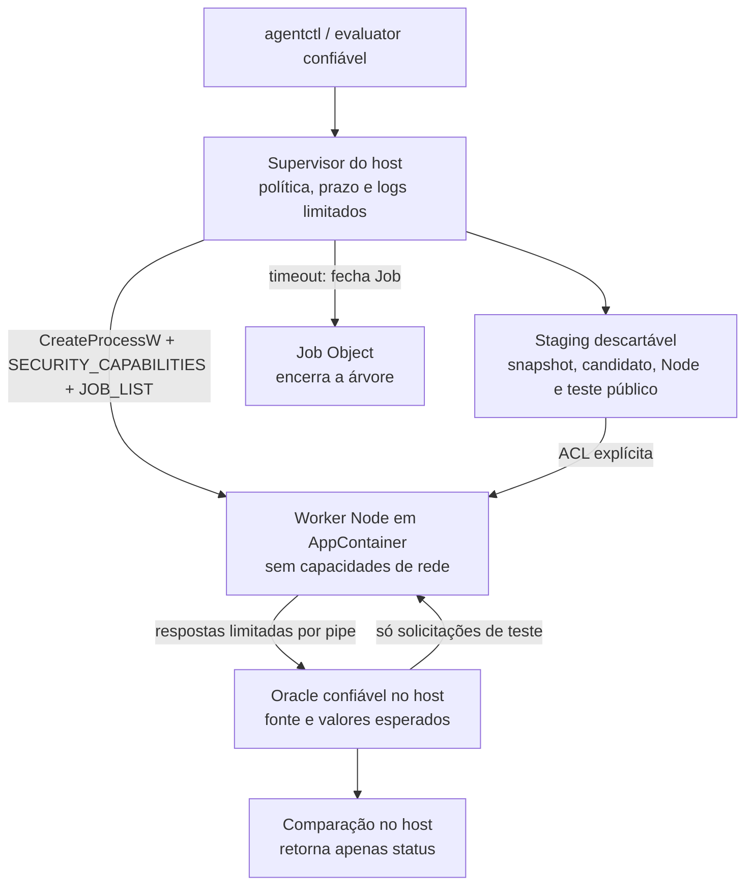

# Isole o avaliador antes de executar

**Veredito: o primeiro spike terminal-first deve usar um launcher confiável com AppContainer sem capacidades, ACLs explícitas e Job Object; o `spawn` atual do Node não cria essa fronteira.** Esse caminho usa APIs já incluídas no Windows e pode ser orquestrado por um helper C++ já disponível ou por P/Invoke via Windows PowerShell 5.1, sem custo de licença ou pacote novo. Ele ainda precisa provar, neste host, negação de arquivos sensíveis, rede e processos descendentes; AppContainer não é uma VM nem uma visão de filesystem fechada. **O avaliador também precisa separar o oracle do processo que carrega o código candidato:** hoje `oracle-runner.mjs` importa a implementação oculta e chama `verify(workspaceRoot)` no próprio processo. Até existir launcher real, G2.2 bloqueia aplicação de qualquer patch e execução de qualquer teste de tarefa; depois disso, só probes benignos da fronteira podem rodar. Falha de criação, ACL, rede, encerramento ou sigilo do oracle encerra o caminho antes de G2.3, sem fallback para `spawn` comum.

## AppContainer + Job é a opção terminal-first mais plausível

| Opção | Custo e uso no Windows 10 Pro | O que isola | Limite para este evaluator | Veredito |
|---|---|---|---|---|
| **AppContainer + Job Object** | APIs nativas e Windows PowerShell já incluídos; sem compra ou instalação necessária para o protótipo. Node sozinho não expõe os atributos Win32 necessários, então é preciso helper confiável ou P/Invoke por `Add-Type`. ([AppContainer](https://learn.microsoft.com/en-us/windows/win32/secauthz/implementing-an-appcontainer), [PowerShell `Add-Type`](https://learn.microsoft.com/en-us/powershell/module/microsoft.powershell.utility/add-type?view=powershell-5.1), [Node `child_process`](https://nodejs.org/api/child_process.html)) | Token AppContainer sem capacidades de rede, ACL no staging e Job Object com término por fechamento podem limitar arquivos e encerrar descendentes. O job pode ser atribuído no próprio `CreateProcessW` no Windows 10. ([`UpdateProcThreadAttribute`](https://learn.microsoft.com/en-us/windows/win32/api/processthreadsapi/nf-processthreadsapi-updateprocthreadattribute), [Job Objects](https://learn.microsoft.com/en-us/windows/win32/procthread/job-objects)) | AppContainer usa ACLs, não um namespace de montagem, e mantém acesso a alguns recursos públicos do Windows. Perfil, runtime Node, ACLs e compatibilidade precisam ser provados localmente; não promete que nenhum arquivo do host será legível. ([AppContainer isolation](https://learn.microsoft.com/en-us/windows/win32/secauthz/appcontainer-isolation)) | **Primeiro spike recomendado**, se G2 aceitar acesso a recursos imutáveis do sistema necessários para executar o runtime e a definição de contenção for mensurável. Se o requisito significar zero leitura de qualquer arquivo fora do staging, parar e escolher uma VM. |
| **Windows Sandbox** | Recurso incluído em edições Pro suportadas, sem licença adicional; ativação é opcional, pode exigir elevação e reinício. `.wsb` pode desligar rede/clipboard e limitar pastas compartilhadas. ([Install Windows Sandbox](https://learn.microsoft.com/en-us/windows/security/application-security/application-isolation/windows-sandbox/windows-sandbox-install), [configuração `.wsb`](https://learn.microsoft.com/en-us/windows/security/application-security/application-isolation/windows-sandbox/windows-sandbox-configure-using-wsb-file)) | Kernel separado por virtualização; pastas mapeadas são os canais explícitos com o host. Pastas graváveis continuam expostas ao guest. ([Windows Sandbox](https://learn.microsoft.com/en-us/windows/security/application-security/application-isolation/windows-sandbox/)) | No Windows 10, `.wsb` e `LogonCommand` não equivalem a um runner headless com captura de saída, timeout e encerramento automatizado. A CLI `wsb` documentada começa no Windows 11 24H2 e nem oferece captura de I/O de processo. ([CLI e versões](https://learn.microsoft.com/en-us/windows/security/application-security/application-isolation/windows-sandbox/windows-sandbox-cli)) | **Fallback de maior isolamento**, depois de confirmar feature, virtualização e controle de saída/timeout. Não é a primeira opção terminal-first em Win10. |
| **WSL2 + Bubblewrap/NsJail** | Bom fluxo de terminal e sem licença nova; a distribuição ainda precisa estar habilitada e funcional. | WSL2 executa kernel Linux numa VM leve, mas as distribuições compartilham esse kernel e mantêm integrações com arquivos e processos Windows. Bubblewrap/NsJail podem adicionar namespaces Linux dentro da distribuição. ([WSL architecture](https://learn.microsoft.com/en-us/windows/wsl/about), [Bubblewrap](https://github.com/containers/bubblewrap/blob/main/README.md), [NsJail](https://github.com/google/nsjail)) | O levantamento local registrou `Wsl/E_ACCESSDENIED`; `networkingMode=none` é documentado para Windows 11, não para Windows 10. Interop, montagens e término de toda árvore precisariam de probes; `wsl --terminate` sozinho não comprova encerramento no prazo. ([WSL configuration](https://learn.microsoft.com/en-us/windows/wsl/wsl-config), [WSL commands](https://learn.microsoft.com/en-us/windows/wsl/basic-commands)) | **Não utilizável no estado observado** e não atende G2.2 até todas as quatro propriedades serem demonstradas. |
| **Sandboxie-Plus** | Núcleo GPLv3; requer driver/serviço e elevação para seu uso real. A licença da interface Plus não é a mesma licença aberta do núcleo. ([repositório e licença](https://github.com/sandboxie-plus/Sandboxie)) | Tem controles de arquivos, firewall WFP e CLI para iniciar/terminar processos. | Leitura do host pode ocorrer por padrão; regras de rede em modo usuário não cobrem todas as APIs e o projeto não promete fail-closed de WFP. O comando de terminar não confirma que toda a árvore parou. ([acesso a arquivos](https://github.com/sandboxie-plus/sandboxie-docs/blob/main/docs/Content/ResourceAccessSettings.md), [rede](https://github.com/sandboxie-plus/sandboxie-docs/blob/main/docs/Content/NetworkAccess.md), [CLI](https://github.com/sandboxie-plus/sandboxie-docs/blob/main/docs/Content/StartCommandLine.md)) | **Não recomendado para fechar G2.2** sem endurecimento e evidência extra; tem mais dependências e menos confiança de término que fechar um Job Object ou destruir uma VM. |

O launcher AppContainer deve ser código fixo e confiável. O controlador cria um SID de pacote por execução, concede ACL somente ao staging descartável, usa ambiente mínimo e passa apenas handles de pipes necessários. Cria o processo com `SECURITY_CAPABILITIES`, sem capacidades de rede, e o associa no lançamento a um Job Object com `JOB_OBJECT_LIMIT_KILL_ON_JOB_CLOSE` e sem breakaway. Prefira `PROC_THREAD_ATTRIBUTE_JOB_LIST` para evitar janela entre criação e atribuição; restrinja handles com `PROC_THREAD_ATTRIBUTE_HANDLE_LIST`. Se o helper, perfil, ACL ou processo falhar, o resultado é `RUNNER_FAILURE` e a execução termina; nunca se chama `spawn` sem isolamento como alternativa. ([AppContainer launch](https://learn.microsoft.com/en-us/windows/win32/secauthz/implementing-an-appcontainer), [atributos de criação](https://learn.microsoft.com/en-us/windows/win32/api/processthreadsapi/nf-processthreadsapi-updateprocthreadattribute), [Job Objects](https://learn.microsoft.com/en-us/windows/win32/procthread/job-objects))

## O oracle precisa ficar fora do worker

O defeito atual não é apenas o caminho do oracle no disco. O evaluator injeta `spawn` normal por padrão, inicia testes e oracle com a mesma API de processo e, no timeout, chama `child.kill('SIGKILL')` no filho direto. Em seguida, lança `oracle-runner.mjs`; esse script resolve o caminho oculto, importa o módulo e executa `verify(canonicalWorkspace)` no mesmo processo que carrega o código candidato. Um patch hostil poderia então alcançar arquivos do mesmo usuário e, durante a verificação, o processo confiável já está executando código candidato. A documentação local do evaluator também diz que snapshot, allowlist e hash não são sandbox. ([launcher atual](../bench/evaluator/index.mjs#L173), [término atual](../bench/evaluator/index.mjs#L209), [oracle atual](../bench/evaluator/oracle-runner.mjs#L48), [chamada ao candidato](../bench/evaluator/oracle-runner.mjs#L51), [limite declarado](../bench/evaluator/README.md#L7))

A mudança obrigatória é manter o supervisor, os arquivos do oracle e a comparação dentro do processo confiável do host, e executar somente o candidato em worker isolado. O contrato atual `verify(workspaceRoot)` precisa ser substituído por um protocolo pequeno de solicitação/resposta: o host envia a solicitação necessária; o worker devolve saída limitada; o host compara e emite apenas `PASS`/`FAIL` e evidência redigida. Não enviar ao worker a fonte do oracle, valores esperados, asserções detalhadas, stack traces, estado sensível ou caminhos do repositório. **Os dados de entrada enviados para testar a função ficam observáveis pelo próprio candidato**; essa arquitetura esconde a lógica e o resultado esperado, não os dados que o worker precisa processar. Cada oracle que exija outro acesso precisa ser redesenhado em vez de importar o candidato dentro do processo confiável.

## G2.2 permite preflight estático, não testes de tarefa

O gate exige uma fronteira de SO concreta no host, negativa de leitura/escrita fora do workspace descartável incluindo oracle, rede negada, árvore inteira encerrada no timeout e uma atestação presa ao host e ao fingerprint do runner. O guia do evaluator permite preflight estático, restauração de snapshot, hash, parsing de diff e recusas de política antes do gate; isso não equivale a execução de fixture. G0.5–G0.7 e G1 podem avançar somente dentro desses limites. ([G2.2](../GOALS.md#L127), [limites pre-gate](../GOALS.md#L66), [comandos do harness](../bench/evaluator/README.md#L7))

| Fase | Implementação e verificação prevista | Condição para avançar ou parar |
|---|---|---|
| **1. Fechar o contrato** | Antes do código, confirmar o que “fora do workspace” inclui. Separar snapshot de staging de runtime/teste autorizados e decidir se arquivos imutáveis necessários do Windows são exceção explícita. Reconciliar a versão do host e escolher helper P/Invoke ou nativo já disponível. | Se o gate exige literalmente zero leitura de qualquer arquivo do host, AppContainer não basta: parar o spike e desenhar VM/Sandbox. Não instalar ferramentas nem ativar recurso Windows sem autorização local própria. |
| **2. Refatorar o evaluator** | Introduzir uma porta fixa de launcher em vez de `spawn` injetável no caminho de produção; worker só recebe `process.execPath` staged, args fixos, cwd e env controlados. Separar a API do oracle host-side do módulo candidato; não mapear o diretório original nem `.env`. | Qualquer caminho que ainda permita `spawn` comum, argumento/código de shell do modelo, oracle no processo do candidato ou fallback sem AppContainer é `RUNNER_FAILURE` e bloqueia o gate. |
| **3. Criar launcher real** | Implementar AppContainer sem capacidades, ACL mínima, pipes explicitamente herdados e Job Object aplicado na criação. Registrar versões, hashes, configuração, handles e identidade do token para cada execução de probe. Fail-closed em erro de API, perfil, ACL, rede ou criação. | Não rodar probe de boundary antes de este caminho real existir. Sem ele, não há evidência G2.2. |
| **4. Rodar somente probes dedicados** | Em árvore descartável e sem fixture: provar leitura/escrita permitida no staging e negada em sentinelas de host, repositório, perfil e caminho real do oracle, incluindo junction/reparse; negar DNS, TCP/UDP, IPv4/IPv6, loopback/host conforme o contrato; criar netos/processos persistentes e provar que timeout/fechamento do Job os elimina; provar que o worker não lê arquivo do oracle nem abre processo confiável. Repetir com configurações inválidas para demonstrar fail-closed. | Um único acesso proibido, pacote de rede, processo órfão, incompatibilidade de runtime, ambiguidade de evidência ou erro do launcher para antes de G2.3. Se AppContainer não for suficiente, mover para VM com canais explicitamente desligados; nunca atestar por configuração apenas. |
| **5. Atestar e retomar por etapas** | Gerar evidência reproduzível ligada ao baseline e fingerprint, incluindo limites observados; revisão independente da atestação. Só então G2.3 roda nulls e references aprovados pelo owner. Modelo espera G2.3 passar e o gate posterior de GOALS 2. | Após G2.2, falha em qualquer null/reference/hash gera `NO_GO`. Nenhum benchmark de modelo começa antes de G2.3. ([G2.3](../GOALS.md#L129), [G2.6](../GOALS.md#L135)) |

## Evidência local e incógnitas não são a mesma coisa

| Estado | Evidência disponível | Limite do que ela prova |
|---|---|---|
| **Registrado localmente** | O baseline de 24/10 registra produto `Windows 10 Pro`, display version `26H2`, build `26300.9711`, Node `v24.18.0` e RAM total indisponível. ([baseline](../docs/hardware-baseline.md#L4)) | A combinação de produto/versão/build deve ser reconciliada antes de aplicar limites específicos de Win10 versus Win11. O registro não confirma RAM medida, virtualização, política de segurança, ESU/LTSC ou permissões de administrador. Se o host for Win10 22H2 padrão, o suporte terminou em 14/10/2025 sem ESU; o canal desta máquina não está confirmado. ([ciclo de vida](https://learn.microsoft.com/en-us/lifecycle/products/windows-10-home-and-pro)) |
| **Reportado pelo levantamento anterior** | WSL retornou `Wsl/E_ACCESSDENIED`; `WindowsSandbox.exe` não foi encontrado em PATH nem em `System32`. | Isso não prova a feature Sandbox desabilitada nem a causa da falha WSL. Os resultados não foram repetidos durante esta síntese. |
| **Teste local existente, escopo estreito** | `windows-junction-check.json` contém `PASS` para rejeitar junctions de origem/destino e preservar origem/destino. ([artefato](../runtime/diagnostics/windows-junction-check.json)) | Testa validação de paths do próprio programa; não prova token AppContainer, ACL do oracle, negação de rede, término de filhos ou isolamento de processo. |
| **Código inspecionado nesta síntese** | `index.mjs` usa `spawn` comum e mata só o processo direto; `oracle-runner.mjs` importa e chama o oracle com o workspace do candidato. ([evaluator](../bench/evaluator/index.mjs#L192), [oracle](../bench/evaluator/oracle-runner.mjs#L48)) | Inspeção estática prova o desenho atual, não o comportamento de escape nem o resultado de uma futura fronteira. |
| **Ainda desconhecido** | Sucesso de `CreateAppContainerProfile`, DACL real, acesso do Node, suporte a LPAC, estado do Sandbox/WSL, rede, acesso ao oracle, processo descendente e eficácia do timeout no launcher proposto. | Não há atestação G2.2. Nenhum probe de isolamento, patch, teste de tarefa ou oracle foi executado nesta síntese. |

## Conclusão

O caminho sem custo novo e mais alinhado a terminal é um helper pequeno, fixo e fail-closed em AppContainer + ACL + Job Object. Ele só é candidato até os probes provarem a fronteira e até o projeto explicitar se os recursos públicos imutáveis do Windows contam como exceção ao “fora do workspace”. Windows Sandbox oferece um kernel separado, mas, no Win10 descrito pelas notas, sua automação terminal, captura e timeout não estão demonstrados. O impedimento estrutural mais claro está no contrato do oracle, que hoje compartilha processo com a implementação candidata.

**Decisão única do owner:** aprovar o novo limite de confiança do evaluator — oracle permanece no host e consulta um worker isolado, com valores esperados privados; o staging declara explicitamente runtime e recursos imutáveis do Windows permitidos. Se G2 proibir qualquer leitura fora do workspace, inclusive desses recursos, o mesmo desenho exige uma VM em vez de AppContainer. Isso autoriza substituir o contrato `verify(workspaceRoot)`? Sem a separação host/worker, G2.2 não pode afirmar confidencialidade do oracle.
